# PANS Princípy a aplikácia neurónových sietí 

Prednáška 2 

Základy hlbokého strojového učenia 

26.2.2026 

## Ešte raz AI-ML-DL (a aj GenAI) 

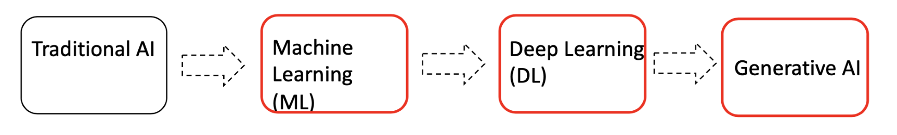

1956 - Dartmouth workshop 

1995 – Support Vector Machines 

2012 – AlexNet, ImageNet, backpropagation 

2023 – ChatGPT 

Ešte raz AI-ML-DL (a aj GenAI) 

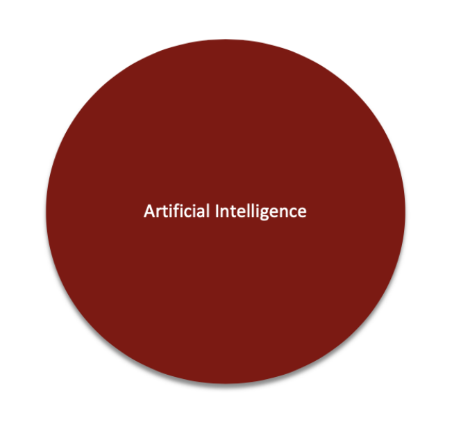

If-then algoritmy 

Ešte raz AI-ML-DL (a aj GenAI) 

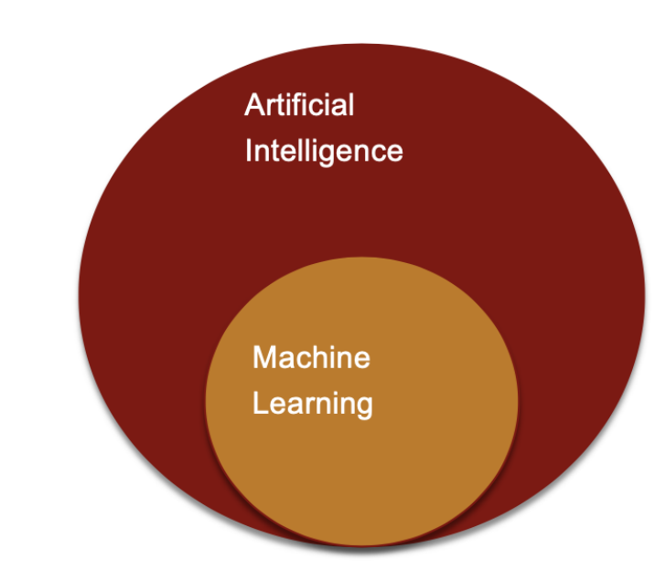

Dáta Vstupy x – výstupy y Definujme príznaky Model sa naučí vzťahy medzi príznakmi a výstupmi Výborné na štruktúrované dáta 

## Ešte raz AI-ML-DL (a aj GenAI) 

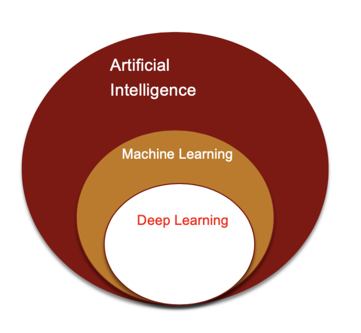

Vstupy môžu byť neštruktúrované Obraz, zvuk, video, text Model si vytvorí reprezentáciu, vlastné príznaky A dá výstupy – regresia, klasifikácia Výstupy sú **štruktúrované** DL umožní každému senzoru rozoznať a klasifikovať, čo senzor detekuje. 

Ďalekohľad + DL 

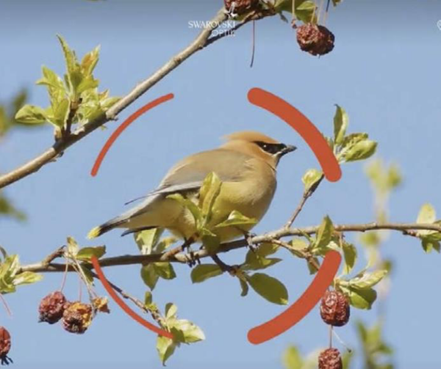

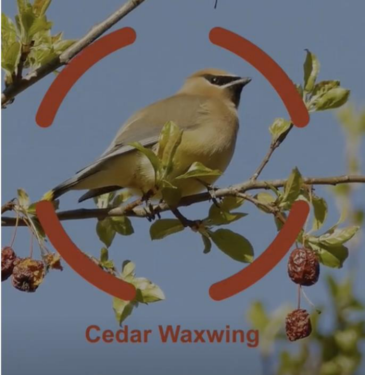

+ DL = 

Ešte raz AI-ML-DL (a aj GenAI) 

Vstupy môžu byť neštruktúrované Výstupy **neštruktúrované** Výstupy: Obraz, zvuk, video, text **Vstupy môžu byť hocičo, výstupy môžu byť hocičo** 

## Čo je to tá neurónová sieť? 

• Ako by som popísal vzťah medzi oblačnosťou a tým, ako veľmi sa mi chce ísť na prechádzku? 

## Čo je to tá neurónová sieť? 

- Ako by som popísal vzťah medzi oblačnosťou a tým, ako veľmi sa mi chce ísť na prechádzku? 

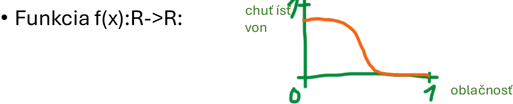

<!-- Start of picture text -->
chuť ísť •  Funkcia f(x):R->R: von oblačnosť <!-- End of picture text -->

- Oblačnosť, únava -> chuť ísť von f(x,y): R2 ->R 

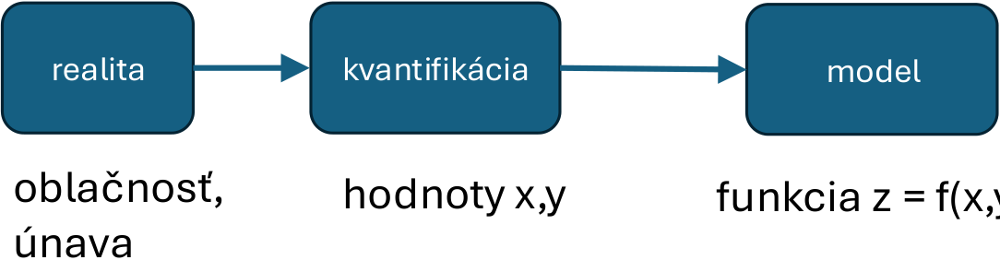

<!-- Start of picture text -->
realita kvantifikácia model oblačnosť, hodnoty x,y funkcia z = f(x,y) únava <!-- End of picture text -->

funkcia z = f(x,y) 

## Čo je to tá neurónová sieť? 

Klasifikačný model ML alebo DL Na danom obrázku z MNIST datasetu mám cifru Úloha: Klasifikácia či je na obrázku cifra 5 

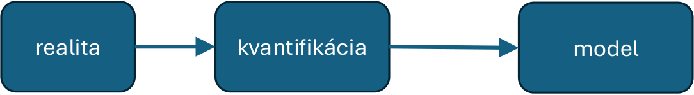

<!-- Start of picture text -->
realita kvantifikácia model <!-- End of picture text -->

## Čo je to tá neurónová sieť? 

Klasifikačný model ML alebo DL Na danom obrázku z MNIST datasetu mám cifru Úloha: Klasifikácia či je na obrázku cifra 5 

realita kvantifikácia obrázok 28x28 Vektor s 784 pixelov komponentami 

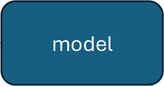

<!-- Start of picture text -->
model <!-- End of picture text -->

funkcia z = f( **x** ) **x** je vektor vracia medzi 0 a 1 

## Čo je to tá neurónová sieť? 

Klasifikačný model ML alebo DL Na danom obrázku z MNIST datasetu mám cifru Úloha: Klasifikácia či je na obrázku cifra 5 

realita kvantifikácia obrázok 28x28 Vektor s 784 pixelov komponentami Neurónová sieť je funkcia 

<!-- Start of picture text -->
model <!-- End of picture text -->

funkcia z = f( **x** ) **x** je vektor vracia medzi 0 a 1 

## Mechanizmus rozhodovania sa 

- Príklad s festivalom: Chce ísť moja dcéra na festival? 

- Bude počasie dobré - x1? Pôjde s ňou jej partner - x2? Je festival blízko MHD - x3? 

<!-- Start of picture text -->
realita kvantifikácia model <!-- End of picture text -->

**x** = (x1,x2,x3), x1,x2,x3 ,y sú buď 0 alebo 1 f( **x** ) = f(x1,x2,x3) : R3 ->R 

## Mechanizmus rozhodovania sa 

- Príklad s festivalom: Chce ísť moja dcéra na festival? 

- Bude počasie dobré - x1? Pôjde s ňou jej partner - x2? Je festival blízko MHD - x3? 

1. Dcéra chce ísť, ak sú aspoň dve podmienky splnené 

2. Ak viac zaváži to, že jej partner ide s ňou 

## Mechanizmus rozhodovania sa 

- Príklad s festivalom: Chce ísť moja dcéra na festival? 

- • Bude počasie dobré - x1? Pôjde s ňou jej partner - x2? Je festival blízko MHD - x3? 

- 1. Dcéra chce ísť, ak sú aspoň dve podmienky splnené: x1 + x2 + x3 ≥ 2 

- • 2. Ak viac zaváži to, že jej partner ide s ňou: 0.2x1 + 2.1x2 + 1.8x3 ≥ 2 

## Mechanizmus rozhodovania sa 

- Príklad s festivalom: Chce ísť moja dcéra na festival? 

- Bude počasie dobré - x1? Pôjde s ňou jej partner - x2? Je festival blízko MHD - x3? 

- 1. Dcéra chce ísť, ak sú aspoň dve podmienky splnené: x1 + x2 + x3 ≥ 2 

- • 2. Ak viac zaváži to, že jej partner ide s ňou: 0.2x1 + 2.1x2 + 1.8x3 ≥ 2 

- Všeobecne: w1x1 + w2x2 + w3x3 > T, pričom **w** = (w1,w2,w3) • 𝑤1 = 0.2, 𝑤2 = 2.1, 𝑤3 = 1.8, 𝑏= −1 

- σ𝑛𝑖=1 𝑤𝑖𝑥𝑖 + 𝑏≥0      alebo 𝒘∙𝒙+ 𝑏≥0 

- Ak σ𝑛𝑖=1 𝑤𝑖𝑥𝑖 + 𝑏≥0 tak rozhodnutie je 1, inak je 0 

## Mechanizmus rozhodovania sa 

• Ak σ𝑛𝑖=1 𝑤𝑖𝑥𝑖 + 𝑏≥0 tak rozhodnutie je 1, inak je 0 3 𝑤𝑖𝑥𝑖 + 𝑏= 𝒘∙𝒙+ 𝑏 𝑧= ෍ 𝑖=1 • Ako to zapíšem ako funkciu? 

## Mechanizmus rozhodovania sa 

• Ak σ𝑛𝑖=1 𝑤𝑖𝑥𝑖 + 𝑏≥0 tak rozhodnutie je 1, inak je 0 3 𝑤𝑖𝑥𝑖 + 𝑏= 𝒘∙𝒙+ 𝑏 𝑧= ෍ 𝑖=1 

- Ako to zapíšem ako funkciu? 

- Signum: sgn(z) 

## Mechanizmus rozhodovania sa 

• Ak σ𝑛𝑖=1 𝑤𝑖𝑥𝑖 + 𝑏≥0 tak rozhodnutie je 1, inak je 0 3 𝑤𝑖𝑥𝑖 + 𝑏= 𝒘∙𝒙+ 𝑏 𝑧= ෍ 𝑖=1 

- Ako to zapíšem ako funkciu? 

- Signum: sgn(z) 

#### Heaviside-ova funkcia 

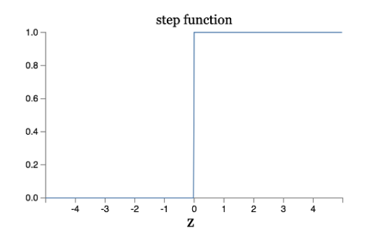

z z z 

## Mechanizmus rozhodovania sa 

- Ak σ𝑛𝑖=1 𝑤𝑖𝑥𝑖 + 𝑏≥0 tak rozhodnutie je 1, inak je 0 

- Matematický zápis 𝑦= 𝐹 𝒙 = 𝐻 𝒘∙𝒙+ 𝑏 

Funkcia H(z) sa nazýva aktivačná funkcia 

## Mechanizmus rozhodovania sa 

- Ak σ𝑛𝑖=1 𝑤𝑖𝑥𝑖 + 𝑏≥0 tak rozhodnutie je 1, inak je 0 

- Matematický zápis 

   - 𝑦= 𝐹 𝒙 = 𝐻 𝒘∙𝒙+ 𝑏 

- **x** sú dáta (počasie, mhd, kamarát) 

- Premenné **w** a b sú parametre modelu 

- **Proces učenia modelu - hľadanie parametrov modelu tak, aby model sedel na dáta** 

## Vizualizácia 

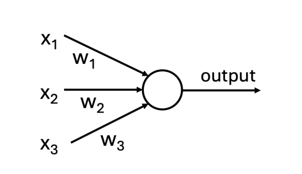

symbolický zápis rozhodovania - PERCEPTRON (typ neurónu) 

## Vizualizácia 

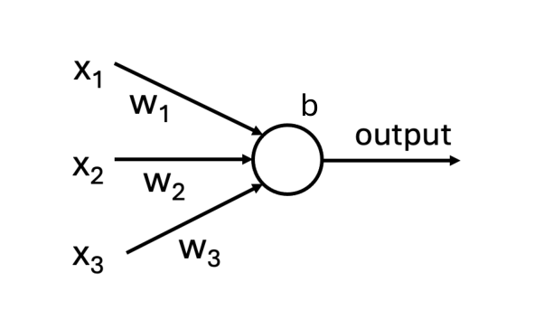

<!-- Start of picture text -->
b <!-- End of picture text -->

symbolický zápis rozhodovania - PERCEPTRON (typ neurónu) 

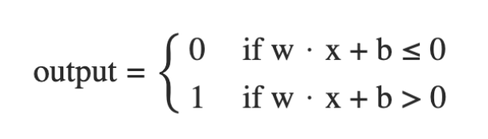

### **Rigorózny zápis** 

Vstup: 𝒙= (𝑥1, 𝑥2, 𝑥3) Parametre: 𝒘= 𝑤1, 𝑤2, 𝑤3 , 𝑏 3 𝑤𝑖𝑥𝑖 + 𝑏= 𝒘∙𝒙+ 𝑏 𝑧= ෍ 𝑖=1 

Výstup z perceptronu - rozhodnutie 

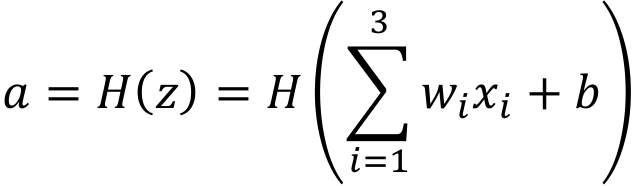

<!-- Start of picture text -->
3 𝑎= 𝐻 𝑧= 𝐻 𝑤𝑖𝑥𝑖 + 𝑏 ෍ 𝑖=1 <!-- End of picture text -->

## Viac perceptronov 

- Dcéra, syn A, syn B 

- Dcéra: priateľ, počasie, MHD 

• Syn A: kamaráti, MHD, počasie a Bad Bunny 

• Syn B: kamaráti 

## Viac perceptronov 

- Dcéra, syn A, syn B 

- Dcéra: priateľ, počasie, MHD 

- Syn A: kamaráti, MHD, počasie a Bad Bunny 

• Syn B: kamaráti 

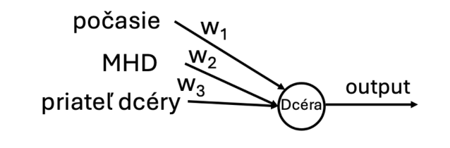

## Viac perceptronov 

- Dcéra, syn A, syn B 

- Dcéra: priateľ, počasie, MHD 

- Syn A: kamaráti, MHD, počasie a Bad Bunny 

- Syn B: kamaráti 

## Viac perceptronov 

- Dcéra, syn A, syn B 

- Dcéra: priateľ, počasie, MHD 

- Syn A: kamaráti, MHD, počasie a Bad Bunny 

- Syn B: kamaráti 

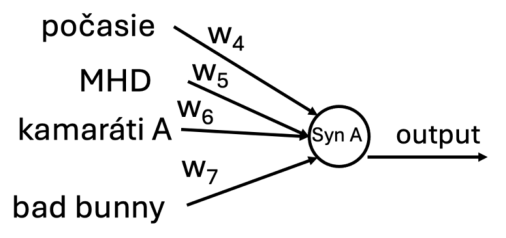

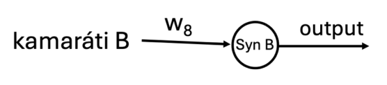

## Viac perceptronov 

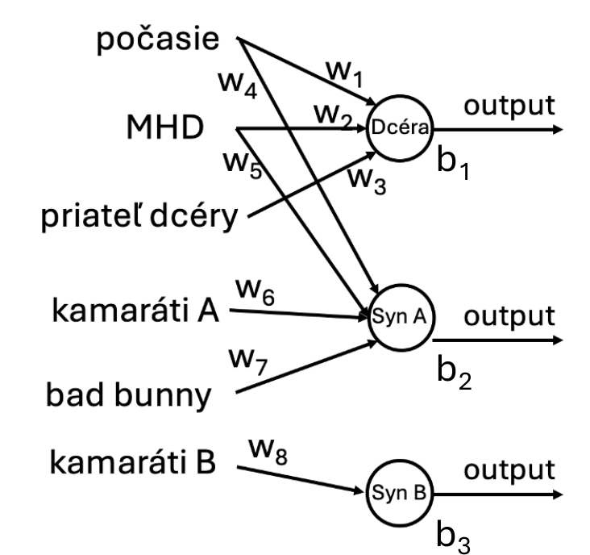

<!-- Start of picture text -->
b1 b2 b3 <!-- End of picture text -->

- Dcéra: priateľ, počasie, MHD 

- Syn A: kamaráti, MHD, počasie a Bad Bunny 

- Syn B: kamaráti 

## Viac perceptronov 

<!-- Start of picture text -->
b1 b2 b3 <!-- End of picture text -->

- Dcéra: priateľ, počasie, MHD 

- Syn A: kamaráti, MHD, počasie a Bad Bunny 

- Syn B: kamaráti 

### Neprehľadná štruktúra 

## Viac perceptronov 

- Dcéra: priateľ, počasie, MHD 

- Syn A: kamaráti, MHD, počasie a Bad Bunny 

- Syn B: kamaráti 

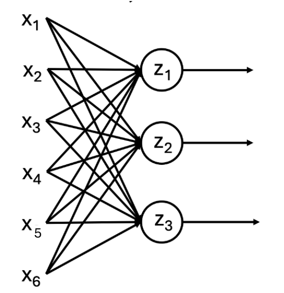

<!-- Start of picture text -->
5 <!-- End of picture text -->

wij – kde i = 1,..,6 a j = 1,2,3 bj 

## Viac perceptronov 

- Dcéra: priateľ, počasie, MHD 

- Syn A: kamaráti, MHD, počasie a Bad Bunny 

- Syn B: kamaráti 

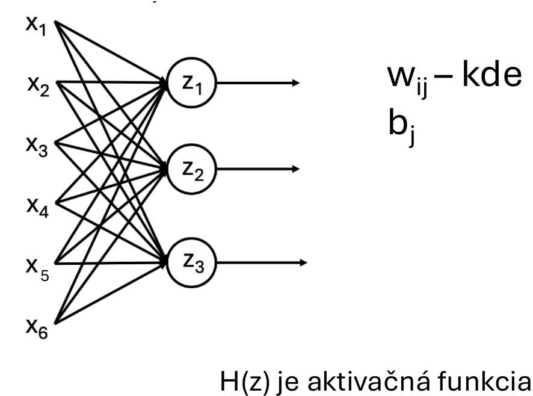

<!-- Start of picture text -->
wij ij – kde i = 1,..,6 a j = 1,2,3 bjj 5 H(z) je aktivačná funkcia <!-- End of picture text -->

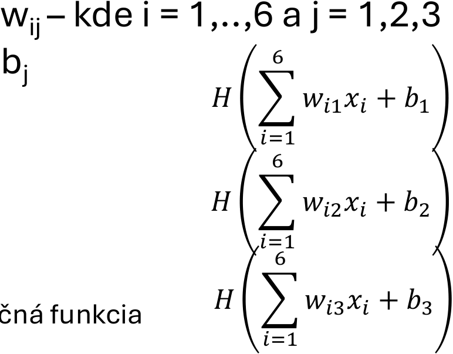

<!-- Start of picture text -->
wij ij – kde i = 1,..,6 a j = 1,2,3 bjj 6 𝐻 𝑤𝑖1𝑥𝑖 + 𝑏1 ෍ 𝑖=1 6 𝐻 𝑤𝑖2𝑥𝑖 + 𝑏2 ෍ 𝑖=1 6 𝐻 𝑤𝑖3𝑥𝑖 + 𝑏3 ෍ 𝑖=1 <!-- End of picture text -->

## Viac perceptronov 

- Dcéra: priateľ, počasie, MHD 

- Syn A: kamaráti, MHD, počasie a Bad Bunny 

- Syn B: kamaráti 

- **Na festival sa pôjde, ak chcú ísť aspoň dvaja** 

## Viac perceptronov 

- Dcéra: priateľ, počasie, MHD 

- Syn A: kamaráti, MHD, počasie a Bad Bunny 

- Syn B: kamaráti 

- Na festival sa pôjde, ak chcú ísť aspoň dvaja 

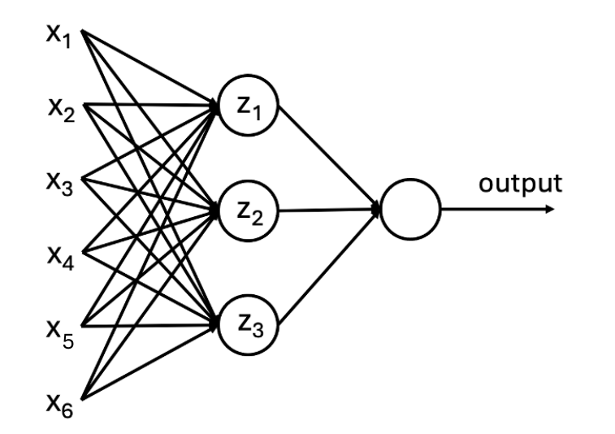

<!-- Start of picture text -->
5 <!-- End of picture text -->

## Viac perceptronov 

- Dcéra: priateľ, počasie, MHD 

- Syn A: kamaráti, MHD, počasie a Bad Bunny 

- Syn B: kamaráti 

- Na festival sa pôjde, ak chcú ísť aspoň dvaja 

<!-- Start of picture text -->
5 <!-- End of picture text -->

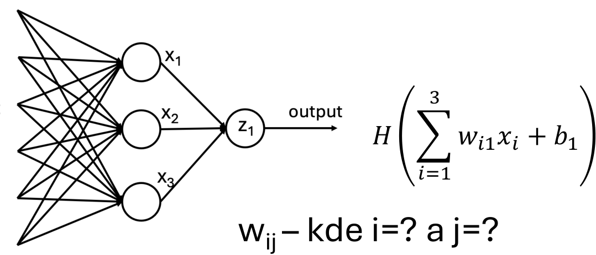

<!-- Start of picture text -->
3 𝐻 𝑤𝑖1𝑥𝑖 + 𝑏1 ෍ 𝑖=1 wij – kde i=? a j=? <!-- End of picture text -->

## Viac perceptronov 

- Dcéra: priateľ, počasie, MHD 

- Syn A: kamaráti, MHD, počasie a Bad Bunny 

- Syn B: kamaráti 

- Na festival sa pôjde, ak chcú ísť aspoň dvaja 

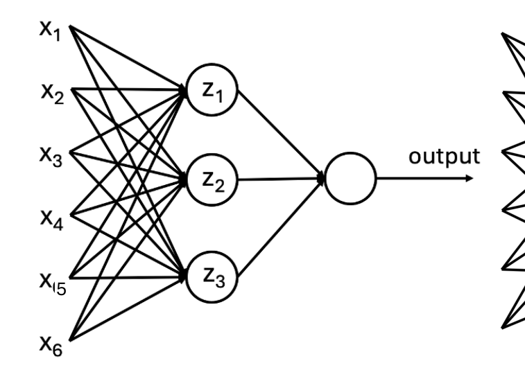

<!-- Start of picture text -->
5 <!-- End of picture text -->

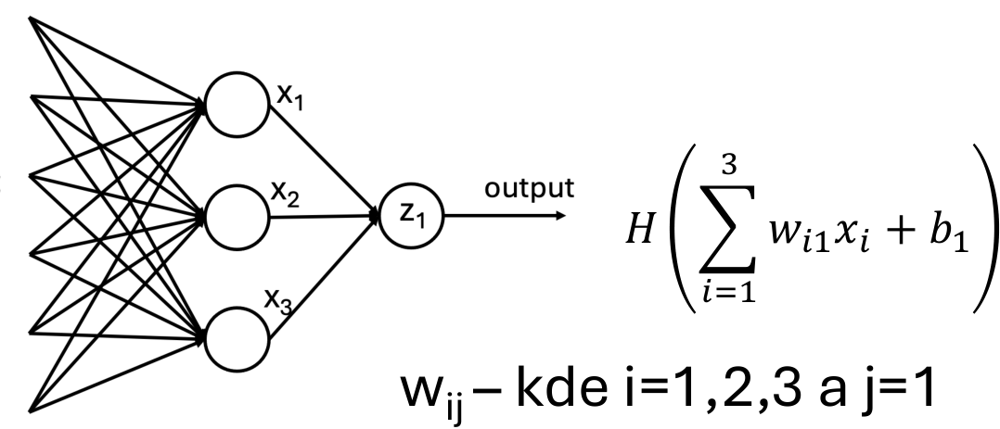

<!-- Start of picture text -->
3 𝐻 𝑤𝑖1𝑥𝑖 + 𝑏1 ෍ 𝑖=1 wij – kde i=1,2,3 a j=1 <!-- End of picture text -->

## Terminológia 

Vstupná vrstva Skryté vrstvy Výstupná vrstva Aktivačná funkcia Neurón Váhy Biasy Vrstva Šírka 3 Hĺbka 𝐻 𝑤𝑖1𝑥𝑖 + 𝑏1 ෍ Parametre 𝑖=1 

## Terminológia 

Vstupná vrstva Skryté vrstvy Výstupná vrstva Aktivačná funkcia Neurón Váhy Biasy Vrstva Šírka 3 Hĺbka 𝐻 𝑤𝑖1𝑥𝑖 + 𝑏1 ෍ Parametre 𝑖=1 

Koľko parametrov má prvá skrytá vrstva? Koľko parametrov má celá architektúra? 

## Čo je to tá neurónová sieť? 

Jednoduchá odpoveď: 

Funkcia Zložitejšia odpoveď: 

Funkcia, ktorej štruktúra je zobrazená takto, má na každej vrstve váhy a biasy 

a jej aktivačná funkcia je Heaviside-ova funkcia H(z) 

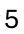

<!-- Start of picture text -->
5 <!-- End of picture text -->

Problém nespojitosti 

## Problém nespojitosti 

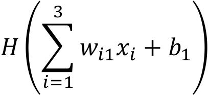

<!-- Start of picture text -->
3 𝐻 𝑤𝑖1𝑥𝑖 + 𝑏1 ෍ 𝑖=1 <!-- End of picture text -->

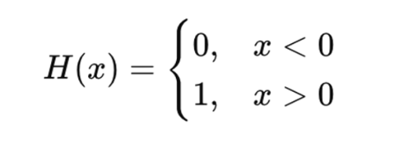

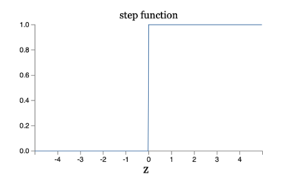

Malá zmena počasia – úplne otočí výsledok 

Nevieme predvídať z aktuálnych hodnôt, čo bude za chvíľu. 

## Sigmoidový neurón 

3 𝑤𝑖𝑥𝑖 + 𝑏= 𝒘∙𝒙+ 𝑏 𝑧= ෍ 𝑖=1 

## Sigmoidový neurón 

3 𝑤𝑖𝑥𝑖 + 𝑏= 𝒘∙𝒙+ 𝑏 𝑧= ෍ 𝑖=1 

Perceptron 

<!-- Start of picture text -->
3 <!-- End of picture text -->

3 𝑎= 𝐻 𝑧= 𝐻 𝑤𝑖𝑥𝑖 + 𝑏 ෍ 𝑖=1 

## Sigmoidový neurón 

3 𝑤𝑖𝑥𝑖 + 𝑏= 𝒘∙𝒙+ 𝑏 𝑧= ෍ 𝑖=1 

Perceptron 

<!-- Start of picture text -->
3 <!-- End of picture text -->

3 𝑎= 𝐻 𝑧= 𝐻 𝑤𝑖𝑥𝑖 + 𝑏 ෍ 𝑖=1 

Kde sa nachádza to krízové miesto? 

## Sigmoidový neurón 

3 𝑤𝑖𝑥𝑖 + 𝑏= 𝒘∙𝒙+ 𝑏 𝑧= ෍ 𝑖=1 

Perceptron 

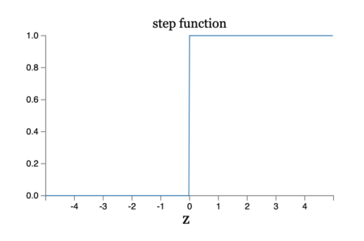

<!-- Start of picture text -->
3 <!-- End of picture text -->

3 𝑎= 𝐻 𝑧= 𝐻 𝑤𝑖𝑥𝑖 + 𝑏 ෍ 𝑖=1 

## Sigmoidový neurón 

3 𝑤𝑖𝑥𝑖 + 𝑏= 𝒘∙𝒙+ 𝑏 𝑧= ෍ 𝑖=1 

Perceptron 

<!-- Start of picture text -->
3 <!-- End of picture text -->

3 𝑎= 𝐻 𝑧= 𝐻 𝑤𝑖𝑥𝑖 + 𝑏 ෍ 𝑖=1 

Sigmoid Ak je z veľmi záporné, tak je output takmer nula Ak je z veľmi kladné, tak je output takmer jedna a medzitým to bude niekde medzi nulou a jednotkou. 

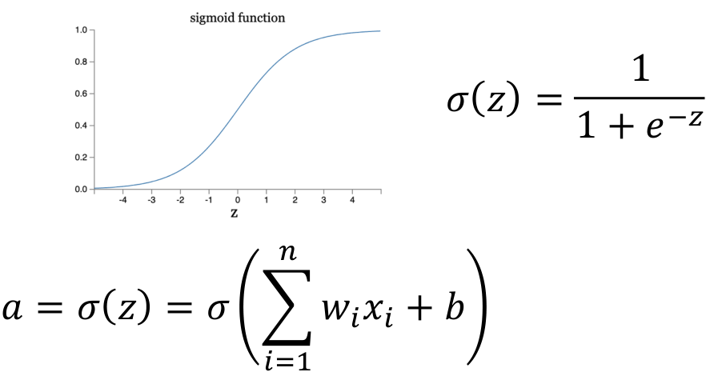

<!-- Start of picture text -->
1 𝜎 𝑧= 1 + 𝑒 −𝑧 𝑛 𝑎= 𝜎 𝑧= 𝜎 𝑤𝑖𝑥𝑖 + 𝑏 ෍ 𝑖=1 <!-- End of picture text -->

## Aktivačné funkcie 

Heaviside-ova (perceptron) 

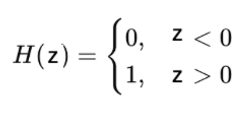

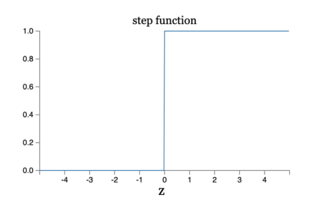

Sigmoidova 

1 𝜎 𝑧= 1 + 𝑒−𝑧 

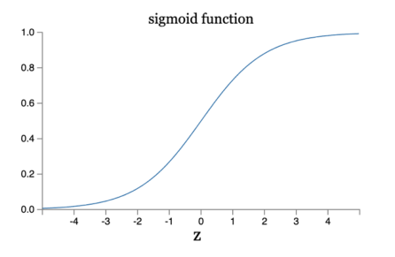

ReLU 

𝑅𝑒𝐿𝑈 𝑧 = max(0, 𝑧) 

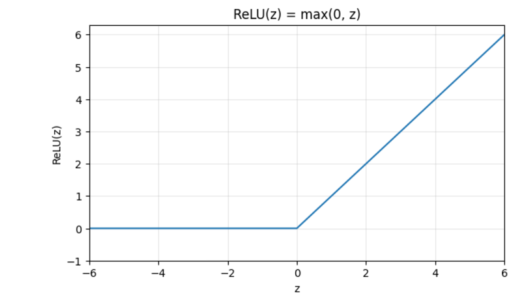

## Formalizácia učenia neurónovej siete 

O festivale rozhodujú dvaja rodičia 6 vstupov - 3 deti - dvaja rodičia - rozhodnutie 

## Formalizácia učenia neurónovej siete 

O festivale rozhodujú dvaja rodičia 6 vstupov - 3 deti - dvaja rodičia - rozhodnutie 

Sieť je funkcia: 

kombinácii x1 až x6 priradíme číslo medzi 0 a 1 Fw,b: x -> Fw,b(x) Parametre **w** a **b** 

Koľko je v tejto sieti parametrov? 

K dispozícii sú dáta: mnoho dvojíc **x** ,y 

## Formalizácia učenia neurónovej siete 

O festivale rozhodujú dvaja rodičia 6 vstupov - 3 deti - dvaja rodičia - rozhodnutie 

Sieť je funkcia: 

kombinácii x1 až x6 priradíme číslo medzi 0 a 1 Fw,b: x -> Fw,b(x) Parametre **w** a **b** 

Koľko je v tejto sieti parametrov? 18+3  +  6+2  +  2+1 

K dispozícii sú dáta: mnoho dvojíc **x** ,y 

## Formalizácia učenia neurónovej siete 

O festivale rozhodujú dvaja rodičia 6 vstupov - 3 deti - dvaja rodičia - rozhodnutie 

Sieť je funkcia: 

kombinácii x1 až x6 priradíme číslo medzi 0 a 1 Fw,b: x -> Fw,b(x) Parametre **w** a **b** 

K dispozícii sú dáta: mnoho dvojíc **x** ,y 

Chceme nájsť model pre našu rodinu 

= nájsť **w** a **b** také, aby predikované hodnoty 𝑥 ො𝑦= 𝐹𝑤,𝑏 

sa čo najviac podobali na y. 

## Formalizácia učenia neurónovej siete 

O festivale rozhodujú dvaja rodičia 6 vstupov - 3 deti - dvaja rodičia - rozhodnutie Sieť je funkcia: 

kombinácii x1 až x6 priradíme číslo medzi 0 a 1 Fw,b: x -> Fw,b(x) Parametre **w** a **b** Učenie siete = hľadanie parametrov w a b K dispozícii sú dáta: mnoho dvojíc **x** ,y 

Chceme nájsť model pre našu rodinu = nájsť **w** a **b** také, aby predikované hodnoty 𝑥 ො𝑦= 𝐹𝑤,𝑏 sa čo najviac podobali na y. 

## Formalizácia učenia neurónovej siete 

vstupy: **x** dáta: y 𝑥 predikcia: ො𝑦= 𝐹𝑤,𝑏 

## Formalizácia učenia neurónovej siete 

vstupy: **x** dáta: y 𝑥 predikcia: ො𝑦= 𝐹𝑤,𝑏 

Hľadáme w a b tak, aby chyba bola čo najmenšia 

= minimalizácia MSE(w,b) ako funkcia premenných w, b 

## Minimalizácia funkcie MSE(w,b) 

Triviálna situácia Jediný neurón Iba jeden vstup (počasie) Pevný threshold 0.5 MSE(w,b) je funkciou jednej premennej w: MSE(w) Minimalizácia je hľadanie minima 

## Minimalizácia funkcie MSE(w,b) 

Triviálna situácia Jediný neurón Iba jeden vstup (počasie) Pevný treshold 0.5 MSE(w,b) je funkciou jednej premennej w: MSE(w) Minimalizácia je hľadanie minima Derivácia = 0, lokálne minimum 

## Minimalizácia funkcie MSE(w,b) 

Menej triviálna situácia Jediný neurón Dva vstupy (počasie a MHD) Pevný treshold 0.5 MSE(w,b) je funkciou dvoch premenných w1 a w2 Minimalizácia je hľadanie minima 

## Minimalizácia funkcie MSE(w,b) 

Menej triviálna situácia Jediný neurón Dva vstupy (počasie a MHD) Pevný treshold 0.5 MSE(w,b) je funkciou dvoch premenných w1 a w2 Minimalizácia je hľadanie minima Parciálne derivácie = 0, lokálne minimum 

## Minimalizácia pomocou iterovania 

• Problém s veľa dimenziami 

- Príklad iteratívneho hľadania minima v 2D – turistika 

##### **Realita** 

Pohybujem sa v horskom prostredí (hmla) Hľadám najnižšie položený bod v údolí Stojím v nejakom bode Poobzerám sa dookola a nájdem smer najväčšieho sklonu V tomto smere sa pohnem o vzdialenosť 𝜂 Zopakujem predchádajúce dva kroky 

**Kvantifikácia a model** z = f(x,y) min( f(x,y) ) 

(xn,yn) 

(Dx,Dy) = (df/dx, df/dy) 

(xn+1,yn+1) = (xn,yn) – 𝜂 . (Dx,Dy) n = n+1 

## Minimalizácia pomocou iterovania 

(xn+1,yn+1) = (xn,yn) – 𝜂 . (Dx,Dy) 

Postupnosť (x0,y0) -> (x1,y1) -> (x2,y2) -> (x3,y3) -> …… -> (xmin,ymin) 

Ilustrácia - vrstevnice 

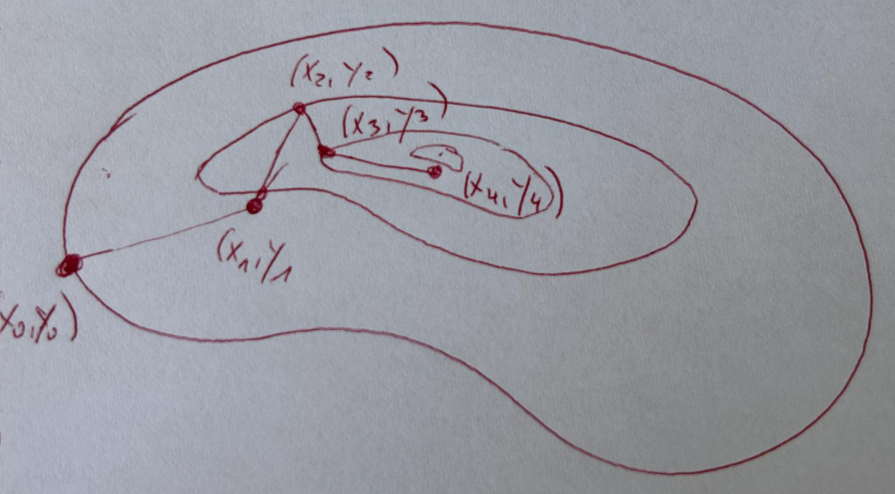

## Minimalizácia (učenie) 

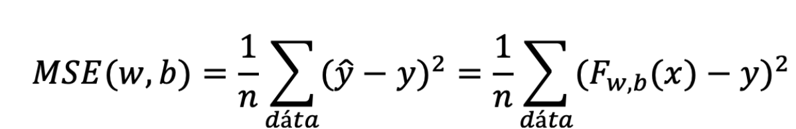

(wn+1,bn+1) = (wn,bn) – 𝜂  . ( **dF/dw , dF/db** ) 

Kľúčový krok sú parciálne derivácie F ! 

## Minimalizácia (učenie) 

(wn+1,bn+1) = (wn,bn) – 𝜂  . ( **dF/dw , dF/db** ) 

Kľúčový krok sú parciálne derivácie F ! 

Aktivačné funkcie 

Perceptron 

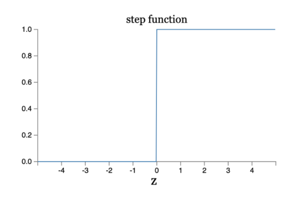

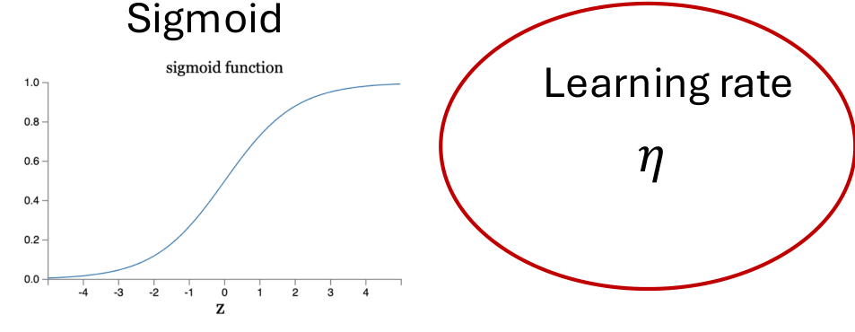

<!-- Start of picture text -->
Sigmoid Learning rate 𝜂 <!-- End of picture text -->

## Minimalizácia (učenie) Iné stratové funkcie 

**MSE (Mean Squared Error)** Regresia: predikcia číselnej hodnoty, napr. ceny bytu. F = (1/n) σᵢ (ŷᵢ − yᵢ)² 

**Binárna krížová entropia (Binary Cross-Entropy)** Klasifikácia do 2 tried: napr. spam / nie spam. Výstup: sigmoid. F = −(1/n) σᵢ [yᵢ ln pᵢ + (1 − yᵢ) ln(1 − pᵢ)] 

**Kategorická krížová entropia (Categorical Cross-Entropy)** Výber 1 z K tried: napr. číslice 0–9. Výstup: softmax. F = −(1/n) σᵢ σₖ yᵢₖ ln pᵢₖ 

n: počet vzoriek, i = 1, …, n.    K: počet tried, k = 1, …, K. 

y: cieľ, ŷ: predikcia, p: pravdepodobnosť.    y ᵢ ₖ = 1 pre správnu triedu, inak 0. 

## Zhrnutie 

- **AI-ML-DL-GenAI** 

- Neurónová sieť ako funkcia f(x) 

- Vizualizácia architektúry siete 

- Nespojitosť a zavedenie sigmoidu 

- Rozhodovanie – aktivačné funkcie 

- Učenie ako minimalizácia 

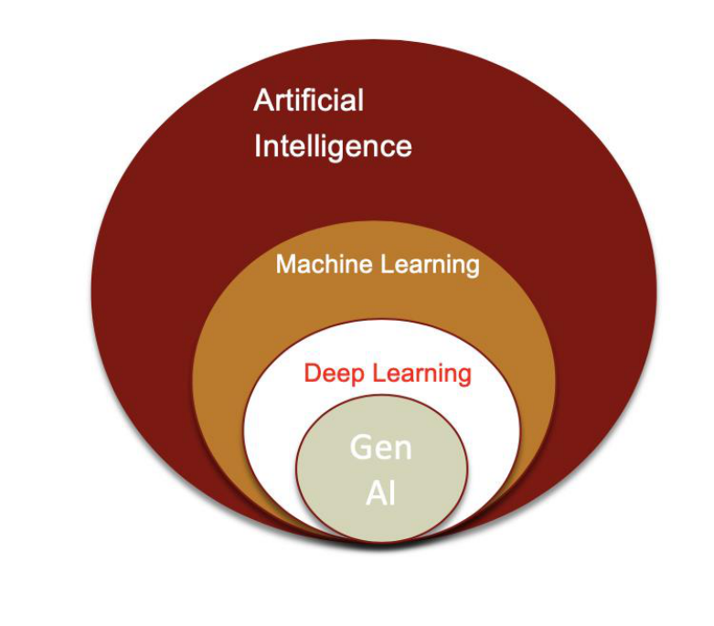

## Zhrnutie 

- AI-ML-DL-GenAI 

- **Neurónová sieť ako funkcia f(x)** 

- Vizualizácia architektúry siete 

- Nespojitosť a zavedenie sigmoidu 

- Rozhodovanie – aktivačné funkcie 

- Učenie ako minimalizácia 

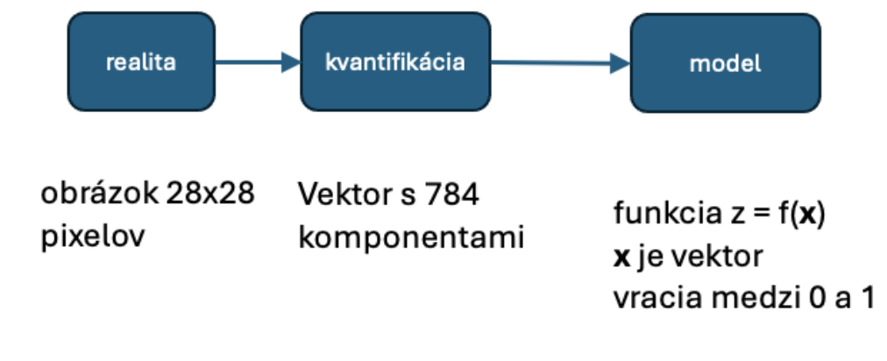

## Zhrnutie 

- AI-ML-DL-GenAI 

- Neurónová sieť ako funkcia f(x) 

- **Vizualizácia architektúry siete** 

- Nespojitosť a zavedenie sigmoidu 

- Rozhodovanie – aktivačné funkcie 

- Učenie ako minimalizácia 

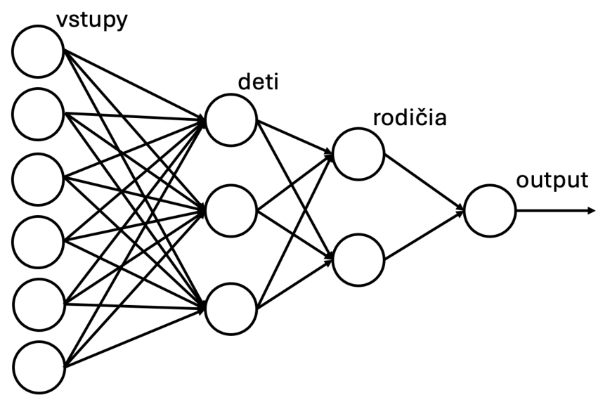

## Zhrnutie 

- AI-ML-DL-GenAI 

- Neurónová sieť ako funkcia f(x) 

- Vizualizácia architektúry siete 

- **Nespojitosť a zavedenie sigmoidu** 

- Rozhodovanie – aktivačné funkcie 

- Učenie ako minimalizácia 

## Zhrnutie 

• AI-ML-DL-GenAI 

- Neurónová sieť ako funkcia f(x) 

- Vizualizácia architektúry siete 

- Nespojitosť a zavedenie sigmoidu 

- **Rozhodovanie – aktivačné funkcie** 

- Učenie ako minimalizácia 

## Zhrnutie 

- AI-ML-DL-GenAI 

- Neurónová sieť ako funkcia f(x) 

- Vizualizácia architektúry siete 

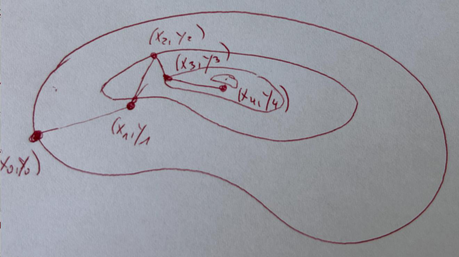

- Rozhodovanie – aktivačné funkcie 

- Nespojitosť a zavedenie sigmoidu 

- Učenie ako minimalizácia 

