# **PANS Prednáška 3** 

Tréning neurónovej siete – od chyby k váhe 

**Dáta, parametre, hyperparametre** 

## **Štruktúra dát pri supervised learning (zopakovanie)** 

###### **Supervised learning pracuje s pármi (X, Y):** 

###### X – príznaky (features) 

- čo vieme zmerať o každom príklade 

###### Y – label (štítok / anotácia) 

- čo chceme predpovedať 

|**Plocha (m²)**|**Izby**|**Lokalita**|**→ Cena (Y)**|
|---|---|---|---|
|62|3|Bratislava|**174 000 €**|
|45|2|Košice|**98 000 €**|
|88|4|Bratislava|**260 000 €**|
|34|1|Trnava|**72 000 €**|
|71|3|Žilina|**145 000 €**|
||**Príznaky X (vstu**|**p do modelu)**|**Label Y**|

PANS – Prednáška 3 

3 

## **Parameter  vs.  Hyperparameter** 

#### **Parametre** 

###### **Čo to je:** 

Hodnoty, ktoré sa sieť naučí sama z dát počas trénovania 

#### **Hyperparametre** 

###### **Čo to je:** 

Nastavenia, ktoré volíme my – pred / mimo tréningu 

###### **Príklady:** 

###### **Príklady:** 

- Váhy  w  (weights) 

- Biasy  b  (biases) 

###### **Kedy sa nastavia:** 

Počas trénovania – optimalizačná metóda (napr. gradient descent) ich aktualizuje automaticky v každom kroku 

- Learning rate  η 

- Počet vrstiev, počet neurónov na vrstvu 

- k  pri k-NN, aktivačná funkcia 

###### **Kedy sa nastavia:** 

Mimo tréningu – optimálne hodnoty hľadáme na validačných dátach 

PANS – Prednáška 3 

4 

## **Príklady hyperparametrov v úlohách** 

**k-NN Lineárna regresia Neurónová sieť Hyperparameter Hyperparameter Hyperparameter** k – počet susedov žiadne pri analytickom riešení learning rate η, počet vrstiev, volili sme ho na validačných dátach (pri tréningu cez GD: η, počet epoch) počet neurónov, aktivačná funkcia, ... **Parameter Parameter Parameter** žiadne koeficienty w₁, w₂, b všetky váhy w (k-NN si nič netrénuje) (analyticky alebo cez GD) všetky biasy b 

PANS – Prednáška 3 

5 

# **Stratová funkcia** 

# **a minimalizácia (optimalizácia)** 

## **Tréningový cyklus – celkový pohľad** 

**Opakovanie (pre každý batch)** 

**Dáta (X, Y)** 

**Forward pass** 

**Loss L(ŷ, y)** 

**Gradient ∂L/∂w** 

**Aktualizácia váh** 

Vstupné dáta Predikcia (príznaky X, siete labely Y) ŷ = f(X, w) 

Strata: L(ŷ, y) napr. MSE 

_backpropagation_ Smer zmeny každej váhy ∂L/∂w 

_optimalizátor_ w ←w − η·∂L/∂w pre každú váhu w 

PANS – Prednáška 3 

7 

## **Lineárna regresia ako prvý príklad** 

###### **Sieť s 1 neurónom, bez aktivácie:** 

### **ŷ  =  w · x  +  b** 

_To je presne lineárna regresia z P1 – len iným jazykom._ 

- Najjednoduchší možný prípad 

- Rovnaký princíp zovšeobecníme na hlboké siete 

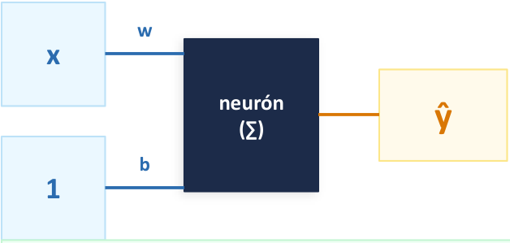

<!-- Start of picture text -->
w x neurón ŷ (∑) b 1 <!-- End of picture text -->

<!-- Start of picture text -->
Tréningový cyklus: <!-- End of picture text -->

1. Forward: ŷ = w·x + b 

2. Loss: L = (y − ŷ)² 

3. Gradient: ∂L/∂w 

4. Update: w ← w − η·∂L/∂w 

PANS – Prednáška 3 

8 

## **Stratová funkcia – čo a prečo** 

**Ako vieme, či sieť predikuje dobre?** Potrebujeme jedno číslo – loss. 

<!-- Start of picture text -->
MSE <!-- End of picture text -->

<!-- Start of picture text -->
1/n · Σ (yᵢ − ŷᵢ)² <!-- End of picture text -->

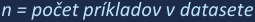

<!-- Start of picture text -->
n = počet príkladov v datasete <!-- End of picture text -->

PANS – Prednáška 3 

9 

## **Stratová funkcia – čo a prečo** 

**Ako vieme, či sieť predikuje dobre?** Potrebujeme jedno číslo – loss. 

###### **Naivný nápad: priemer chýb (y − ŷ)** 

- Problém: kladné a záporné chyby sa rušia 

###### **MSE** 

<!-- Start of picture text -->
1/n · Σ (yᵢ − ŷᵢ)² <!-- End of picture text -->

- _Príklad: +3 a −3 → priemer = 0, aj keď sa sieť mýli_ 

_n = počet príkladov v datasete_ 

###### **Riešenie: štvorec chyby (y − ŷ)²** 

- Záporné aj kladné chyby → vždy kladné 

- Väčšie chyby sú penalizované viac 

###### **MSE = priemer štvorcových chýb** 

- Priemer: nezávisí od veľkosti datasetu 

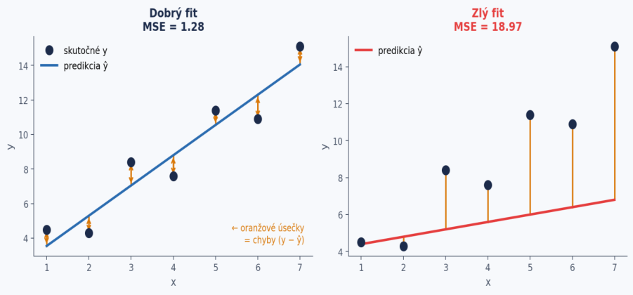

PANS – Prednáška 3 

10 

## **Minimalizácia straty – 1D prípad** 

###### **MSE ako funkcia váhy w:** 

- L(w) – krivka, ktorej minimum hľadáme 

###### **Kde je minimum?** 

- Tam kde derivácia = 0  →  krivka je „plochá“ 

###### **Gradient descent:** 

- Gradient (∂L/∂w) hovorí, o koľko a ktorým smerom strata rastie, keď zvýšime w 

- Ak je gradient **kladný** → strata rastie smerom doprava → my ideme doľava (mínus) 

- Ak je gradient **záporný** → strata rastie smerom doľava → my ideme doprava (mínus záporného = kladné) 

- Vypočítame sklon krivky v aktuálnom bode a ideme opačným smerom 

##### **w ← w − η · ∂L/∂w** 

- _∂L/∂w > 0 → krivka stúpa → w zmenšíme_ 

- _∂L/∂w < 0 → krivka klesá → w zväčšíme_ 

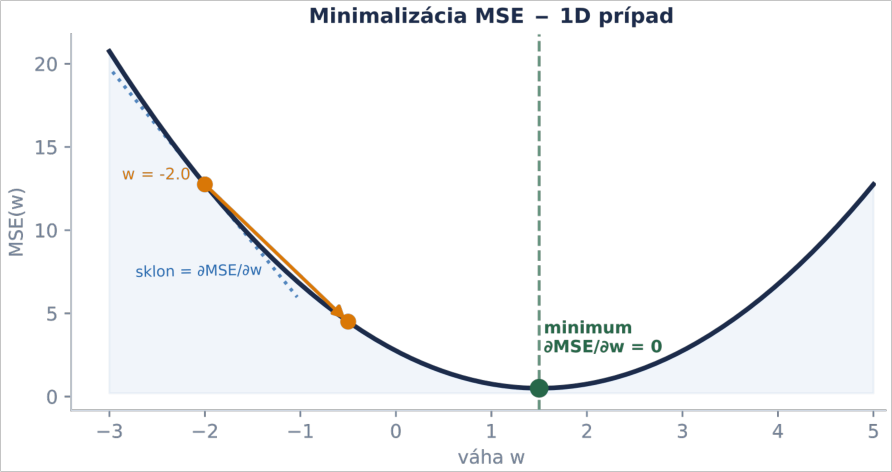

PANS – Prednáška 3 

11 

## **Jeden krok gradientného zostupu – ručne** 

_Jeden príklad, jedna váha a bias. Vypočítajte s nami na kalkulačke._ 

**Zadanie** 

**1 Forward pass** ŷ = 0 · 2 + 0 = 0      L = (4 − 0)² = 16 

**Model:  ŷ = w · x + b Príklad:** x = 2,  y = 4 **Štart:** w = 0,  b = 0 **Learning rate:** η = 0.05 **Strata:  L = (y − ŷ)² Dosadením:  L = (y − w·x − b)² Derivácie:  ∂L/∂w = −2(y − ŷ)·x ∂L/∂b = −2(y − ŷ) Update:  w ← w − η · ∂L/∂w b ← b − η · ∂L/∂b** 

PANS – Prednáška 3 

12 

## **Jeden krok gradientného zostupu – ručne** 

_Jeden príklad, jedna váha a bias. Vypočítajte s nami na kalkulačke._ 

###### **Zadanie** 

**1 Forward pass** ŷ = 0 · 2 + 0 = 0      L = (4 − 0)² = 16 

**Model:  ŷ = w · x + b Príklad:** x = 2,  y = 4 **2 Gradienty Štart:** w = 0,  b = 0 ∂L/∂w = −2(y − ŷ) · x = −16      ∂L/∂b = −2(y − ŷ) = −8 **Learning rate:** η = 0.05 **Strata:  L = (y − ŷ)² Dosadením:  L = (y − w·x − b)² Derivácie:  ∂L/∂w = −2(y − ŷ)·x ∂L/∂b = −2(y − ŷ) Update:  w ← w − η · ∂L/∂w b ← b − η · ∂L/∂b** 

PANS – Prednáška 3 

13 

## **Jeden krok gradientného zostupu – ručne** 

_Jeden príklad, jedna váha a bias. Vypočítajte s nami na kalkulačke._ 

###### **Zadanie** 

**1 Forward pass** ŷ = 0 · 2 + 0 = 0      L = (4 − 0)² = 16 

**Model:  ŷ = w · x + b Príklad:** x = 2,  y = 4 **Štart:** w = 0,  b = 0 **Learning rate:** η = 0.05 **Strata:  L = (y − ŷ)² Dosadením:  L = (y − w·x − b)² Derivácie:  ∂L/∂w = −2(y − ŷ)·x ∂L/∂b = −2(y − ŷ) Update:  w ← w − η · ∂L/∂w b ← b − η · ∂L/∂b** 

**2 Gradienty** ∂L/∂w = −2(y − ŷ) · x = −16      ∂L/∂b = −2(y − ŷ) = −8 

**3 Update** w ← 0 − 0.05 · (−16) = 0.8      b ← 0 − 0.05 · (−8) = 0.4 

PANS – Prednáška 3 

14 

## **Jeden krok gradientného zostupu – ručne** 

_Jeden príklad, jedna váha a bias. Vypočítajte s nami na kalkulačke._ 

###### **Zadanie** 

**1 Forward pass** ŷ = 0 · 2 + 0 = 0      L = (4 − 0)² = 16 

**Model:  ŷ = w · x + b Príklad:** x = 2,  y = 4 **2 Gradienty Štart:** w = 0,  b = 0 ∂L/∂w = −2(y − ŷ) · x = −16      ∂L/∂b = −2(y − ŷ) = −8 **Learning rate:** η = 0.05 **Strata:  L = (y − ŷ)² 3 Update Dosadením:  L = (y − w·x − b)²** w ← 0 − 0.05 · (−16) = 0.8      b ← 0 − 0.05 · (−8) = 0.4 **Derivácie:  ∂L/∂w = −2(y − ŷ)·x ∂L/∂b = −2(y − ŷ) Update:  w ← w − η · ∂L/∂w Kontrola 4 b ← b − η · ∂L/∂b** ŷ = 0.8 · 2 + 0.4 = 2.0      L = (4 − 2)² = 4 

**Strata klesla zo 16 na 4 po jedinom kroku.** Gradient určil smer (záporný → váhy zväčšiť), η určil, ako ďaleko. 

PANS – Prednáška 3 

15 

## **Čo ak zvolíme iné η?** 

_Rovnaký príklad, rovnaký gradient (_ ∂L/∂w = _−16,_ ∂L/∂b = _−8)._ 

**η = 0.05** 

w ← 0 − 0.05·(−16) = 0.8 b ← 0 − 0.05·(−8) = 0.4 ŷ = 0.8·2 + 0.4 = 2 L = (4 − 2)² = **4** Zlepšenie: sme bližšie k cieľu ŷ = 4. 

**Update:  w ← w − η · ∂L/∂w    |    b ← b − η · ∂L/∂b Vzorce:** ∂L/∂w = −2(y − ŷ) · x = −16    |    ∂L/∂b = −2(y − ŷ) = −8 |   ŷ = w · x + b   |   L = (y − ŷ)² 

PANS – Prednáška 3 

16 

## **Čo ak zvolíme iné η?** 

_Rovnaký príklad, rovnaký gradient (_ ∂L/∂w = _−16,_ ∂L/∂b = _−8)._ 

**η = 0.01 η = 0.05 η = 0.2 η = 0.25** Update: w ← 0 − 0.01·(−16) = 0.16 w ← 0 − 0.05·(−16) = 0.8 w ← 0 − 0.2·(−16) = 3.2 w ← 0 − 0.25·(−16) = 4 b ← 0 − 0.01·(−8) = 0.08 b ← 0 − 0.05·(−8) = 0.4 b ← 0 − 0.2·(−8) = 1.6 b ← 0 − 0.25·(−8) = 2 Nová predikcia: ŷ = 0.16·2 + 0.08 = 0.4 ŷ = 0.8·2 + 0.4 = 2 ŷ = 3.2·2 + 1.6 = 8 ŷ = 4·2 + 2 = 10 Nová loss: L = (4 − 2)² = **4** L = (4 − 8)² = **16** L = (4 − 10)² = **36** L = (4 − 0.4)² = **12.96** Malý krok: strata klesla len z 16 na Zlepšenie: sme bližšie k cieľu ŷ = 4. Preskočili sme cieľ na druhú stranu. Divergencia: každý ďalší krok bude 12.96. Strata sa nezmenila. horší. 

**Update:  w ← w − η · ∂L/∂w    |    b ← b − η · ∂L/∂b Vzorce:** ∂L/∂w = −2(y − ŷ) · x = −16    |    ∂L/∂b = −2(y − ŷ) = −8 |   ŷ = w · x + b   |   L = (y − ŷ)² 

PANS – Prednáška 3 

17 

## **Learning rate η – veľkosť kroku** 

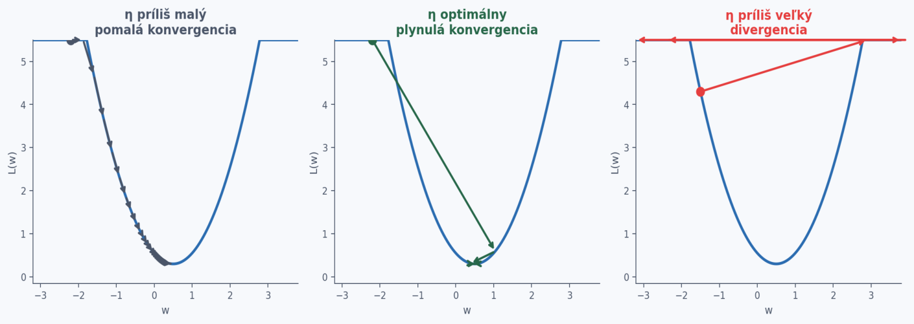

- **η príliš malý η „optimálny“ η príliš veľký** • Pomalá konvergencia • Plynulá konvergencia • Preskakujeme minimum • Malé kroky aj na strmom svahu • Rýchle dosiahnutie minima • Loss môže rásť namiesto klesania • Tréning trvá príliš dlho • Tréning sa rozpadne (NaN) 

_Learning rate η je hyperparameter – volíme ho my. Typicky 0.1 až 0.0001 (pre Adam často 0.001)._ 

PANS – Prednáška 3 

18 

## **Minimalizácia straty – 2D a mnoho D** 

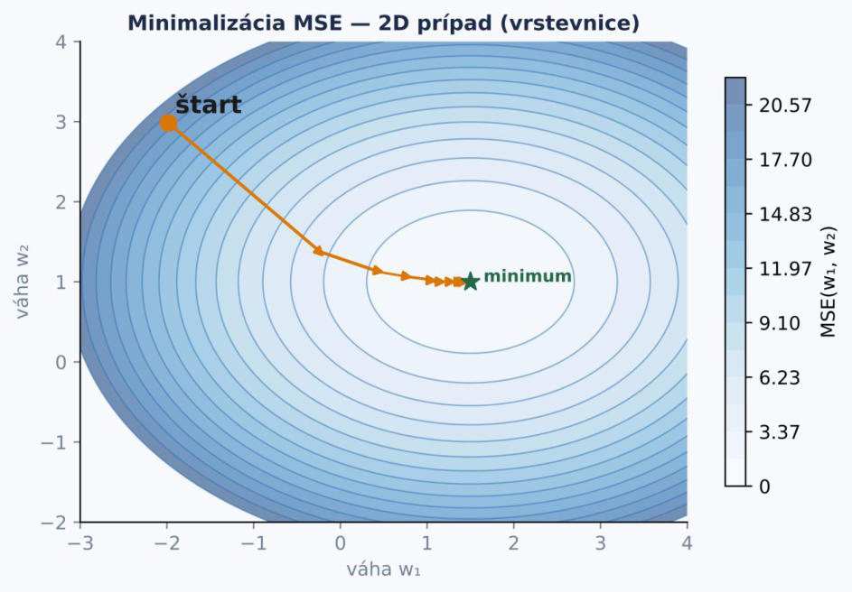

###### **2 váhy w₁, w₂ → MSE je plocha** 

- Vrstevnice = rovnaká hodnota loss 

- Šípka = smer najrýchlejšieho klesania 

###### **Gradient = vektor parciálnych derivácií:** 

∇ **L = [∂L/∂w₁,  ∂L/∂w₂]** 

###### **Aktualizácia pre každú váhu zvlášť:** 

- w₁ ← w₁ − η · ∂L/∂w₁ 

- w₂ ← w₂ − η · ∂L/∂w₂ 

###### **Mnoho D (reálna sieť):** 

- Tisíce váh → nedá sa vizualizovať 

- Matematika je rovnaká – gradient pre každú váhu zvlášť 

PANS – Prednáška 3 

19 

## **Batch, epocha a mini-batch** 

_Doteraz jeden príklad. Pri 700 trénovacích príkladoch gradient priemerujeme, ale nie naraz._ 

**Trénovacia množina: 700 príkladov, batch size 32** 

**Batch 1** 

**Batch 2** 

**Batch 3** 

<!-- Start of picture text -->
… <!-- End of picture text -->

**Batch 22** 

**= 1 epocha** 

###### **Batch (dávka)** 

Skupina príkladov, z ktorých spriemerujeme gradient. **1 batch = 1 krok (update váh).** Typicky 32 – 256 príkladov. 

**Epocha** 

Jeden prechod celou trénovacou množinou. **700 / 32 ≈ 22 krokov na epochu** (posledný batch má len 28 príkladov). Trénujeme desiatky až stovky epoch. 

**Prečo nie celý dataset?** 

**Celý dataset (GD):** presný, ale pomalý. **1 príklad (SGD):** rýchle, ale veľmi zašumené kroky. 

**Mini-batch:** kompromis + paralelizmus na GPU. 

**V praxi:** mini-batch + optimalizátor Adam, ktorý upravuje veľkosť kroku pre každú váhu zvlášť. Ako presne funguje, uvidíme v P8. 

PANS – Prednáška 3 

20 

# **Backpropagation** 

_Ako zistiť, ktorú váhu zmeniť a o koľko_ 

## **Kľúčová otázka** 

**Sieť má milióny až miliardy váh. Po forward passe poznáme stratu L. Ako zistíme, ktorú váhu zmeniť a o koľko?** 

###### **Náhodné zmeny?** 

Skúsime náhodne zmeniť každú váhu a uvidíme či sa L zníži. → Pre 1M váh: prakticky nemožné. 

**Numerický gradient?** 

Pre každú váhu w spočítame (L(w+ε) − L(w)) / ε. → Len približné a 1M dopredných prechodov na každý krok. 

**Backpropagation** ✓ Analytický gradient cez chain rule – 1 spätný prechod. → ∂L/∂w pre každú váhu naraz a presne. 

PANS – Prednáška 3 

22 

## **Chain rule – základ backpropagation** 

###### **Situácia:** 

Strata `L` závisí od aktivácie `a` , aktivácia `a` závisí od `z` , `z` závisí od váhy `w` . 

**Otázka:** 

O koľko zmena `w` ovplyvní `L` ? 

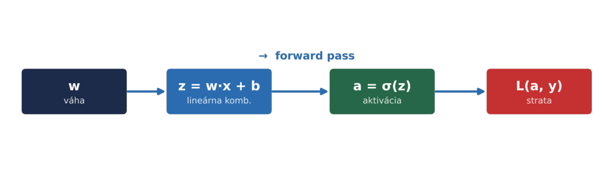

PANS – Prednáška 3 

23 

## **Chain rule – základ backpropagation** 

###### **Situácia:** 

Strata `L` závisí od aktivácie `a` , aktivácia `a` závisí od `z` , `z` závisí od váhy `w` . 

**Otázka:** 

O koľko zmena `w` ovplyvní `L` ? 

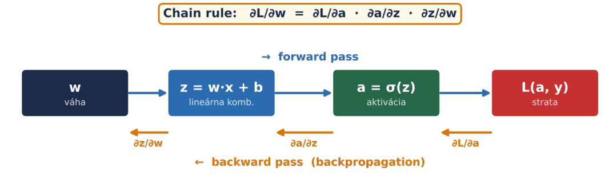

PANS – Prednáška 3 

24 

## **Chain rule – základ backpropagation** 

###### **Situácia:** 

Strata `L` závisí od aktivácie `a` , aktivácia `a` závisí od `z` , `z` závisí od váhy `w` . 

**Otázka:** 

O koľko zmena `w` ovplyvní `L` ? 

###### **Chain rule (pravidlo reťazca):** 

**∂L/∂w  =  ∂L/∂a  ·  ∂a/∂z  ·  ∂z/∂w** 

_Každý člen je jednoduchá derivácia jednej funkcie._ 

PANS – Prednáška 3 

25 

## **Chain rule na číslach** 

_Jeden neurón so sigmoidom:  x = 1,  w = 0.5,  b = 0,  cieľ y = 1,  strata L = (y − a)²_ 

**Forward pass (hodnoty si uložíme)** 

**Backward pass (lokálne derivácie)** 

z = w · x + b = **0.5** a = σ(z) = **0.6225** L = (1 − 0.6225)² = **0.1425 σ = sigmoid:** σ(z) = 1 / (1 + e^(−z)), viac neskôr 

∂L/∂a = −2(y − a) = **−0.755** ∂a/∂z = a(1 − a) = **0.235** ∂z/∂w = x = **1** ∂z/∂b = **1** 

**∂L/∂w = (−0.755) · 0.235 · 1 ≈ −0.177        ∂L/∂b ≈ −0.177** 

**Záporný gradient → w zväčšíme.** 

PANS – Prednáška 3 

26 

## **Krok 1: Forward pass – spočítame predikciu** 

_Každý neurón uloží svoju hodnotu – budeme ju potrebovať pri backpropagation_ 

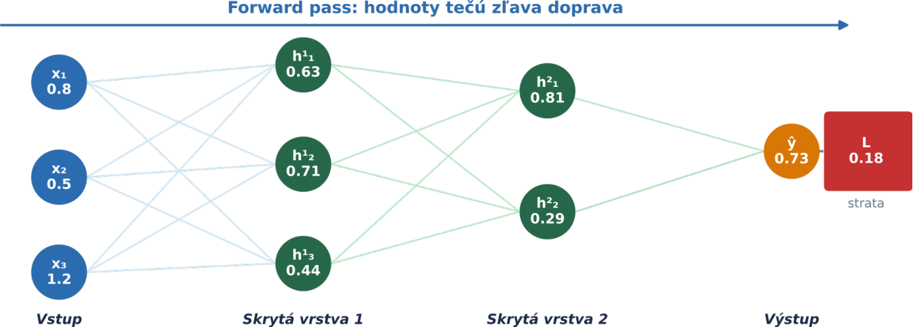

**Prečo ukladáme** **`z` a** **`a` ?** Gradient váhy závisí od aktivácie predchádzajúcej vrstvy: ∂L/∂w = ∂L/∂a · σ′(z) · a_prev.  Bez uložených hodnôt by sme museli forward pass opakovať pre každú váhu zvlášť – to je presne pomalý numerický gradient. 

PANS – Prednáška 3 

29 

## **Krok 2: Backward pass – šírime gradienty** 

_Začneme od straty, chain rule nás dovedie až k ∂L/∂w pre každú váhu_ 

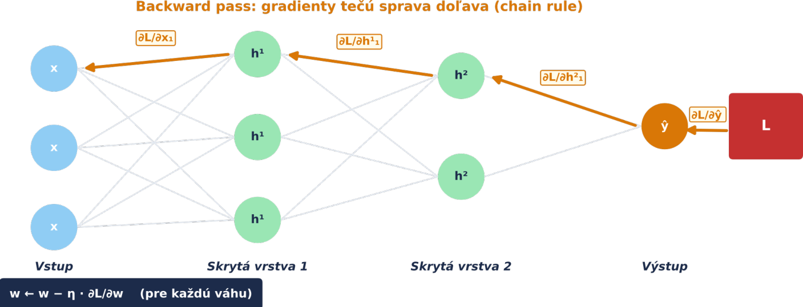

PANS – Prednáška 3 

30 

## **Forward + Backward = jeden tréningový krok** 

**Forward pass** 

###### **Backward pass  (backprop + GD)** 

- **1 Vstup X prechádza sieťou** 

   - **1 Začneme od L: ∂L/∂ŷ** 

- **2 Každý neurón: z = Σ wᵢxᵢ + b** 

   - **2 Cez výstupnú vrstvu: ∂L/∂w_out** 

- **3 Aktivačná funkcia: a = σ(z)** 

**→** 

   - **3 Cez skrytú vrstvu 2: ∂L/∂w_h2** _chain rule_ 

- **4 Výstup ŷ  →  strata L = MSE(ŷ, y)** 

- **4 Cez skrytú vrstvu 1: ∂L/∂w_h1** _chain rule_ 

**5 Uložíme medzivýsledky z a a** _potrebné pre backward_ 

**5 Každá váha: w ← w − η·∂L/∂w** _veľkosť kroku = η·|∂L/∂w|_ 

PANS – Prednáška 3 

31 

## **Dôležité rozlíšenie: Backprop ≠ Gradient Descent** 

_Sú to dve oddelené veci – spolupracujú, ale nie sú totožné_ 

##### **Backpropagation** 

###### **Optimalizátor (napr. Gradient Descent)** 

**Čo robí:** Vypočíta gradienty ∂L/∂w pre každú váhu **Čo NErobí:** Sám o sebe nič nemení – len počíta **Výstup:** Vektor gradientov  [∂L/∂w₁, ∂L/∂w₂, …] 

**→** 

**Čo robí:** Vezme gradienty a aktualizuje váhy **Vzorec (GD): w  ←  w  −  η · ∂L/∂w Iné optimalizátory:** Adam, RMSProp – tiež využívajú gradienty z backpropu, ale aktualizujú inak 

**Backprop vypočíta gradienty. Čo s nimi urobíme, závisí od optimalizátora – tréning = backprop + optimalizátor + dáta.** 

PANS – Prednáška 3 

32 

## **História backpropagation** 

###### **Základy** 

##### **1960** 

Princípy spätného šírenia v teórii riadenia (Kelley 1960, Bryson 1961). Bez spojitosti s neurónovými sieťami. 

###### **Linnainmaa** 

##### **1970** 

Seppo Linnainmaa formalizoval algoritmus spätnej akumulácie gradientov pre kompozitné funkcie. Bez spojitosti s neurónovými sieťami. 

###### **Werbos** 

##### **1974** 

Paul Werbos ako prvý navrhol aplikáciu na trénovanie neurónových sietí (dizertácia na Harvarde). Komunita ho vtedy ignorovala. 

###### **Rumelhart, Hinton, Williams** 

##### **1986** 

Prelomový článok v Nature „Learning representations by back-propagating errors“. Ukázali, že siete sa vedia naučiť reprezentácie. Renesancia neurónových sietí. 

###### **GPU + veľké dáta** 

##### **2010+** 

Backprop existoval desaťročia, ale až hlboké siete + GPU + ImageNet ukázali jeho plný potenciál. Deep learning revolúcia. 

PANS – Prednáška 3 

33 

## **Čo si z backpropagation odniesť** 

Backprop sám o sebe sieť netrénuje – len počíta **1** gradienty. Tréning = backprop + optimalizátor + dáta. 

Gradientný zostup zvyčajne nenájde globálne minimum – skončí v lokálnom minime alebo pri sedlovom bode. V **3** hlbokých sieťach prevládajú sedlové body; v praxi to väčšinou nevadí. 

Backprop nemení architektúru siete – iba hodnoty váh a **5** biasov. Počet vrstiev a neurónov je fixný počas celého tréningu. 

Backprop ≠ gradient descent. Backprop hovorí „o **2** koľko“, optimalizátor (GD, Adam, …) rozhoduje „čo s tým“. 

Veľkosť kroku závisí od oboch: η (hyperparameter) aj **4** |∂L/∂w| (strmosť povrchu). Blízko minima sú kroky prirodzene menšie. 

Update váh nemusí čakať na celý dataset – stačí minibatch (pozri slajd o batchoch a epochách). 

**6** 

PANS – Prednáška 3 

34 

## **Tréningový cyklus – celkový pohľad** 

**Opakovanie (pre každý batch)** 

**Dáta (X, Y)** 

**Forward pass** 

**Loss L(ŷ, y)** 

**Gradient ∂L/∂w** 

**Aktualizácia váh** 

Vstupné dáta Predikcia (príznaky X, siete labely Y) ŷ = f(X, w) 

Strata: L(ŷ, y) napr. MSE 

_backpropagation_ Smer zmeny každej váhy ∂L/∂w 

_optimalizátor_ w ←w − η·∂L/∂w pre každú váhu w 

PANS – Prednáška 3 

35 

# **Prečo ReLU v skrytých vrstvách** 

_Čo sa deje s gradientom v hlbokej sieti (podrobne v P6)_ 

## **Gradient v hlbokej sieti ako tichá pošta** 

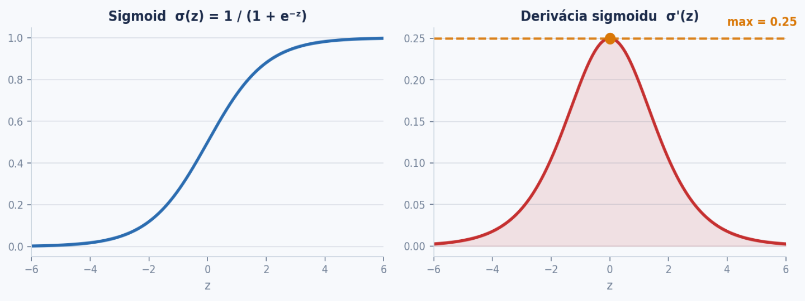

**Derivácia sigmoidu je najviac 0.25. Pri váhach okolo 1 prepustí každá vrstva najviac štvrtinu gradientu: po 5 vrstvách 0.25⁵ ≈ 0.001, po 10 vrstvách 0.25¹⁰ ≈ 0.000001. Prvé vrstvy sa takmer neučia – vanishing gradient.** 

PANS – Prednáška 3 

37 

## **ReLU a problém miznúceho gradientu** 

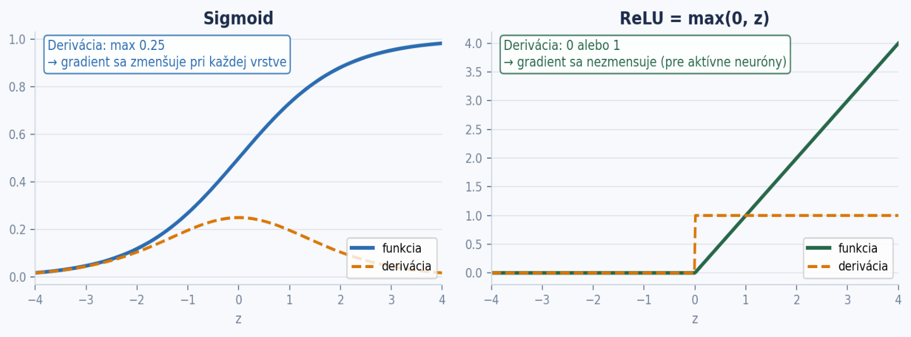

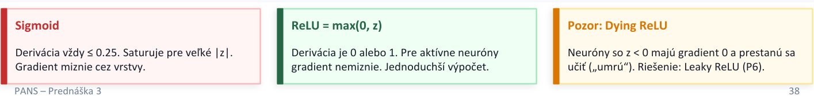

<!-- Start of picture text -->
Sigmoid ReLU = max(0, z) Pozor: Dying ReLU Derivácia vždy ≤ 0.25. Saturuje pre veľké |z|.  Derivácia je 0 alebo 1. Pre aktívne neuróny  Neuróny so z < 0 majú gradient 0 a prestanú sa Gradient miznie cez vrstvy. gradient nemiznie. Jednoduchší výpočet. učiť („umrú“). Riešenie: Leaky ReLU (P6). PANS – Prednáška 3 38 <!-- End of picture text -->

###### **Základné pojmy** 

- Štruktúra dát: X, Y, supervised learning 

- • Parameter (váha, bias) vs. hyperparameter (learning rate, počet vrstiev) 

- Batch, epocha, mini-batch 

###### **Backpropagation** 

- Chain rule 

- Forward pass (hodnoty) + backward pass (gradienty) 

- Backprop ≠ gradient descent 

###### **Stratová funkcia** 

- MSE – prečo štvorec, prečo priemer 

- Gradientný zostup – ručný výpočet, 1D, 2D 

- Learning rate – veľkosť kroku 

###### **Hlboké siete** 

- Vanishing gradient (intuícia) 

- Prečo ReLU v skrytých vrstvách 

- Podrobnosti a riešenia: P6 

