**PANS – Prednáška 4 Klasifikácia a vyhodnotenie: od výstupu siete po metriky** 

_Od čísel na výstupe k rozhodnutiu o triede_ 

**Výstupy siete pri klasifikácii** 

## **Výstupná vrstva závisí od úlohy** 

**Regresia Binárna klasifikácia Multi-class klasifikácia Počet výstupov Počet výstupov Počet výstupov** 1 výstupný 1 výstupný N výstupných neurón neurón neurónov (1 / trieda) **Aktivačná funkcia Aktivačná funkcia Aktivačná funkcia** bez aktivačnej Sigmoid  σ(z) Softmax funkcie **Výstupný rozsah Výstupný rozsah Výstupný rozsah** výstup ∈ℝ vektor „pravdepodobností“ výstup ∈ (0, 1) = „pravdepodobnosť“ (ľubovoľné číslo) súčet = 1 **Príklad Príklad Príklad** Cena bytu Spam / nie spam Pes / mačka / vták Predikcia teploty Chorý / zdravý Cifry 0 – 9 

_Dnes: binárna klasifikácia (sigmoid) a viac tried (softmax) – výstupná vrstva aj stratová funkcia._ PANS – Prednáška 4 

3 

## **Binárna klasifikácia – 1 výstup so sigmoidom** 

_Najjednoduchší prípad: dve triedy (napr. zdravý / chorý, spam / nie spam)_ 

_Vstup Skrytá vrstva Výstup (σ)_ **x1 h p = 0.73 Rozhodnutie: x2 h σ** sigmoid výstup **p ≥ 0.5  →  Trieda 1 p < 0.5  →  Trieda 0 x3 h** 

##### **binárna klasifikácia:** 

- 1 výstupný neurón so sigmoidom 

- Loss: **Binary cross-entropy      −[y·log p + (1−y)·log(1−p)]** 

- Výstup p = P(trieda 1 | x) ∈ (0, 1) – rozhodnutie podľa prahu (threshold, typicky 0.5) 

PANS – Prednáška 4 

4 

## **Viac tried – prečo nestačí jeden výstup?** 

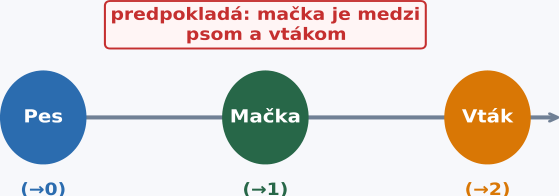

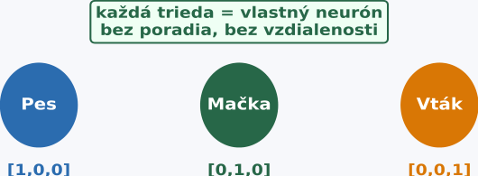

**Kľúčový problém ordinálneho kódovania:** sieť sa naučí, že mačka = priemer psa a vtáka. Triedy sú však kategorické – nemajú prirodzené poradie ani vzdialenosť. One-hot ruší túto implikovanú geometriu. 

PANS – Prednáška 4 

6 

**Geometrické vysvetlenie: problém ordinálneho kódovania** _MSE minimalizuje priemernú štvorcovú chybu – v priestore čísel to má nezamýšľaný dopad_ 

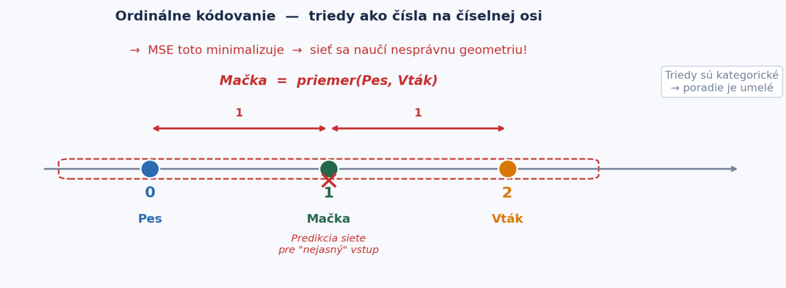

**Problém:** 

Sieť minimalizuje MSE, t. j. hľadá priemer. Ak váha medzi psom (0) a vtákom (2), predikuje 1 = Mačka. Sieť sa naučí, že Mačka je geometricky „uprostred“ Psa a Vtáka. 

PANS – Prednáška 4 

7 

## **Geometrické vysvetlenie: one-hot v 3D priestore** 

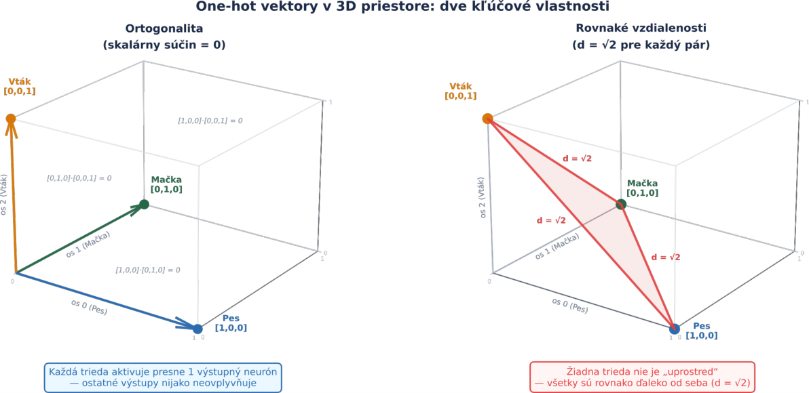

**Ortogonalita zaistí, že každá trieda má vlastný nezávislý výstup – gradient jednej triedy neovplyvňuje ostatné. Rovnaké vzdialenosti** zaručujú symetriu: žiadna trieda nie je geometricky privilegovaná. 

PANS – Prednáška 4 

8 

## **One-hot kódovanie – každá trieda dostane vlastný neurón** 

|**Trieda**|**Index**||**One-hot vektor**|**Cieľ siete**|
|---|---|---|---|---|
|**Pes**|0||**[1, 0, 0]**|Nastav výstup 0 → 1 ostatné → 0|
|**Mačka**|1||**[0, 1, 0]**|Nastav výstup 1 → 1 ostatné → 0|
|**Vták**|2||**[0, 0, 1]**|Nastav výstup 2 → 1 ostatné → 0|
|**K** K tried  →  K výstupných neur K hodnôt pred softmaxom|ónov  →|**1**|Práve jedna 1 vo vektore – sieť sa učí tlačiť správny výstup k 1, ostatné k 0|**L** Loss sa počíta cez všetky triedy – softmax + cross-entropy|

PANS – Prednáška 4 

9 

## **Softmax – od výstupov siete k pravdepodobnostiam** 

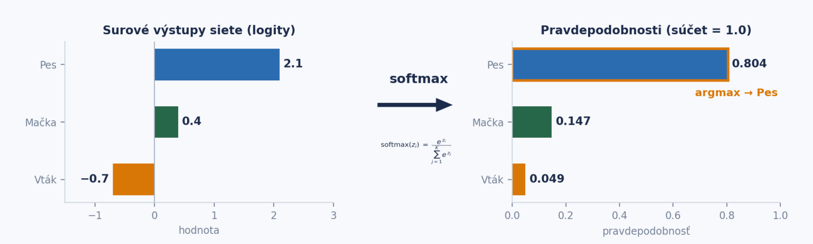

**Vzorec:** 

###### **Vlastnosti:** 

- Súčet všetkých výstupov = 1.0 (pravdepodobnostná distribúcia) 

- • Zachováva poradie: väčší logit → väčšia pravdepodobnosť 

- Argmax (trieda s max p.) = finálna predikcia 

PANS – Prednáška 4 

10 

## **Cross-entropy s one-hot: stačí jedna predikcia** 

**Gra** **~~d~~ ient: ∂L/∂** **~~pc~~ ̂** **~~=~~ −1/p̂** **~~c –~~ tlačí p̂c nahor, ostatné cez softmax nadol.** Pri tréningu sa optimalizujú logity z; pre softmax + cross-entropy platí ∂L/∂z = p̂ − y. 

**Prakt. dôsledok:** GPU počíta len  −log(p̂_c)  pre každý príklad v batchi – nie sumu cez všetky triedy. Softmax však musí prejsť cez všetkých K tried (na výpočet menovateľa). 

PANS – Prednáška 4 

11 

## **Logity v praxi: kde je softmax a sigmoid?** 

_Najčastejšia chyba začiatočníkov v PyTorchi: softmax je v modeli aj v loss funkcii._ 

✗ **Zle: softmax dvakrát** 

✓ **Správne: model vracia logity** 

`model = nn.Sequential( ..., nn.Linear(64, 3),` **`nn.Softmax(dim=1))`** `loss_fn = nn.CrossEntropyLoss()` _Sieť sa učí pomaly a nič nehlási chybu._ 

`model = nn.Sequential( ..., nn.Linear(64, 3))   # logity loss_fn = nn.CrossEntropyLoss() # softmax je vnútri loss probs = torch.softmax(model(x), dim=1)` _len pri predikcii_ 

**Binárna klasifikácia rovnako:** model vracia 1 logit, `nn.BCEWithLogitsLoss` obsahuje sigmoid. 

**Prečo?** Spojený výpočet (sigmoid/softmax + log) je numericky stabilný. Podrobnosti v prílohe. 

PANS – Prednáška 4 

12 

## **Threshold – kedy je 0.5 nesprávny výber?** 

_Sigmoid dá číslo medzi 0 a 1 – ale kde nastaviť hranicu rozhodnutia?_ 

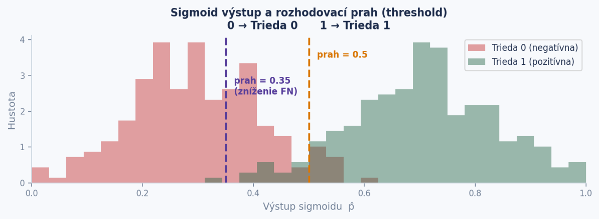

**Threshold = 0.5 (default) Nižší prah (napr. 0.35) Vyšší prah (napr. 0.65)** Rovnako trestá FP a FN. Vhodné pre Viac True Positives, ale aj False Positives. Menej FP, ale viac FN. vyvážený dataset s rovnakou cenou oboch Vhodné keď FN je drahší. Vhodné keď FP je drahší. chýb. 

PANS – Prednáška 4 

13 

## **Zhrnutie – výstupná vrstva závisí od úlohy** 

|**Úloha**|**Výstupy**|**Aktivácia**|**Loss funkcia**|**Výstup**|
|---|---|---|---|---|
|**Regresia**|1|Žiadna|MSE|Reálne číslo|
|**Binárna klasifikácia**|1|Sigmoid|Binary cross-entropy|P(trieda 1 | x)∈(0,1)|
|**Multi-class (K tried)**|K|Softmax|Cross-entropy|[p₁…pₖ], súčet=1|

PANS – Prednáška 4 

14 

# **Metriky vyhodnotenia klasifikátora** 

_Ako merať úspešnosť klasifikátora – a kedy nás accuracy kláme_ 

**„Sieť dosiahla 90 % accuracy.** Je to dobrý výsledok? A je to vôbec 90 %?“ 

## **Confusion matrix – základ všetkých metrík** 

_Základné metriky odvodzujeme z matice chýb / zámien_ 

###### **Predikovaná trieda** 

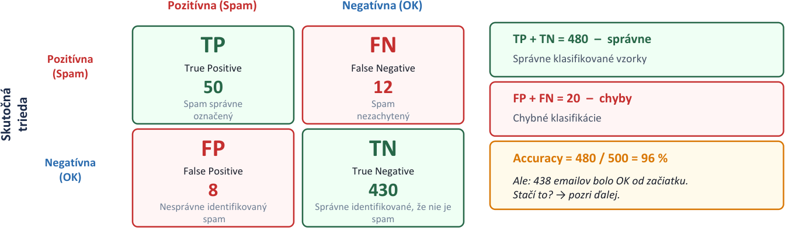

<!-- Start of picture text -->
Pozitívna (Spam) Negatívna (OK) TP FN TP + TN = 480  – správne Pozitívna Správne klasifikované vzorky True Positive False Negative (Spam) 50 12 FP + FN = 20  – chyby Spam správne Spam označený nezachytený Chybné klasifikácie FP TN Negatívna Accuracy = 480 / 500 = 96 % False Positive True Negative (OK) Ale: 438 emailov bolo OK od začiatku. 8 430 Stačí to? → pozri ďalej. Nesprávne identifikovaný Správne identifikované, že nie je spam spam trieda Skutočná <!-- End of picture text -->

**Ako čítať: riadok = skutočnosť  |  stĺpec = predikcia modelu (ako v scikit-learn)  |  diagonála = správne** 

PANS – Prednáška 4 

16 

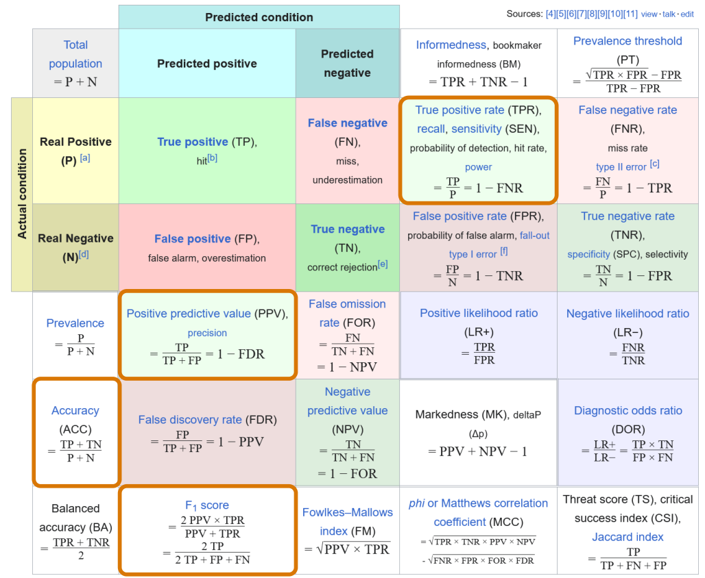

**Metrík je veľmi veľa.** Dnes preberieme štyri vyznačené: **accuracy, precision, recall a F1** , plus confusion matrix a ROC/AUC. _Dôležité je vedieť, ktorú metriku zvoliť, prečo, a ako funguje._ 

Zdroj: Wikipedia, Precision and recall 

## **Accuracy a kedy nás kláme** 

**Accuracy  =  (TP + TN) / celkový počet** _Podiel správne klasifikovaných vzoriek_ 

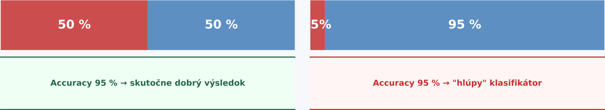

**Zlá správa:** 95 % accuracy môže byť známka modelu bez učenia. Accuracy stačí iba pri vyvážených dátach. 

PANS – Prednáška 4 

18 

## **Baseline náhody – čo dosiahne klasifikátor bez učenia?** 

_Model musí byť lepší ako náhodný klasifikátor – nie len „vysoké“ číslo_ 

PANS – Prednáška 4 

19 

## **Baseline náhody – čo dosiahne klasifikátor bez učenia?** 

_Model musí byť lepší ako náhodný klasifikátor – nie len „vysoké“ číslo_ 

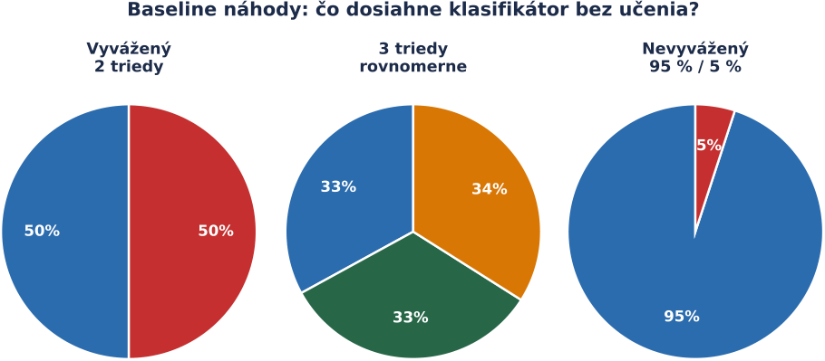

**Aká je úspešnosť náhodného klasifikátora pre 95 % / 5 %? ?** 

PANS – Prednáška 4 

20 

## **Baseline náhody – čo dosiahne klasifikátor bez učenia?** 

_Model musí byť lepší ako náhodný klasifikátor – nie len „vysoké“ číslo_ 

**Aká je úspešnosť náhodného klasifikátora pre 95 % / 5 %? ?** 

**Odpoveď** 

**Klasifikátor vždy predpovedá väčšinovú triedu:** 

**Klasifikátor vyberá triedu rovnomerne 50/50:** 

**Klasifikátor kopíruje rozdelenie tried:** 

PANS – Prednáška 4 

21 

## **Baseline náhody – čo dosiahne klasifikátor bez učenia?** 

_Model musí byť lepší ako náhodný klasifikátor – nie len „vysoké“ číslo_ 

**Aká je úspešnosť náhodného klasifikátora pre 95 % / 5 %? ?** 

**Odpoveď** 

**Klasifikátor vždy predpovedá väčšinovú triedu: 0.95** ⋅ **1 = 95 %** 

**Klasifikátor vyberá triedu rovnomerne 50/50:** 

**Klasifikátor kopíruje rozdelenie tried:** 

PANS – Prednáška 4 

22 

**Baseline náhody – čo dosiahne klasifikátor bez učenia?** _Model musí byť lepší ako náhodný klasifikátor – nie len „vysoké“ číslo_ 

**Aká je úspešnosť náhodného klasifikátora pre 95 % / 5 %? ?** 

**Odpoveď** 

- 𝑷 **_correct_** = 𝑷 𝑨𝑷 ෡𝑨+ 𝑷 𝑩𝑷 ෡𝑩 

**Klasifikátor vždy predpovedá väčšinovú triedu: 0.95** ⋅ **1 = 95 %** 

**Klasifikátor vyberá triedu rovnomerne 50/50:** 

**Klasifikátor kopíruje rozdelenie tried:** 

PANS – Prednáška 4 

23 

## **Baseline náhody – čo dosiahne klasifikátor bez učenia?** 

_Model musí byť lepší ako náhodný klasifikátor – nie len „vysoké“ číslo_ 

**Aká je úspešnosť náhodného klasifikátora pre 95 % / 5 %? ?** 

**Odpoveď** 

𝑷 **_correct_** = 𝑷 𝑨𝑷 ෡𝑨+ 𝑷 𝑩𝑷 ෡𝑩 

**Klasifikátor vždy predpovedá väčšinovú triedu: 0.95** ⋅ **1 = 95 %** 

**Klasifikátor vyberá triedu rovnomerne 50/50: 0.95** ⋅ **0.5 + 0.05** ⋅ **0.5 = 50 %** 

**Klasifikátor kopíruje rozdelenie tried:** 

PANS – Prednáška 4 

24 

## **Baseline náhody – čo dosiahne klasifikátor bez učenia?** 

_Model musí byť lepší ako náhodný klasifikátor – nie len „vysoké“ číslo_ 

**Aká je úspešnosť náhodného klasifikátora pre 95 % / 5 %? ?** 

**Odpoveď** 

𝑷 **_correct_** = 𝑷 𝑨𝑷 ෡𝑨+ 𝑷 𝑩𝑷 ෡𝑩 

**Klasifikátor vždy predpovedá väčšinovú triedu:** 

**0.95** ⋅ **1 = 95 %** 

**Klasifikátor vyberá triedu rovnomerne 50/50: 0.95** ⋅ **0.5 + 0.05** ⋅ **0.5 = 50 %** 

**Klasifikátor kopíruje rozdelenie tried:** 

**0.95** ⋅ **0.95 + 0.05** ⋅ **0.05 = 90.5 %** 

**_Model s 90 % accuracy nemusí byť lepší ako „náhoda“_** 

PANS – Prednáška 4 

25 

## **Precision a Recall – dva pohľady na rovnakú chybu** 

_Ktorá chyba nás viac stojí – FP alebo FN? Odpoveď určí, ktorú metriku sledujeme._ 

### **Precision** 

### **Recall** 

P  = **TP** /  ( **TP** + **FP** ) 

R  = **TP** /  ( **TP** + **FN** ) 

_Z toho, čo model označil ako pozitívne, koľko z toho naozaj pozitívne bolo?_ 

_Z všetkých skutočných pozitívnych, koľko sme ich zachytili?_ 

**Všetko, čo model označil ako spam:** 

**Všetky skutočné spamy v dátach:** 

**10 × TP** 

**3 × FP** 

**10 × TP  (zachytené) 4 × FN  (nezachytené)** 

P = 10 / (10+3) = **0.77** 

R = 10 / (10+4) = **0.71** 

TP 

FP 

FN 

PANS – Prednáška 4 

26 

## **F1-score – prečo harmonický priemer?** 

_Aritmetický priemer ignoruje extrémnu nerovnováhu – harmonický ju odhalí_ 

|**F1  =  2 · P · R / (P + R)** _Harmonický priemer – citlivý na nízke hodnoty_|||rozsah: 0 (najhoršie) – 1 (dokonale)|
|---|---|---|---|
|**Príklad** **Precision**|**Recall**|**Aritm. priemer**|**F1 (harmonický)**|
|**Takmer nič nezachytí** **0.99**|**0.01**|**0.50**|**0.02**|
|**Sklon k Recall** **0.50**|**0.90**|0.70|**0.64**|
|**Vyrovnaný** **0.80**|**0.80**|0.80|**0.80**|
|**Kľúčový príklad:**P=0.99, R=0.01 →  Aritm. priemer = 0.50 (zdanlivo OK) →  F1 = 0.02 (zle – model zachytí len 1 % spamu)||||

PANS – Prednáška 4 

27 

## **Precision-Recall krivka** 

_Zmenou thresholdu sa posúvame po PR krivke F1 iso-krivky ukazujú rovnaké F1 skóre_ 

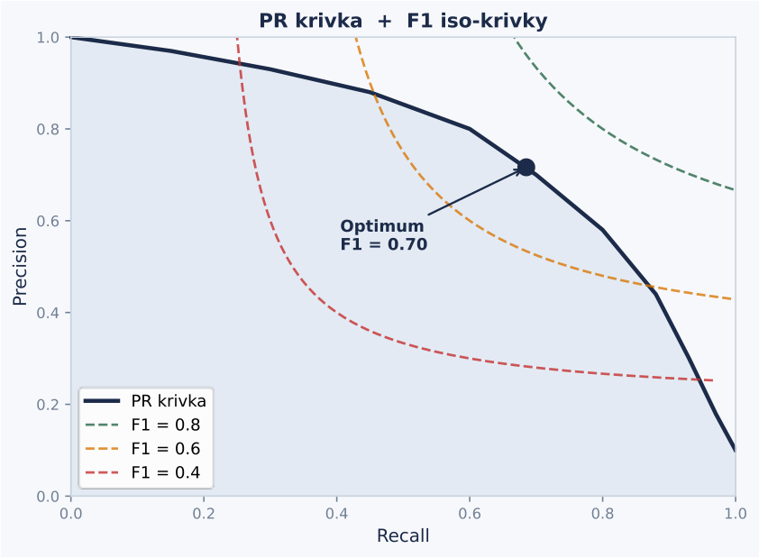

###### **Ako čítať PR krivku** 

Každý bod = iný threshold klasifikátora. Vyšší threshold: vyššia Precision, nižší Recall. Nižší threshold: nižšia Precision, vyšší Recall. 

###### **F1 iso-krivky** 

Body na rovnakej čiarkovanej čare majú rovnaké F1. Optimum = bod kde sa PR krivka dotýka najvyššej iso-krivky. 

###### **Keď je Recall dôležitý viac...** 

Posuň sa vpravo na krivke (nižší threshold). 

PANS – Prednáška 4 

28 

## **Ktorú metriku kedy použiť?** 

|**Metrika**|**Vzorec**|**Kedy použiť**|**Na čo pozor**|
|---|---|---|---|
|**Accuracy**|(TP+TN) / N|Vyvážený dataset|_Pri nevyvážených triedach môže klamať_|
|**Precision**|TP / (TP+FP)|Drahý FP (spam, pôžičky)|_Ignoruje FN_|
|**Recall**|TP / (TP+FN)|Drahý FN (onkológia, podvody)|_Ignoruje FP_|
|**F1-score**|2·P·R / (P+R)|Kompromis medzi P a R, ktorý nám dá jedno číslo|_F1 je harmonický priemer precision a recall_ _Penalizuje, keď je jedna metrika veľmi nízka_|
|**Confusion** **matrix**|–|Vždy ako prvý pohľad|_Nie je to jedno číslo_|
|**Nie je univerzálna najle**|**pšia metrika – výber závis**|**í od domény a od toho, čo nás stojí viac: FP**|**alebo FN.**|

PANS – Prednáška 4 

30 

# **Rozdelenie datasetu** 

_Ako správne oddeliť tréning, validáciu a test – a čo sa stane, keď to pokazíme_ 

**Model dosiahol 99 % presnosť na trénovacích dátach.** Prečo zlyháva v produkcii? 

## **Train / Validation / Test – tri sady s rôznou úlohou** 

_Každá sada slúži na iný účel a nesmú sa navzájom kontaminovať_ 

#### **TRAIN  70 %** 

**VAL  15 % TEST  15 %** 

##### **Train** 

- Sieť sa učí váhy (parametre) 

- Vidí tieto dáta pri každej epoche 

- Čím väčšia, tým lepšie naučený model 

##### **Validation** 

- Ladenie hyperparametrov 

- Sledovanie overfittingu počas tréningu 

- Model ju nevidí priamo, ale ovplyvňuje ho 

**Test** 

- Záverečné vyhodnotenie 

- Používaš ju iba RAZ – na samom konci 

- Simuluje reálne nasadenie modelu 

**Testovacia sada je zapečatená obálka – otváraš ju iba raz, po finálnom výbere modelu.** 

PANS – Prednáška 4 

32 

## **Ako veľký má byť split?** 

_70 / 15 / 15 je bežný štart, nie dogma. Rozhoduje veľkosť datasetu._ 

<!-- Start of picture text -->
Malý dataset (stovky vzoriek) 60 / 20 / 20 <!-- End of picture text -->

Val a test potrebujú dosť príkladov na stabilné metriky. Často lepšie: k-fold. 

<!-- Start of picture text -->
Stredný dataset 80 / 10 / 10 (tisíce vzoriek) <!-- End of picture text -->

Bežný východiskový bod (podobne 70 / 15 / 15). 

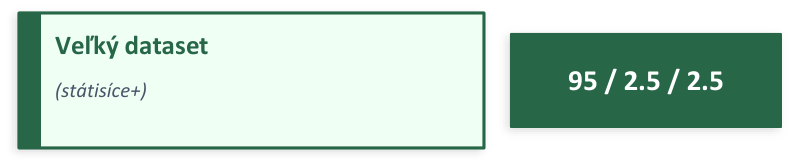

<!-- Start of picture text -->
Veľký dataset (státisíce+) 95 / 2.5 / 2.5 <!-- End of picture text -->

Aj 1 % môže dávať tisíce vzoriek – dostatočné pre stabilné metriky. 

**Kľúčové pravidlo: test musí byť dosť veľký na štatisticky stabilné metriky – rozhoduje absolútny počet príkladov, nie podiel.** 

PANS – Prednáška 4 

33 

## **k-fold Cross-Validation – keď nemáme dosť dát** 

<!-- Start of picture text -->
Čo ak mám veľmi málo dát a nemôžem si dovoliť odložiť 15 % bokom na validáciu? <!-- End of picture text -->

**Odpoveď: k-fold cross-validation** 

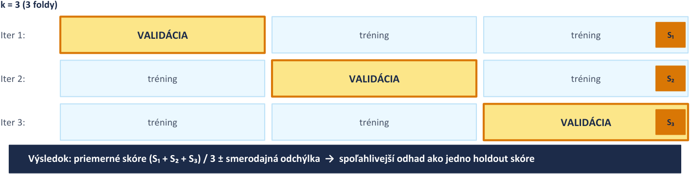

<!-- Start of picture text -->
k = 3 (3 foldy) Iter 1: VALIDÁCIA tréning tréning S₁ Iter 2: tréning VALIDÁCIA tréning S₂ Iter 3: tréning tréning VALIDÁCIA S₃ Výsledok: priemerné skóre (S₁ + S₂ + S₃) / 3 ± smerodajná odchýlka  →  spoľahlivejší odhad ako jedno holdout skóre <!-- End of picture text -->

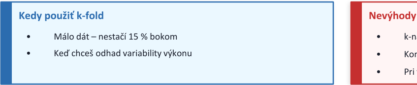

<!-- Start of picture text -->
Kedy použiť k-fold Nevýhody • Málo dát – nestačí 15 % bokom • • Keď chceš odhad variability výkonu • • <!-- End of picture text -->

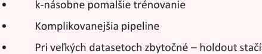

<!-- Start of picture text -->
• k-násobne pomalšie trénovanie • Komplikovanejšia pipeline • Pri veľkých datasetoch zbytočné – holdout stačí <!-- End of picture text -->

PANS – Prednáška 4 

34 

## **Stratified k-fold – zachovaj rozloženie tried** 

_Pri nevyvážených triedach náhodný split môže vytvoriť fold bez jediného pozitívneho príkladu_ 

✗ **Náhodný split – nevyvážený dataset (90 % / 10 %)** 

Fold 1: 

Fold 2: 

Fold 3: 

**0 pozit.** 

**3 pozit.** 

**0 pozit.** 

✓ **Stratified split – zachované rozloženie tried** 

Fold 1: 

Fold 2: 

Fold 3: 

✓ **10 %** 

✓ **10 %** 

✓ **10 %** 

###### **Ako funguje Stratified k-fold** 

- Pred splitom zistíš rozloženie tried v celom datasete (napr. 90 % / 10 %). 

- Každý fold dostane rovnaký pomer tried – menšinová trieda je vždy zastúpená. 

- V scikit-learn: StratifiedKFold namiesto KFold, StratifiedShuffleSplit pre veľké datasety. 

PANS – Prednáška 4 

35 

## **Zhrnutie – pravidlá správneho rozdelenia datasetu** 

_Tieto chyby sa ťažko odhaľujú, ale ľahko sa im vyhnúť_ 

**1 Rozdeľ pred akýmkoľvek predspracovaním** 

**2 Pri nevyvážených triedach stratifikuj** 

Najskôr rozdeľ na train / val / test, potom normalizácia atď. 

Každá sada aj každý fold má mať rovnaký pomer tried ako celý dataset. (Delenie podľa entít a časové rady: P8.) 

**3 Test sadu otvor iba raz** 

**4 Pre malé datasety: k-fold** 

Každý pohľad na test sadu pri ladení hyperparametrov je formou leakage. Jeden model, jeden test. 

Keď nemáš dostatok dát na stabilný holdout, k-fold ti dá spoľahlivejší odhad generalizácie. 

PANS – Prednáška 4 

36 

