# Princípy operačných systémov 

Prednáška 1: Úvod do operačných systémov 

doc. Ing. Miroslav Kvaššay, PhD. 

## Predstavenie 

2 

#### **Vyučujúci** 

- Prednášky: 

   - doc. Ing. Miroslav Kvaššay, PhD. 

- Laboratórne cvičenia: 

   - Ing. Michal Mrena, PhD. 

   - doc. Ing. Patrik Rusnák, PhD. 

   - doc. Ing. Peter Sedláček, PhD. 

   - Ing. Tomáš Sobek 

3 

#### **Literatúra** 

- A. Silberschatz, P. B. Galvin, G. Gagne: Operating System Concepts, 10th ed., Wiley, 2018 

- P. Martincová, K. Grondžák: Operačné systémy, EDIS, 2004 

- P. Martincová, K. Grondžák, M. Zábovský: Programovanie v jadre operačného systému Linux, EDIS, 2008 

- R. H. Arpaci-Dusseau, A. C. Arpaci-Dusseau: Operating Systems: Three Easy Pieces (voľne dostupná): • <u>https://pages.cs.wisc.edu/~remzi/OSTEP/</u> 

- M. Kerrisk: The Linux Programming Interface, No Starch Press, 2010 

- • Manuálové stránky Linuxu: 

   - <u>https://man7.org/linux/man-pages/</u> 

- Materiály k cvičeniam: 

   - <u>https://frios.fri.uniza.sk/</u> 

4 

#### **Hodnotenie** 

- Semester (100 bodov, potrebných **aspoň 61 bodov** ): 

   - aktívna práca na cvičeniach – 10 bodov; 

   - **programátorská písomka zo synchronizácie** – 40 bodov (potrebných **aspoň 24 bodov** ) – 9. týždeň; 

   - **semestrálna práca** – 50 bodov – 13. týždeň; 

   - každé odovzdané riešenie sa kontroluje na originalitu. 

- Skúška (100 bodov, potrebných **aspoň 61 bodov** ): 

   - písomná a ústna časť – princípy operačných systémov. 

- Výsledné hodnotenie: 

   - súčet bodov zo semestra a zo skúšky v pomere 50 : 50; 

   - stupnica je definovaná v informačnom liste predmetu. 

5 

## Trocha histórie 

6 

#### **Počítačový systém** 

Vykonáva programy vytvorené používateľmi, ktoré umožňujú riešiť konkrétne problémy. Prvé počítačové systémy boli jednoúčelové zariadenia, ktoré riešili konkrétny problém: • šifrovanie/dešifrovanie (Enigma); • kryptoanalýza (Colossus); 

- výpočet balistických tabuliek (ENIAC); 

- podporné výpočty pre konštrukciu vodíkovej bomby (MANIAC). 

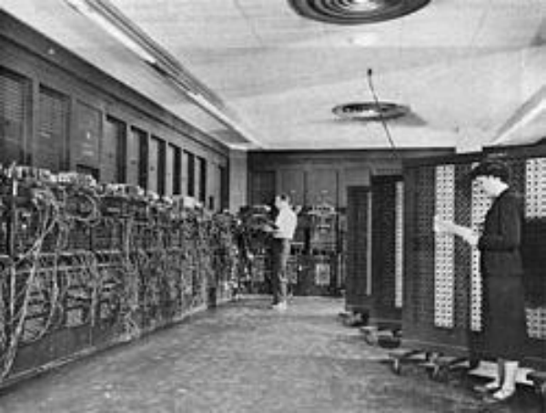

7 

#### **Počítačový systém** 

###### Evolúcia sálových počítačov 

- Z jednoúčelových systémov sa postupne stali viacúčelové zariadenia, akými boli alebo sú: 

   - sálové počítače (angl. „mainframes“), 

   - minipočítače (angl. „minicomputers“), 

   - osobné počítače (angl. „personal computers“), 

   - mobilné telefóny, 

   - ... 

- Väčšina jednoúčelových systémov má dnes charakter vstavaných systémov (angl. „embedded systems“). 

- Sálové počítače nezanikli – IBM z17 (2025) spracúva bankové a platobné transakcie a má integrovaný akcelerátor AI. 

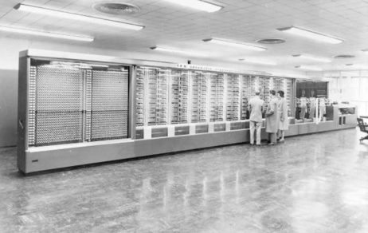

Harvard Mark I (1944) 

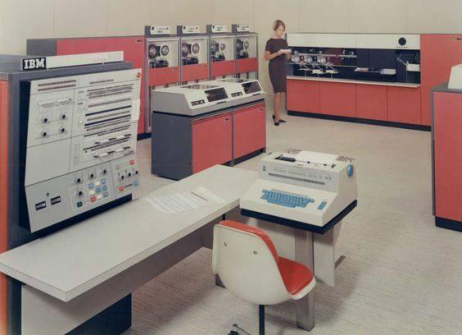

IBM System/360 (1964 – 1978) 

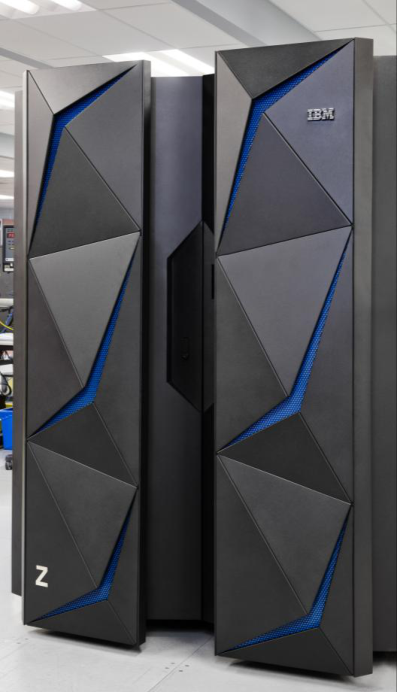

IBM Z14 (2017) 

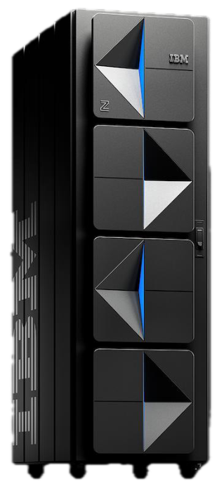

IBM Z17 (2025) 

8 

#### **Významné osobnosti – 18. a 19. storočie** 

- Basile Bouchon 

- Joseph Marie Jacquard 

- • Charles Babbage 

- Ada Lovelace 

- George Boole 

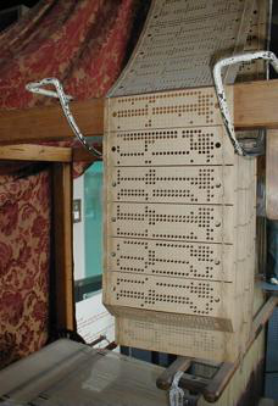

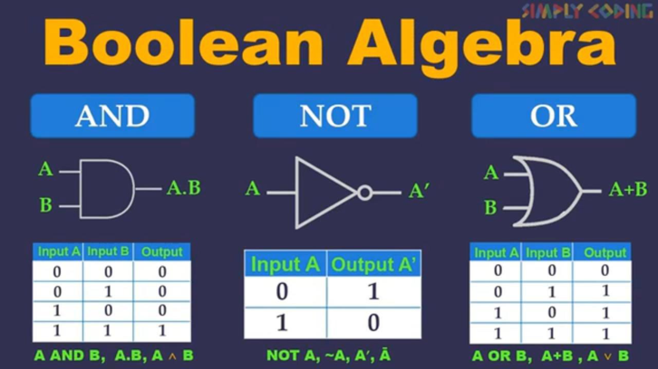

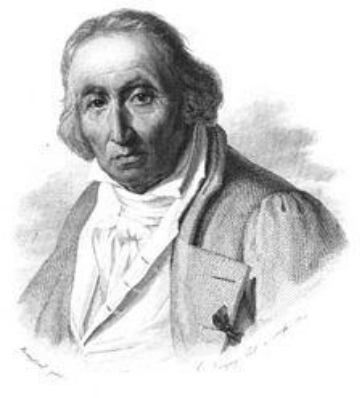

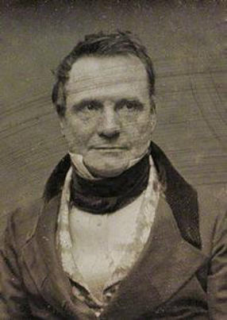

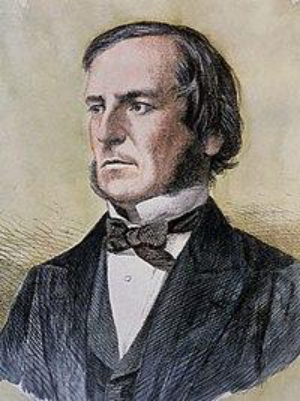

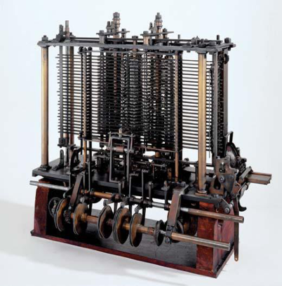

9 

#### **Významné osobnosti – 20. storočie** 

- Alan Turing 

- John von Neumann 

- John Bardeen, William Shockley, Walter Brattain 

- • Jack Kilby, Robert Noyce 

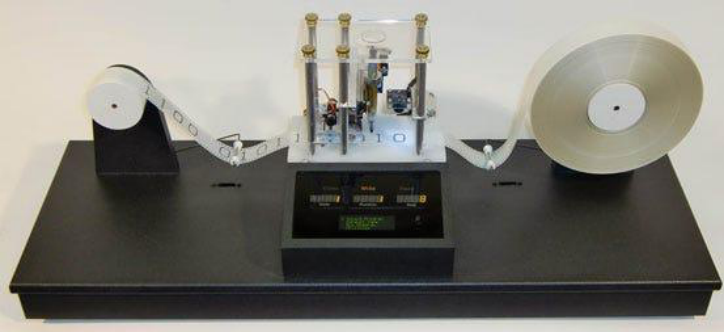

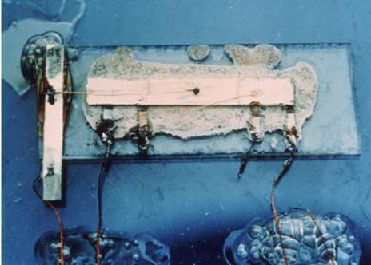

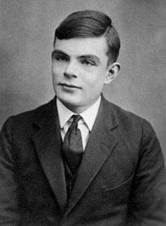

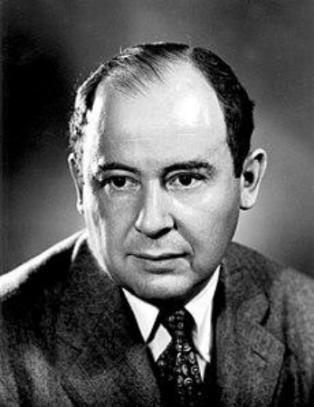

10 

## Počítačový systém 

11 

### **Komponenty počítačového systému** 

- Hardvér = výpočtové zdroje 

   - CPU, pamäť, I/O zariadenia 

- Operačný systém – riadi a koordinuje používanie hardvéru programami a používateľmi 

- Systémové programy 

   - ovládače, asemblery, kompilátory, debuggery a pod. 

- Aplikačné programy 

   - textové editory, tabuľkové procesory, databázové systémy a pod. 

- Používatelia 

      - osoby, stroje, iné počítače 

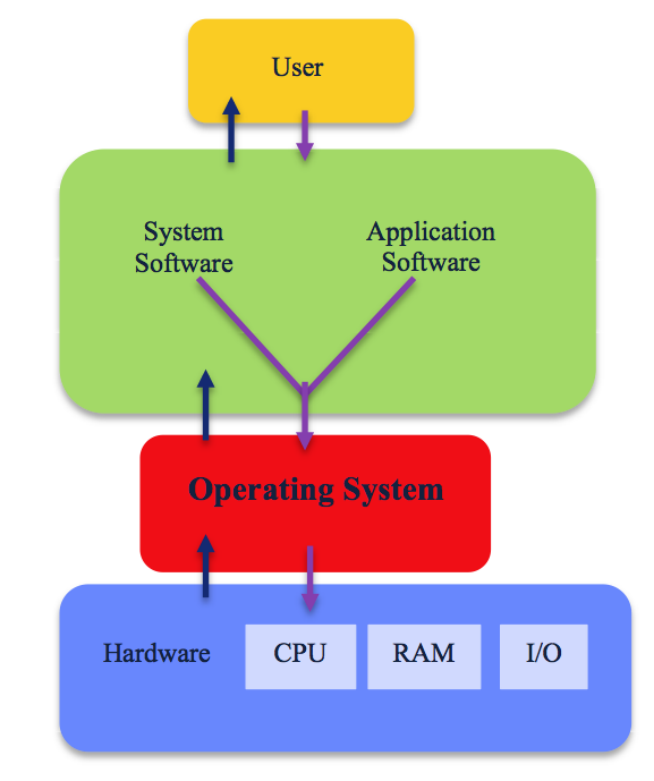

12 

#### **Hardvér počítačového systému** 

• **Procesor** (angl. „Central Processing Unit“, CPU) – riadi počítač a vykonáva jeho hlavnú činnosť – spracovanie údajov. V súčasnosti je procesor realizovaný ako jeden integrovaný obvod – **mikroprocesor** ; často je súčasťou čipu SoC (angl. „System on a Chip“) spolu s GPU a ďalšími jednotkami. 

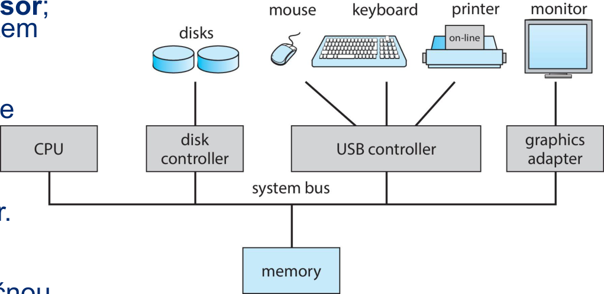

<!-- Start of picture text -->
; <!-- End of picture text -->

- **Operačná pamäť** – umožňuje ukladanie údajov a inštrukcií pre CPU. 

- **Vstupno-výstupný** systém (I/O, angl. „Input/Output“) – slúži na komunikáciu s ostatnými zariadeniami počítača (napr. vonkajšia pamäť, klávesnica, monitor). 

- **Systémová zbernica** – umožňuje komunikáciu medzi procesorom, operačnou pamäťou a I/O systémom. 

13 

#### **Počítačová architektúra** 

- Definuje štruktúru počítačového systému zostaveného z komponentov. 

- • Môže ísť o: 

   - vysokoúrovňový teoretický opis, ktorý ignoruje detaily konkrétnej implementácie (napr. von Neumannova architektúra, harvardská architektúra); 

   - nízkoúrovňový opis, ktorý sa môže zameriavať na CPU: 

         - **architektúra inštrukčného súboru** (angl. „Instruction Set Architecture“, ISA) – definuje strojový kód, veľkosť slova, adresné módy, registre procesora a podporované údajové typy; 

            - **CISC** (angl. „Complex Instruction Set Computer“) – napr. x86, Motorola 68000, z/Architecture; 

            - **RISC** (angl. „Reduced Instruction Set Computer“) – napr. SPARC, PowerPC, ARM, RISC-V; 

      - **mikroarchitektúra** – definuje konkrétnu implementáciu ISA, napr. Intel Core; 

      - alebo na ostatné komponenty počítača: 

         - **systémový návrh** – činnosť jednotlivých komponentov a ich vzájomné prepojenie. 

Otázka: Aký je rozdiel medzi inštrukciou a mikrokódom? 

14 

#### **Počítačová architektúra – teoretický opis** 

- **Von Neumannova architektúra** (Princetonská architektúra): 

   - spoločný pamäťový subsystém pre inštrukcie a data; 

   - inštrukcie a dáta sú sprístupňované striedavo ⇒ úzke miesto von Neumannovej architektúry (angl. „von Neumann bottleneck“). 

- **Harvardská architektúra** : 

   - oddelený pamäťový subsystém pre inštrukcie a dáta, 

   - inštrukcie a dáta sú sprístupňované súčasne a nezávisle, 

   - elektromechanický počítač Harvard Mark I (1944). 

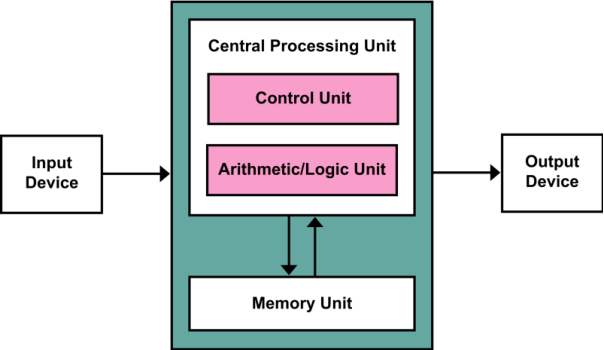

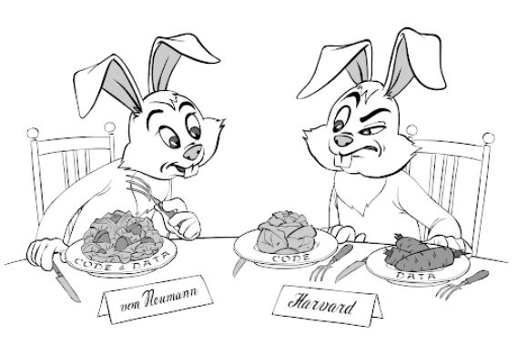

15 

#### **Počítačová architektúra – teoretický opis** 

- **Modifikovaná harvardská architektúra** : 

   - viaceré varianty: 

      - spoločná pamäť pre inštrukcie a údaje avšak s oddelenými zbernicami; 

      - • spoločná pamäť pre inštrukcie a údaje, spoločná zbernica, cache pamäť rozdelená na pamäť pre inštrukcie a údaje = **architektúra s rozdelenou cache pamäťou** : 

         - väčšina súčasných počítačov. 

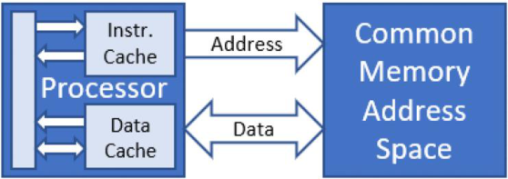

16 

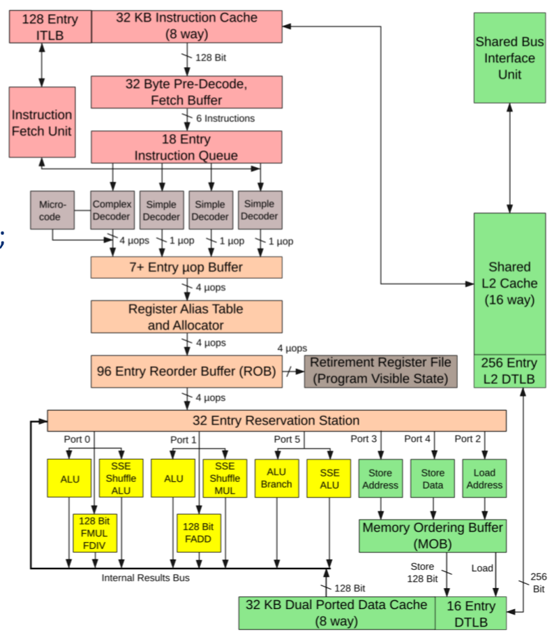

#### **Mikroarchitektúra** 

- Mikroarchitektúra je primárne definovaná inštrukčným súborom. 

- Ďalej však zohľadňuje: 

   - inštrukčný cyklus (angl. „fetch“ – „decode“ – „execute“); 

   - prekrývanie inštrukcií (angl. „instruction pipelining“); 

   - vyrovnávaciu pamäť (cache); 

   - preusporiadanie inštrukcií (angl. „out-of-order execution“); 

   - predpovedanie skokov a špekulatívne vykonávanie (angl. „branch prediction“ a „speculative execution“); 

   - multiprocesing (angl. „multiprocessing“) – prítomnosť viacerých procesorov v systéme alebo viacero výpočtových jadier v jednom CPU; 

   - viacvláknovosť (angl. „multithreading“) – schopnosť jedného výpočtového jadra vykonávať viacero vlákien výpočtu a efektívne medzi nimi prepínať; 

      - simultánna viacvláknovosť (angl. „ **Simultaneous MultiThreading** “, SMT) – schopnosť jedného výpočtového jadra vykonávať inštrukcie z viacerých vlákien súčasne. 

Intel Core mikroarchitektúra (ISA x86) 

17 

#### **Registre procesora** 

- Najrýchlejšia, ale najmenšia pamäť v počítačovom systéme. 

- • Sú súčasťou CPU. 

- Riadiace a stavové registre: 

   - **počítadlo inštrukcií** (angl. „Program Counter“, PC) – adresa inštrukcie, ktorá sa bude vykonávať po skončení práve vykonávanej inštrukcie; 

   - **register aktuálnej inštrukcie** (angl. „Current Instruction Register“, CIR) – inštrukcia, ktorá sa práve dekóduje a vykonáva (jej operačný kód, angl. „opcode“, a operandy); 

   - • **register príznakov** (angl. „flag register“). 

- Všeobecne prístupné registre: 

   - **akumulátory (angl. „accumulators“, AC)** – na výpočty; 

   - • **adresové registre** : 

      - indexový register (angl. „index register“) – na adresovanie úsekov pamäte vzhľadom na bázu (začiatočnú adresu úseku); 

      - ukazovateľ zásobníka (angl. „stack pointer“) – určuje adresu vrcholu zásobníka; mení sa inštrukciami push a pop, prípadne priamo; 

      - segmentový register (angl. „segment register“) – používa sa pri segmentácii pamäte; uchováva adresu začiatku segmentu. 

18 

#### **Inštrukčný cyklus** 

PC – program counter MAR – memory address register MDR – memory data register CIR – current instruction register CU – control unit 

ALU – arithmetic logic unit 

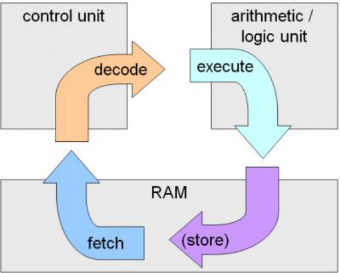

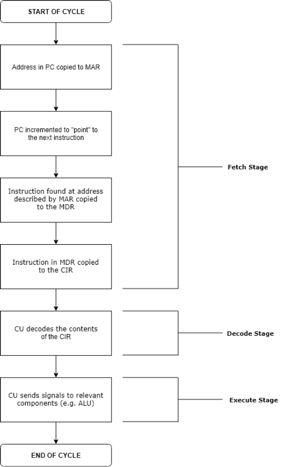

19 

#### **Cache pamäť** 

- Rýchla vyrovnávacia pamäť. 

- Obyčajne malá. 

- Používa sa za účelom zvýšenia výkonu počítačového systému. 

- Môže mať softvérový charakter alebo hardvérový charakter (špecifické pamäťové čipy). 

- • Hardvérová cache pamäť – typické uplatnenie v CPU (veľmi rýchly komponent v porovnaní s operačnou pamäťou) alebo HDD (veľmi pomalý komponent v porovnaní s operačnou pamäťou). 

- Súčasné CPU: L1 32 – 48 KiB a L2 1 – 3 MiB na jadro, zdieľaná L3 desiatky až stovky MiB (AMD 3D V-Cache – 96 MiB na čiplete, serverové EPYC vyše 1 GiB). 

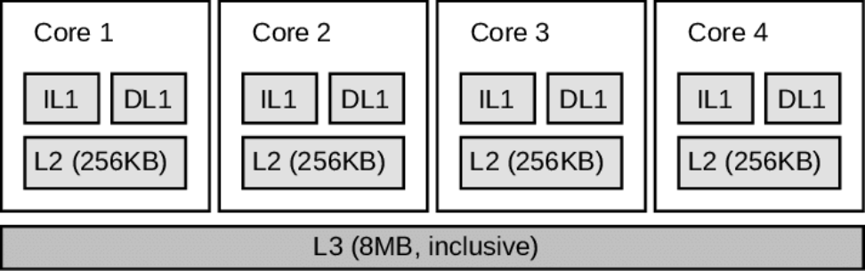

CPU Intel Core i7 

20 

#### **Úložný priestor počítačového systému – operačná pamäť** 

- **Primárne úložisko údajov** – operačná pamäť: 

   - CPU má k nej priamy prístup – všetky údaje, ktoré CPU spracúva, musia byť uložené v tejto pamäti; 

   - pamäť s náhodným prístupom (angl. „Random Access Memory“, RAM), štandardne realizovaná ako dynamická pamäť DRAM – dnes DDR5, v serveroch aj HBM a pamäť pripojená cez CXL; 

   - typicky energeticky závislá (angl. „volatile memory“); 

   - najmenšou adresovateľnou jednotkou je 1 bajt, každý bajt je jednoznačne identifikovaný svojou adresou (nezáporné celé číslo); 

   - na urýchlenie činnosti CPU je kópia časti práve spracúvaných údajov uložená v cache pamäti CPU. 

- Kapacity dnes: notebooky 16 – 32 GiB, pracovné stanice 64 – 256 GiB, servery jednotky TiB; prenosová rýchlosť DDR5 desiatky GiB/s na kanál. 

- Energeticky nezávislá pamäť s bajtovým prístupom (Intel Optane) sa komerčne nepresadila (výroba ukončená 2022). 

21 

#### **Úložný priestor počítačového systému – disky a archív** 

- **Sekundárne úložisko údajov** – rozšírenie hlavnej pamäte: veľká kapacita, energetická nezávislosť: 

   - **pevný disk** (angl. „Hard Disk Drive“, HDD) – kovové alebo sklenené platne s magnetickou vrstvou; povrch je rozdelený na stopy a sektory; najmenšou adresovateľnou jednotkou je blok (typicky 4 KiB); tepelne asistovaný záznam HAMR posúva kapacity na 40 – 44 TB (Seagate Mozaic 4+, 2026), 50 TB sa chystá na rok 2027; 

   - **disk bez pohyblivých častí** (angl. „Solid State Drive“, SSD) – polovodičová pamäť NAND flash; podľa počtu bitov v bunke SLC, MLC, TLC, QLC (pripravuje sa PLC); pripojenie NVMe cez PCIe 5.0 – až ~14 GiB/s, rádovo rýchlejšie ako HDD; blok flash pamäte sa pred zápisom musí vymazať – správu rieši radič označovaný angl. ako „Flash Translation Layer“ (FTL). 

- **Terciárne úložisko údajov** – archivácia: 

   - magnetické pásky – LTO-10 (2025): 30 TB na kazetu, 400 MB/s, životnosť ~30 rokov; 

   - optické médiá, archívne cloudové služby (napr. AWS S3 Glacier). 

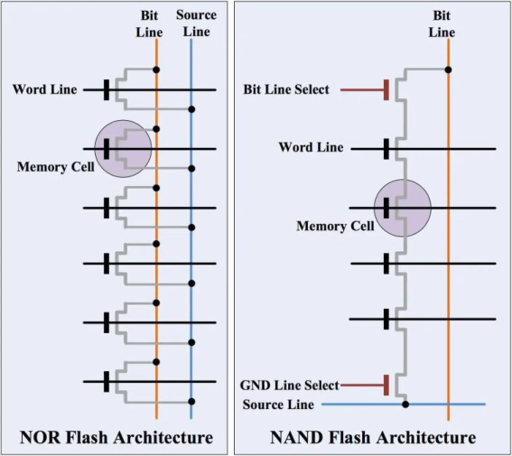

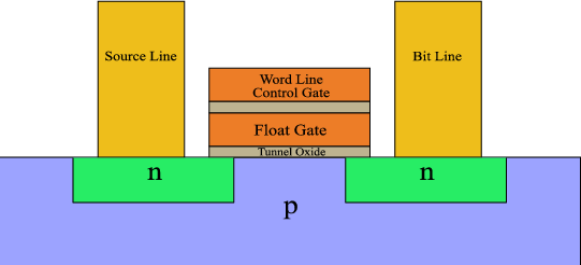

Pamäťová bunka flash pamäte 

22 

#### **Hierarchia pamätí** 

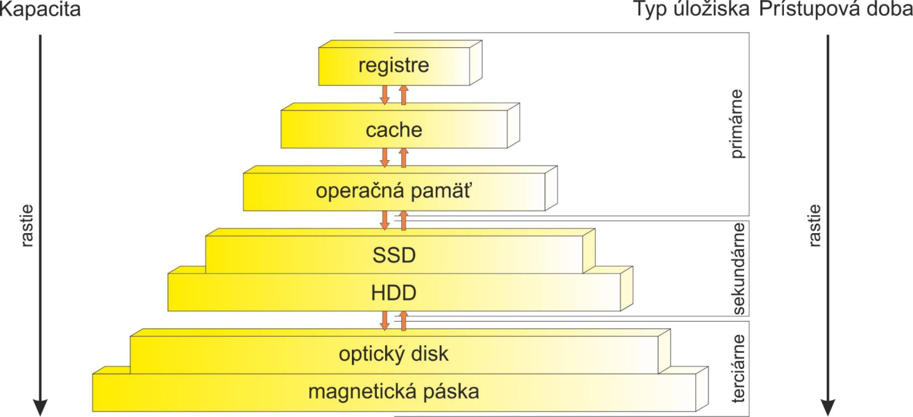

23 

#### **Jednotky používané v súvislosti s kapacitou úložného priestoru** 

- bit (angl. „bit“, b) – jednotka informácie, ktorá môže mať len hodnotu 0 alebo 1; 

- bajt (angl. „byte“, B) = 8 bitov – na väčšine počítačov je to najmenší adresovateľný blok operačnej pamäte; 

- polbajt (angl. „nibble“) = 4 bity – využitie v hexadecimálnych zápisoch; 

- slovo (angl. „word“) – natívna jednotka údajov pre konkrétnu počítačovú architektúru (napr. 64-bitová, 32-bitová architektúra); 

- kibibajt (KiB) = 210 B = 1 024 B; 

- mebibajt (MiB) = 210 KiB = 220 B; 

- gibibajt (GiB) = 210 MiB = 220 KiB = 230 B; 

- tebibajt (TiB) = 210 GiB = 220 MiB = 230 KiB = 240 B; 

- pebibajt (PiB) = 210 TiB = 220 GiB = 230 MiB = 240 KiB = 250 B; 

• exbibajt (EiB) = 210 PiB = 220 TiB = 230 GiB = 240 MiB = 250 KiB = 260 B. **Pozor:** predpony SI sú dekadické (KB = 103 B, MB = 106 B, GB = 109 B, TB = 1012 B). Používajú ich výrobcovia diskov, preto disk s kapacitou 1 TB operačný systém zobrazí ako ≈ 931 GiB. 

24 

#### **Architektúra viacprocesorového počítačového systému** 

- Väčšina systémov používa jeden **univerzálny procesor** = CPU. 

   - Väčšina systémov má však aj **špecializované procesory** , napr.: 

      - FPU (angl. „Floating-Point Unit“); 

      - GPU (angl. „Graphics Processing Unit“); 

      - DSP (angl. „Digital Signal Processor“); 

      - NPU (angl. „Neural Processing Unit“). 

   - Špecializované procesory môžu byť súčasťou čipu CPU (FPU, často aj integrovaná GPU a NPU) alebo samostatnými čipmi (napr. dedikovaná GPU); 

      - od roku 2024 sú NPU súčasťou procesorov pre notebooky (Intel Core Ultra, AMD Ryzen AI, Qualcomm Snapdragon X) – Windows vyžaduje pre „Copilot+ PC“ aspoň 40 TOPS; 

- **Jednoprocesorový systém** – jeden univerzálny procesor obsahujúci jedno výpočtové jadro (angl. „core“). 

- **Viacprocesorový systém** – viac univerzálnych procesorov alebo viac výpočtových jadier. 

- • Typy architektúr viacprocesorových systémov: 

   - voľne prepojený viacprocesorový systém (angl. „loosely coupled multiprocessor system“); 

   - • pevne prepojený viacprocesorový systém (angl. „tightly coupled multiprocessor system“): 

      - architektúra UMA; 

      - architektúra NUMA. 

25 

#### **Voľne prepojený viacprocesorový systém – klaster** 

- Systém s **distribuovanou pamäťou** . 

- Každý procesor má vlastnú: 

   - lokálnu pamäť, 

   - vstupné/výstupné (I/O) kanály, 

   - operačný systém. 

- Procesory si vymieňajú údaje cez vysokorýchlostnú komunikačnú sieť **posielaním správ** (angl. „message passing“). 

- Kľúčové vlastnosti: 

   - vysoká dostupnosť služieb; 

   - podpora paralelných výpočtov – vysokovýkonné počítanie (HPC, angl. „High-Performance Computing“); 

   - pomalšia medziprocesná komunikácia; 

   - vysoká škálovateľnosť. 

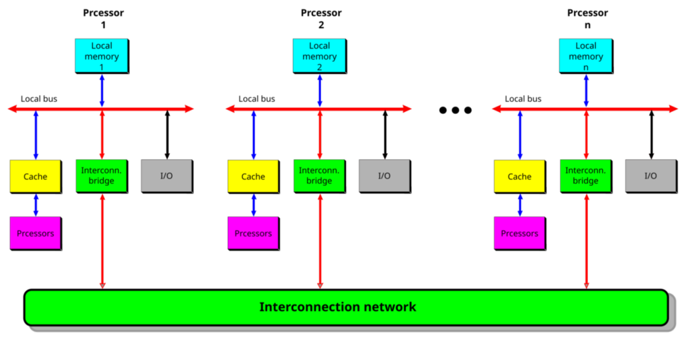

- TOP500 (jún 2026): 

   - 1. LineShine (Šen-čen, Čína) ~2,2 EFLOPS – prvý 

      - čínsky systém na čele od roku 2017, 

      2. El Capitan (USA) ~1,7 EFLOPS, 

   - 

   - 5. JUPITER (Jülich) 1,0 EFLOPS – prvý európsky 

      - exascale systém, 

      145. PERUN (SAV Bratislava) 13,9 PFLOPS. 

   - 

26 

#### **Superpočítač PERUN – Slovensko (SAV + TUKE)** 

- **Národný superpočítač PERUN** – dve lokality, ktoré fungujú ako jeden systém (spoločné prihlásenie a správa používateľov, prenos údajov medzi mestami). 

- **CSČ SAV Bratislava** – Eviden BullSequana XH3000: 

   - uzly s čipmi NVIDIA GH200 Grace Hopper (72-jadrové CPU ARM + GPU), spolu 62 016 jadier, InfiniBand NDR, vodné chladenie, Red Hat Enterprise Linux; 

   - Rmax 13,9 PFLOPS – 145. miesto TOP500 a 16. miesto Green500 (jún 2026); v novembri 2025 125. miesto – najlepšie umiestnenie slovenského systému v histórii; v prevádzke od marca 2026. 

- **TUKE Košice** – spustený 20. 11. 2025: 

   - 10,7 PFLOPS, 12 800 jadier CPU, 208 GPU NVIDIA H200, 115 TiB RAM, sieť 400 Gbit/s, úložisko 6 PiB; 

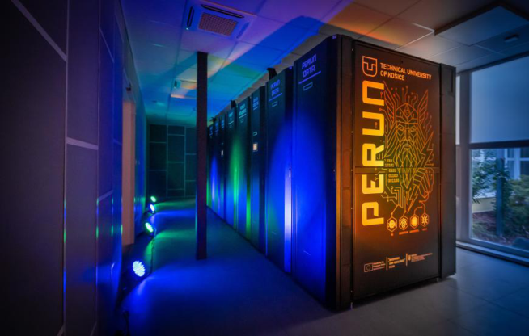

jeden systém: spoločné prihlásenie, prenos údajov medzi lokalitami 

   - kvantový simulátor Qaptiva – emulácia kvantových obvodov (súvis so zameraním kvantová informatika). 

- Prístup cez výzvy: výskumné tímy vrátane študentov, univerzity, startupy a firmy; predchodca Devana (SAV, 2023). 

- Klaster je voľne prepojený systém – každý uzol má vlastný Linux, úlohy rozdeľuje plánovač Slurm, procesy komunikujú posielaním správ cez MPI. 

**CSČ SAV Bratislava TUKE Košice** BullSequana XH3000 208 × NVIDIA H200 NVIDIA GH200 10,7 PFLOPS 13,9 PFLOPS Qaptiva – kvantový TOP500: 145. simulátor 

Národný superpočítač PERUN – dve lokality 

27 

#### **Pevne prepojený viacprocesorový systém** 

- Systém so **zdieľanou pamäťou** . 

- Systém pozostáva z viacerých CPU, pričom všetky majú prístup k spoločnej pamäti. 

- Homogénny viacprocesorový systém: 

   - obsahuje viacero rovnakých univerzálnych výpočtových jednotiek. 

- Heterogénny viacprocesorový systém: 

   - obsahuje viacero univerzálnych výpočtových jednotiek s odlišnými vlastnosťami (frekvencia, spotreba). 

   - dnes bežné aj v PC – Intel Core (od 2021 jadrá P a E), Apple M, Snapdragon X; plánovač OS musí poznať typ jadra (prednáška 6). 

- Kľúčové vlastnosti: 

   - podpora paralelných výpočtov; 

   - rýchlejšia medziprocesná komunikácia; 

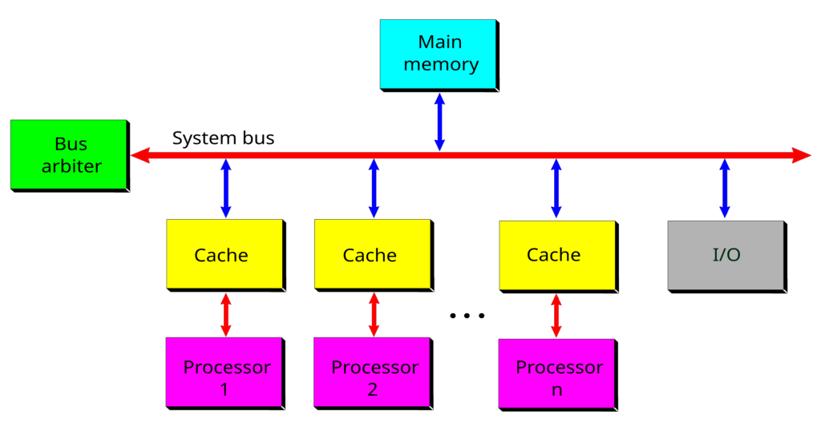

- nižšia škálovateľnosť. 

28 

#### **Homogénny viacprocesorový systém – Intel x86** 

• Dva procesory 

##### • Dvojjadrový procesor 

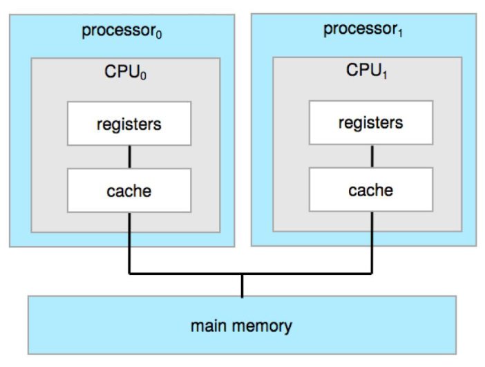

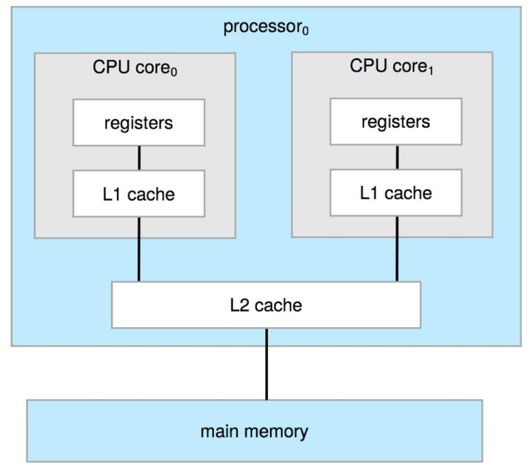

29 

#### **Heterogénny viacprocesorový systém – ARM big.LITTLE** 

- Klastrový model • SMP (angl. „Symmetric MultiProcessing“) model 

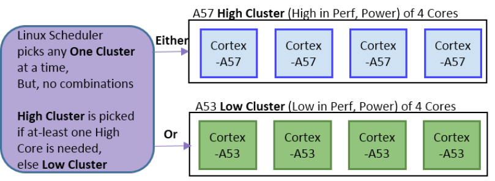

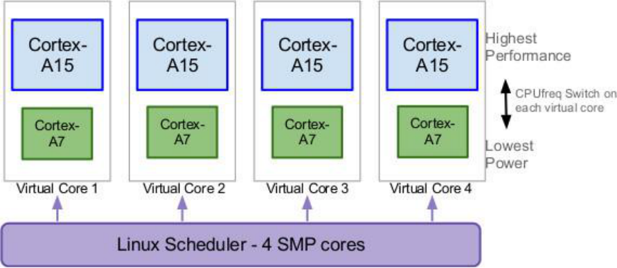

- Heterogénny model 

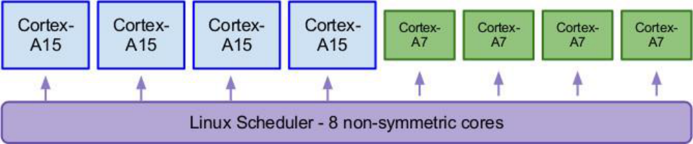

30 

#### **Pevne prepojený viacprocesorový systém – pamäťové architektúry** 

- Architektúra **UMA** (angl. „Uniform Memory Access“): 

   - Intel Front-Side Bus (FSB, vysokorýchlostné FSB – 90. roky). 

- Architektúra **NUMA** (angl. „Non-Uniform Memory Access“): 

   - AMD HyperTransport (HT, 2001); 

   - AMD Infinity Fabric (IF, 2016); 

   - Intel QuickPath Interconnect (QPI, 2008); 

   - Intel Ultra Path Interconnect (UPI, 2017); 

   - CXL (angl. „Compute Express Link“, 2019) – pripojenie ďalšej pamäte cez PCIe (ďalší uzol NUMA). 

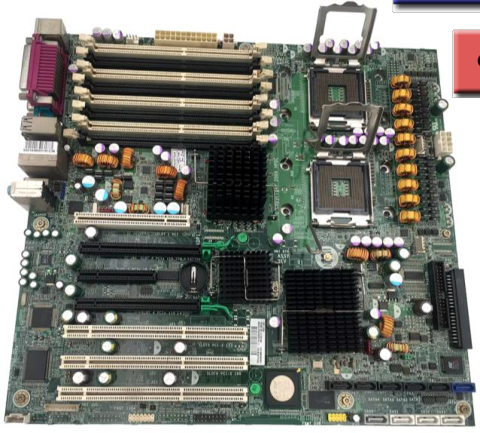

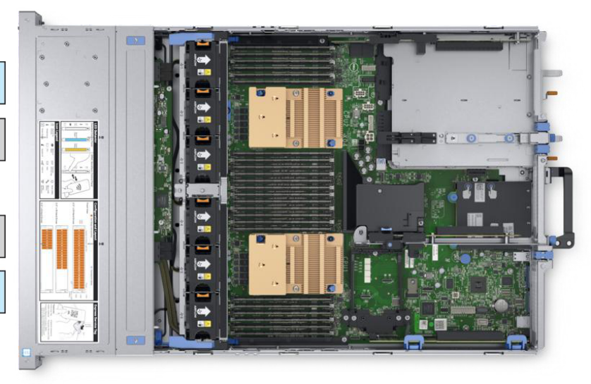

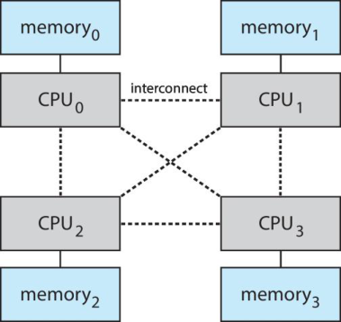

31 

#### **Súčasné viacprocesorové systémy** 

- **Čiplety** – procesor sa skladá z viacerých kremíkových čipov v jednom puzdre (AMD Ryzen a EPYC – Infinity Fabric, Intel Core Ultra – Foveros); každý čiplet má vlastnú cache, pamäť je spoločná. 

- **Hybridné jadrá** – výkonné a úsporné jadrá v jednom CPU (ARM big.LITTLE a DynamIQ, Intel jadrá P a E, Apple M); plánovač OS musí rozlišovať typ jadra (Intel Thread Director, Linux EAS). 

- **Zjednotená pamäť** (angl. „unified memory“) – CPU, GPU a NPU na jednom čipe SoC zdieľajú jednu fyzickú pamäť (Apple M, AMD Ryzen AI Max, NVIDIA Grace Hopper) – odpadá kopírovanie údajov medzi CPU a GPU. 

- **Servery** – dvojpäticové systémy so stovkami jadier (AMD EPYC, Intel Xeon 6, ARM – Ampere, AWS Graviton, NVIDIA Grace) sú systémy NUMA; prepojenia Infinity Fabric a UPI, rozšírenie pamäte cez CXL. 

- Dôsledok pre OS: plánovač a správca pamäte musia poznať topológiu (jadrá, cache, uzly NUMA) – vyskúšajte `lscpu` a `numactl --hardware` . 

32 

## Operačný systém 

33 

#### **Čo robí operačný systém** 

- Závisí od uhla pohľadu. 

- Používatelia vyžadujú pohodlie, **jednoduchosť používania** a **dobrý výkon** ; • nemusia riešiť **využitie zdrojov** . 

- Zdieľaný počítač, akým je **sálový počítač** , musí uspokojiť všetkých používateľov; • operačný systém je alokátor zdrojov a riadiaci program, ktorý efektívne využíva hardvér a riadi vykonávanie používateľských programov. 

- Používatelia špecializovaných systémov, akými sú **pracovné stanice** , majú vyhradené zdroje, ale často používajú zdieľané zdroje zo serverov. 

- Mobilné zariadenia, ako sú **smartfóny** a **tablety** , sú menej náročné na výkon, avšak sú optimalizované z hľadiska použiteľnosti a výdrže batérie; • mobilné používateľské rozhrania, ako sú dotykové obrazovky, rozpoznávanie hlasu. 

- Niektoré počítače majú malé alebo žiadne používateľské rozhranie, napríklad **vstavané počítače** v zariadeniach a automobiloch; 

   - bežia primárne bez zásahu používateľa. 

34 

#### **Čo je operačný systém** 

- Všetko, čo výrobca dodá a označí za súčasť operačného systému. 

- **Kernel + vybraná skupina systémových programov** . 

   - Kernel (jadro operačného systému) – program, ktorý beží od spustenia počítača až do jeho ukončenia a spravuje jeho hardvérové zdroje a softvérové prostriedky. 

   - • Systémový program – môže sa dodávať s operačným systémom, ale nie je súčasťou jadra. 

- Moderné operačné systémy pre osobné počítače a mobilné zariadenia môžu zahŕňať aj middleware. 

   - Middleware – súbor softvérových nástrojov, ktoré poskytujú doplnkové služby pre vývojárov aplikácií pre daný operačný systém. 

- Dnes: Linux beží na všetkých systémoch rebríčka TOP500 a vo väčšine cloudu, Android je najrozšírenejší operačný systém podľa počtu zariadení, Windows dominuje na desktopoch. 

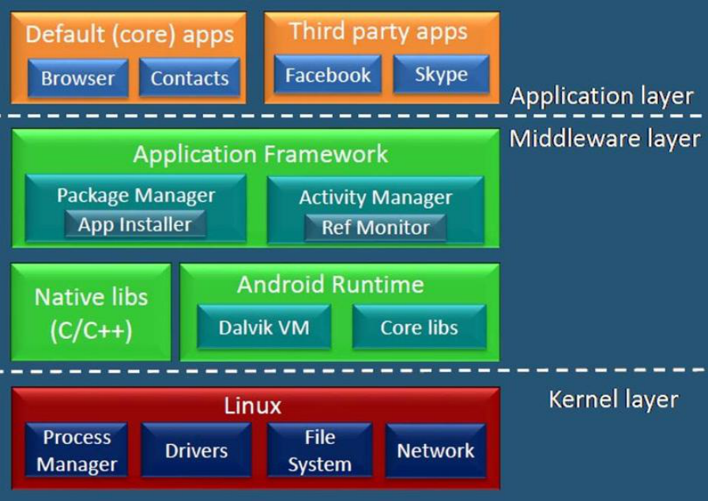

Architektúra operačného systému Android 

35 

#### **Činnosť počítačového systému** 

- I/O zariadenia a CPU môžu vykonávať pridelené úlohy súbežne. 

- Každé **zariadenie** (angl. „ **device** “) počítačového systému je pripojené cez **radič** (angl. „device controller“ – jednoduchý procesor), ktorý riadi činnosť zariadenia a ktorého súčasťou je lokálna **vyrovnávacia pamäť** (angl. „ **buffer** “). 

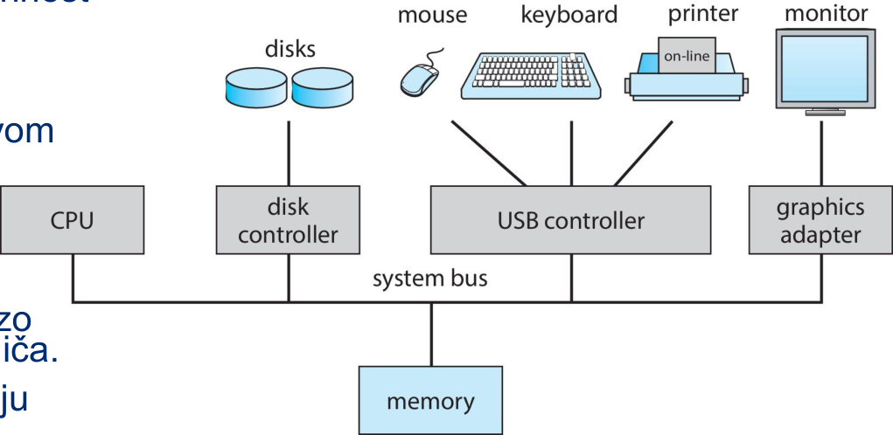

- Súčasťou operačného systému je **ovládač** zariadenia (angl. „ **device driver** “), prostredníctvom ktorého operačný systém komunikuje s radičom zariadenia a riadi jeho činnosť. 

- CPU zodpovedá za prenos údajov z/do hlavnej pamäte do/z lokálnych vyrovnávacích pamätí. 

- V rámci I/O zariadenia prebieha prenos údajov zo zariadenia do lokálnej vyrovnávacej pamäte radiča. 

- Radič zariadenia informuje CPU, že ukončil svoju činnosť prostredníctvom **prerušenia** (angl. „ **interrupt** “). 

36 

#### **Prerušenie (angl. „interrupt“)** 

- Keď je CPU prerušené, prestane vykonávať aktuálnu činnosť a začne obsluhovať prerušenie. 

- Obsluha prerušenia znamená, že sa spustí obslužná funkcia uložená na špecifickej adrese v operačnej pamäti. 

- Adresy obslužných funkcií rôznych typov prerušení generovaných rôznymi zariadeniami sú uložené v údajovej štruktúre typu pole označovanej ako **vektor prerušení** (angl. „interrupt vector“). 

- Každý typ prerušenia má vlastné unikátne číslo, ktoré slúži ako index do vektora prerušení. 

- Obsluha prerušenia obyčajne vyžaduje uloženie aktuálneho stavu CPU a jeho následné obnovenie, čím sa obnoví pôvodná činnosť CPU. 

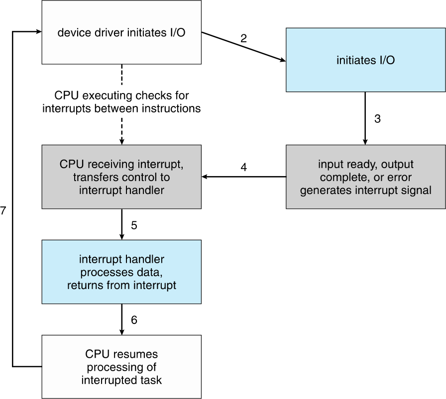

37 

#### **Časová os prerušení** 

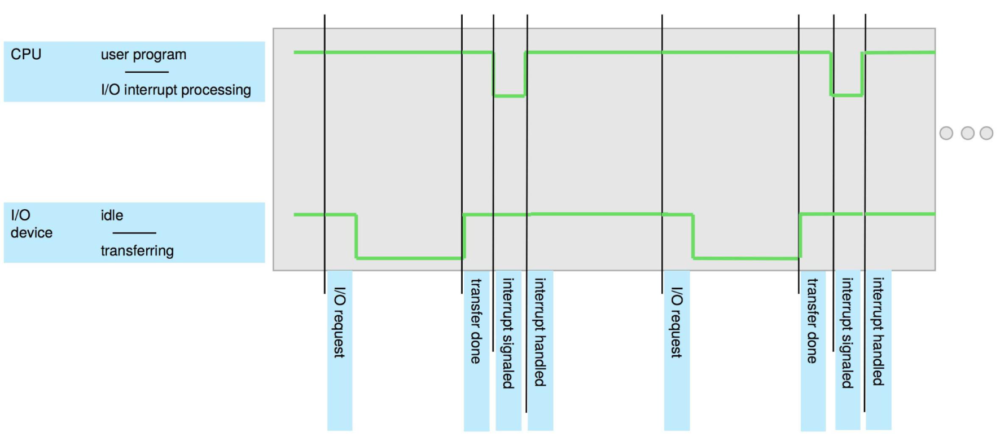

38 

#### **Výnimky a softvérové prerušenia** 

- **Prerušenie** (angl. „interrupt“) – asynchrónna udalosť, ktorú generuje hardvér (zariadenie). 

- **Výnimka** (angl. „exception“) – synchrónna udalosť, ktorú generuje CPU pri vykonávaní inštrukcie: • chyba (angl. „fault“) – napr. výpadok stránky, delenie nulou; po obslúžení sa inštrukcia môže vykonať znova; 

   - pasca (angl. „trap“) – napr. ladiaci bod prerušenia (angl. „breakpoint“); vykonávanie pokračuje nasledujúcou inštrukciou; 

- prerušenie behu (angl. „abort“) – závažná chyba, po ktorej nie je možné pokračovať. 

- • **Softvérové prerušenie** – zámerne vyvolané inštrukciou (napr. int 0x80 na x86); historicky slúžilo na systémové volania. 

      - Súčasné CPU používajú na systémové volania špeciálne inštrukcie (x86-64: syscall, ARM64: svc). 

- Operačný systém je riadený prerušeniami a výnimkami – možno ho chápať ako udalostne riadený systém. 

39 

#### **Vektor prerušení – architektúra Intel x86** 

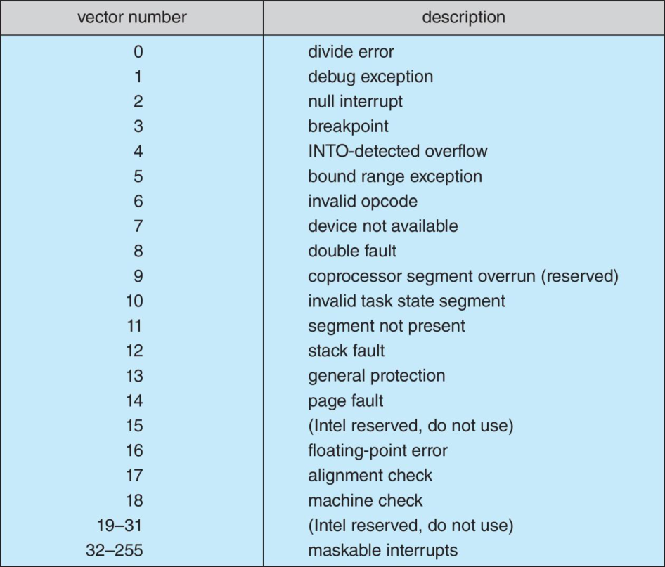

40 

#### **Prevádzka počítačového systému v dvoch režimoch** 

- Prevádzka v dvoch režimoch umožňuje operačnému systému chrániť seba a ďalšie súčasti počítačového systému. 

   - **Používateľský režim** (angl. „ **user mode** “) a **režim jadra** (angl. „ **kernel mode** “). 

   - **Bit režimu** poskytovaný hardvérom: 

      - umožňuje rozlíšiť, kedy sa v systéme vykonáva používateľský kód a kedy kód jadra; 

      - inštrukcie označené ako **privilegované** (napr. vypnutie prerušení, nastavenie časovača, prepnutie kontextu) môžu byť spustené iba v režime jadra; 

      - **systémové volanie** spôsobí prepnutie do režimu jadra (prostredníctvom špeciálnej inštrukcie – x86-64: syscall, ARM64: svc; historicky softvérovým prerušením), zatiaľ čo jeho ukončenie spôsobí opätovné prepnutie do režimu používateľa. 

- Iné architektúry: ARM64 má úrovne EL0 – EL3, RISC-V režimy U, S a M; virtualizácia pridáva ďalší režim pre hypervízor (prednáška 2). 

- Chyby Spectre a Meltdown (2018) ukázali, že špekulatívne vykonávanie môže prelomiť izoláciu režimov – OS doplnil obranu (napr. KPTI) za cenu výkonu. 

###### Privilegované režimy v 

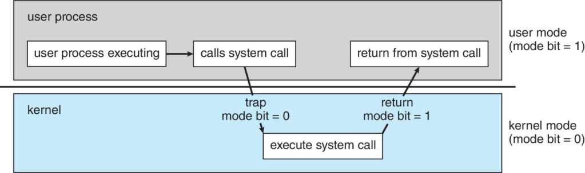

###### architektúre x86 

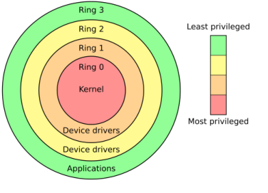

41 

#### **Priamy prístup do pamäte (angl. „Direct Memory Access“, DMA)** 

- Používa sa pre vysokorýchlostné I/O zariadenia schopné prenášať informácie rýchlosťou blízkou rýchlosti pamäte. 

- Radič zariadenia prenáša bloky údajov z vyrovnávacej pamäte zariadenia priamo do hlavnej pamäte bez zásahu CPU. 

- **Na blok sa vygeneruje iba jedno prerušenie** (t. j. negeneruje sa prerušenie na každý prenesený bajt). 

- Zariadenie s DMA vidí celú pamäť, preto OS zapína **IOMMU** (Intel VT-d, AMD-Vi), ktorá obmedzí, kam smie zariadenie zapisovať – ochrana proti útokom cez Thunderbolt a USB4 (angl. „kernel DMA protection“). 

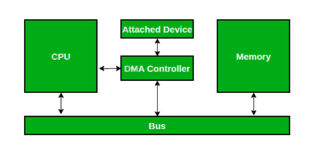

42 

#### **Všeobecný princíp činnosti súčasných počítačov** 

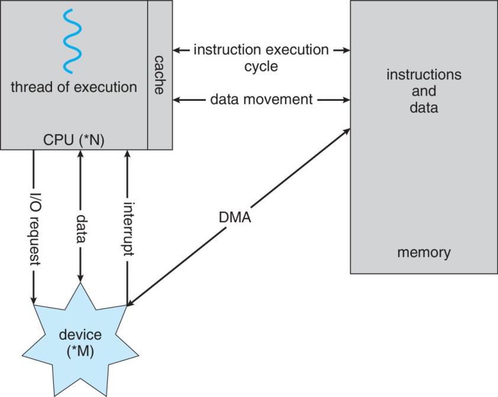

43 

#### **Beh operačného systému** 

Bootstrap program – inicializácia systému a načítanie kernelu 

<!-- Start of picture text -->
Spustenie kernelu <!-- End of picture text -->

Čakanie na udalosti Spustenie systémových reprezentované démonov (služby softvérovými a poskytované mimo hardvérovými jadra) prerušeniami 

44 

#### **Spustenie počítača** 

- **Bootstrapping** – spustenie zložitejšieho systému programov jednoduchým programom označovaným ako bootstrap program. 

- Pri zapnutí alebo reštarte sa spustí **firmvér** (angl. „firmware“) uložený v pamäti flash na základnej doske: • historicky **BIOS** (angl. „Basic Input/Output System“), dnes **UEFI** (angl. „Unified Extensible Firmware Interface“); 

   - inicializuje a otestuje hardvér, nájde zavádzač a overí jeho digitálny podpis (angl. „Secure Boot“). 

- **Zavádzač** (angl. „boot loader“, napr. GRUB, systemd-boot, Windows Boot Manager) načíta jadro operačného systému do pamäte a odovzdá mu riadenie. 

- **Jadro** inicializuje svoje údajové štruktúry a ovládače a spustí prvý používateľský proces (v Linuxe init/systemd s identifikátorom PID 1). 

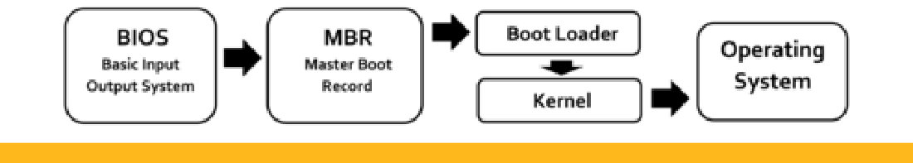

45 

#### **Multiprogramovanie a viacúlohovosť** 

Pamäť v multiprogramovom systéme 

- **Multiprogramovanie** (angl. „multiprogramming“) – zavedenie viacerých **úloh** (angl. „tasks“) do pamäte a ich postupné vykonávanie: 

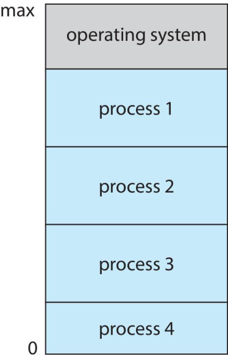

   - v pamäti sa nachádza podmnožina všetkých úloh, ktoré musí počítačový systém vykonať; 

   - CPU vykonáva vždy iba jednu úlohu; 

   - o tom, ktorá úloha sa bude vykonávať, rozhoduje operačný systém; 

   - ak vykonávaná úloha musí čakať (napr. na I/O), operačný systém prepne na inú úlohu; 

   - dávkové systémy. 

- **Viacúlohovosť** (angl. „multitasking“) – rozšírenie multiprogramovania, v ktorom CPU prepína úlohy tak často, že používatelia môžu s každou úlohou interagovať: 

   - kľúčový ukazovateľ – čas odozvy. 

46 

#### **Vyskúšajte si** 

###### Príkazy pre Linux: 

- `lscpu` – architektúra, počet jadier a vlákien (SMT), uzly NUMA, veľkosti cache; 

- `cat /proc/interrupts` – počet prerušení obslúžených jednotlivými jadrami; 

- `lsblk -d -o NAME,ROTA,SIZE` – disky (ROTA = 1 → HDD, ROTA = 0 → SSD); 

- `free -h` – využitie operačnej a odkladacej pamäte; 

- `ls /sys/firmware/efi` – ak adresár existuje, systém bol spustený cez UEFI; 

- `systemd-analyze` – trvanie fáz spustenia (firmvér, zavádzač, jadro, používateľský priestor); 

- `ps -p 1 -o pid,comm` – prvý proces spustený jadrom. 

47 

## Výpočtové prostredia 

48 

#### **Výpočtové prostredia** 

- Odlišujú sa primárnym typom úloh a z toho vyplývajúceho hardvéru a softvéru: 

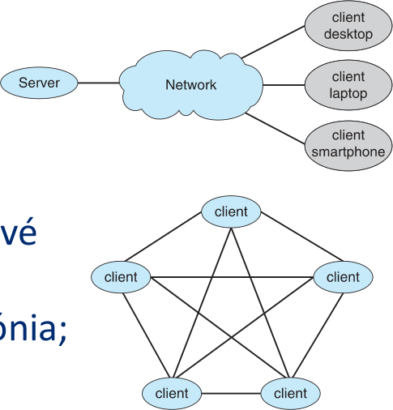

- tradičné – osobný počítač; 

- mobilné – mobilné telefóny, tablety; 

- klient-server – jednoduché terminály (klienti) a komplexné výpočtové zariadenie (server), napr. webové servery, databázové servery; 

- peer-to-peer – všetky zariadenia sú rovnocenné, napr. IP telefónia; 

- vstavané systémy reálneho času; 

- cloud computing (cloudové výpočty). 

- umelá inteligencia – trénovanie modelov v dátových centrách s klastrami GPU, inferencia čoraz častejšie priamo v zariadení (NPU). 

49 

#### **Cloud computing** 

- Poskytuje výpočtovú techniku, úložisko alebo aplikácie ako službu dostupnú cez počítačovú sieť. 

- • Základom je virtualizácia výpočtových strojov. 

   - najväčší poskytovatelia (AWS, Microsoft Azure, Google Cloud) prevádzkujú milióny serverov v desiatkach regiónov sveta. 

- Rôzne typy: 

   - verejný cloud – dostupný cez internet každému, kto je ochotný zaplatiť; 

   - súkromný cloud – prevádzkuje ho spoločnosť pre vlastnú potrebu; 

   - hybridný cloud – zahŕňa komponenty verejného aj súkromného cloudu; 

   - **IaaS** (angl. „Infrastructure as a Service“) – prístup k výpočtovým zdrojom na požiadanie (napr. úložisko dostupné na zálohovanie); 

   - **PaaS** (angl. „Platform as a Service“) – prístup ku kompletnému prostrediu umožňujúcemu vývoj, spúšťanie, údržbu a správu aplikácií na požiadanie (napr. Azure App Service, Google App Engine); 

   - **SaaS** (angl. „Software as a Service“) – prístup k aplikácii na požiadanie (napr. textový procesor); 

   - **FaaS** (angl. „Function as a Service“, „serverless“) – spúšťanie jednotlivých funkcií bez správy serverov (napr. AWS Lambda). 

50 

#### **Cloud computing** 

- Prostredie cloud computingu v sebe zahŕňa tradičné operačné systémy, správcov virtuálnych strojov a nástroje na správu cloudu. 

   - Internetové pripojenie vyžaduje zabezpečenie, akým sú brány firewall. 

   - Vyrovnávače záťaže (angl. „load balancers“) rozdeľujú prevádzku medzi viaceré stroje. 

- Nová záťaž (2023 – 2026): trénovanie a inferencia modelov umelej inteligencie – klastre tisícov GPU ako služba; spotreba dátových centier prudko rastie. 

51 

#### **HPC a HTC – dva spôsoby, ako využiť veľa počítačov** 

|**Kritérium**|**HPC (angl. „High-Performance Computing“)**|**HTC (angl. „High-Throughput Computing“)**|
|---|---|---|
|**Cieľ**|vyriešiť jednu veľkú úlohu čo najrýchlejšie|spracovať čo najviac nezávislých úloh za dlhší čas (dni, mesiace)|
|**Meradlo výkonu**|FLOPS (rebríček TOP500)|počet dokončených úloh za deň, CPU-hodiny za mesiac|
|**Väzba medzi procesmi**|tesná – procesy si často vymieňajú údaje (MPI)|voľná – úlohy sú nezávislé, komunikujú minimálne|
|**Hardvér**|homogénne uzly, sieť s nízkou latenciou (InfiniBand), zdieľaný súborový systém|heterogénne stroje aj s bežnou sieťou; často nevyťažené počítače v učebniach a kanceláriách|
|**Plánovač**|Slurm, PBS|**HTCondor**, BOINC, gridové systémy|
|**Odolnosť voči chybám**|výpadok uzla zastaví celú úlohu (pomáhajú kontrolné body)|výpadok stroja ovplyvní jednu úlohu – spustí sa inde|
|**Typické úlohy**|simulácie (počasie, prúdenie, kvantová chémia), trénovanie veľkých modelov|parametrické štúdie, Monte Carlo, spracovanie veľkých súborov údajov, renderovanie|
|**Príklady**|PERUN, JUPITER, LineShine|WLCG pri CERN-e, Open Science Pool (USA), Folding@home|

52 

## Exotické formy výpočtov 

53 

#### **Limity súčasných počítačov** 

###### **1. Energetická spotreba a rozptyl tepla** 

   - Energia na jednu logickú operáciu sa postupne blíži k Landauerovmu limitu – minimálnej energii na vymazanie 1 bitu (kT·ln 2 ≈ 0,018 eV pri izbovej teplote). 

   - Každý výpočet produkuje teplo, ktoré je čoraz ťažšie odvádzať pri hustote miliárd tranzistorov. 

   - Dennardovo škálovanie sa skončilo okolo roku 2006 – frekvencie ďalej nerastú, výkon sa získava pridávaním jadier a špecializovaných jednotiek. 

   - Dátové centrá spotrebovali v roku 2025 približne 485 TWh (~1,5 % svetovej elektriny, medziročný rast 17 %); do roku 2030 IEA očakáva zdvojnásobenie na ~950 TWh (IEA, 2026). 

**2. Rýchlosť a latencia** – aj keď CPU bežia na gigahertzoch, rýchlosť obmedzujú: 

   - **fyzikálne oneskorenie prenosu signálu** (signál sa po vodičoch na čipe šíri výrazne pomalšie ako svetlo); 

   - **pamäťová stena (memory wall):** prístup do RAM je rádovo pomalší než CPU operácie; 

   - **komunikačné úzke hrdlá** medzi procesorom, GPU, sieťou a úložiskom. 

**3. Miniaturizácia tranzistorov** – Moorov zákon môže prestať platiť; tranzistory dnes majú len niekoľko **nanometrov** , čo prináša: 

   - kvantové tunelovanie elektrónov; 

   - vyšší šum a nestabilitu; 

   - zložitejšie výrobné procesy a vyššie ceny. 

###### **4. Obmedzenia architektúry** 

   - Von Neumannova architektúra aj harvardská architektúra sú založené na oddelení pamäte a procesora – úzke miesto pri prenose údajov. 

   - Paralelizmus (viaceré jadrá, GPU) má limity: synchronizácia, energetická efektívnosť a programovateľnosť. 

**5. Škálovanie a špecifické úlohy** 

   - Niektoré problémy (napr. faktorizácia, simulácia kvantových systémov, optimalizácia) rastú **exponenciálne** a klasické počítače ich nezvládajú ani pri masívnom výkone. 

54 

#### **Nové formy výpočtov – prehľad** 

- **Reverzibilné výpočty** – logické hradlá, pri ktorých sa nestráca informácia (napr. Toffoliho a Fredkinovo hradlo); teoreticky umožňujú obísť Landauerov limit. 

- **Kvantové výpočty** – qubity, superpozícia, prepletenie a interferencia; pre vybrané úlohy exponenciálne alebo kvadratické zrýchlenie (Shorov, Groverov algoritmus); ohrozenie súčasnej kryptografie s verejným kľúčom. 

- **DNA výpočty a úložiská** – masívny paralelizmus biochemických reakcií, extrémna hustota a životnosť záznamu, ale veľmi pomalý zápis a čítanie. 

- **Neuromorfné výpočty** – hardvér inšpirovaný mozgom (impulzné neurónové siete, pamäť a výpočet na jednom mieste), veľmi nízka spotreba (napr. Intel Loihi, IBM NorthPole). 

- **Fotonické a analógové výpočty** – výpočet svetlom alebo priamo v pamäťovom poli; rýchle násobenie matíc pre umelú inteligenciu, ale obmedzená presnosť. 

Spoločný motív: klasický počítač naráža na fyzikálne limity, preto sa hľadá iný spôsob, ako informáciu reprezentovať a spracovať. 

55 

#### **Reverzibilné výpočty** 

- **Landauerov limit** (1961): 

   - teoretická minimálna energia ( 𝐸𝑚 ) potrebná na vymazanie jedného bitu informácie (množstvo tepelnej energie, ktorá musí byť odvodená na prostredia): 𝐸𝑚 = 𝑘𝐵 𝑇ln 2 

      - kde: 

         - 𝑘𝐵 – **Boltzmannova konštanta** ≈ 1,380649.10−23 JK−1 

         - 𝑇 – teplota systému [ K ] 

      - pri izbovej teplote ( ∼300 K ): 

###### 𝐸𝑚 = 2,87.10−21 J ∼0,018 eV 

   - **fundamentálna hranica** – nedá sa obísť bez porušenia druhého termodynamického zákona – zmazanie informácie znižuje entropiu systému, takže túto „stratu“ treba vykompenzovať odvodom tepla do prostredia. 

- Každá **ireverzibilná operácia** , ktorá zmaže informáciu, vedie k odvodu energie do prostredia. 

- • **Reverzibilný výpočet** : 

- každý krok je možné spätne jednoznačne identifikovať; 

- žiadna informácia sa nevymaže; 

- teoreticky nie je nutné odviesť do prostredia žiadnu energiu; 

- prakticky je nutné „upratať“ pomocné bity (angl. „ancilla bits“ a „garbage bits“), čo vedie k odvodu energie. 

56 

#### **Landauerov limit a súčasné technológie** 

<!-- Start of picture text -->
30 25 20 15 10 5 0 1940 1960 1980 2000 2020 2040 2060 2080 2100 rok Historický trend (Koomeyho zákon) Extrapolácia pri súčasnom tempe Landauerov limit (300 K) log10 (operácií na kWh) <!-- End of picture text -->

Schematický priebeh: energetická efektívnosť výpočtov sa zdvojnásobovala každých ~1,57 roka (Koomey et al., 2011), od roku 2009 približne každých 2,6 roka (Koomey a Naffziger, 2015). Pri tomto tempe by sa Landauerov limit dosiahol okolo roku 2095; Prieto et al. (Cluster Computing, 2024) odhadujú rok 2090. 

57 

#### **Reverzibilné výpočty** 

- Hlavné výzvy: 

   - fyzická realizácia hradiel – v reálnych obvodoch vždy existuje odpor, kapacitné straty a šum ⇒ energia sa rozptyľuje aj pri reverzibilnom prepínaní; 

   - garbage bits a „upratovanie“ – minimalizácia množstva „garbage“ bitov; 

   - rýchlosť a adiabaticita – aby sa minimalizovala energia, musí byť prepínanie adiabatické (pomalé a riadené); 

   - integrácia s existujúcimi technológiami – súčasné technológie sú postavené na ireverzibilnej logike. 

###### **Ireverzibilné logické hradlá** 

###### **Reverzibilné logické hradlá** 

58 

#### **Reverzibilné výpočty – kde sú dnes** 

- Klasické hradlá (AND, OR) **zahadzujú informáciu** – a práve vymazanie bitu má podľa Landauera nenulovú energetickú cenu. 

- Reverzibilné hradlá (Toffoliho, Fredkinovo) sú **bijektívne** – zo vstupov aj z výstupov sa dá zrekonštruovať ten druhý; cenou sú pomocné bity. 

- **Adiabatické prepínanie** – náboj sa v obvode presúva postupne a časť energie sa vracia späť namiesto premeny na teplo. 

- Technológia opúšťa laboratóriá – testovací čip Ice River startupu Vaire Computing (august 2025) spojil reverzibilnú logiku s rezonátorom, ktorý vracia energiu späť do obvodu, a spotreboval o ~30 % menej energie než bežný obvod; produkčný čip sa plánuje do konca desaťročia. 

- Reverzibilita je **prirodzenou vlastnosťou kvantových hradiel** – kvantový obvod je okrem merania vždy reverzibilný. 

59 

#### **Kvantová mechanika** 

- Fyzikálna teória, ktorá opisuje správanie hmoty a energie na **mikroskopickej úrovni** – teda na úrovni atómov, subatomárnych častíc a fotónov. 

- Začiatok 20. stor. – klasická fyzika nedokázala vysvetliť viaceré javy: 

   - fotoelektrický jav; 

   - stabilitu atómov; 

   - žiarenie absolútne čierneho telesa. 

- Stav systému sa opisuje **vlnovou funkciou** 𝜓 , ktorá obsahuje všetky informácie o systéme. 

- Základné princípy: 

   - kvantovanie energie; 

   - vlnovo-časticový dualizmus; 

   - superpozícia stavov; 

   - Heisenbergov princíp neurčitosti; 

   - kvantové previazanie. 

- Formálne prístupy pre opis kvantovej mechaniky: 

   - Schrödingerova formulácia (vlnová mechanika); 

   - Heisenbergova formulácia (maticová mechanika); 

   - **Diracova formulácia (bra–ket notácia)** ; 

   - Feynmanov integrál po dráhach; 

60 

#### **Kvantová informatika** 

- **Druhá kvantová revolúcia** – obdobie rozsiahleho výskumu a technologického pokroku, ktorý využíva vlastnosti kvantovej mechaniky na vývoj nových systémov a technológií. 

- **Kvantové počítanie** – využitie kvantových javov na vykonávanie výpočtov, ktoré sú pre klasické počítače neuskutočniteľné. 

   - 1985 – **Richard Feynman** : **_<u>Quantum Mechanical Computers</u>_** 

   - **Kvantová simulácia** – simulovanie kvantových systémov s cieľom vývoja nových materiálov, liekov a technológií; 

      - 1982 – Richard Feynman: **_<u>Simulating physics with computers</u>_** – „príroda nie je klasická, a ak ju chceme simulovať, potrebujeme kvantový počítač“. 

   - **Kvantová optimalizácia** – využitie princípov kvantovej mechaniky na riešenie optimalizačných úloh: 

      - mnohé praktické problémy (logistika, plánovanie výroby, rozvrhy, finančné portfólio) majú **obrovský počet kombinácií** , ktoré klasické počítače nedokážu prehľadať v rozumnom čase; 

      - kvantový algoritmus dokáže **prejsť stavový priestor efektívnejšie** vďaka **superpozícii** (paralelné spracovanie viacerých možností) a **interferencii** (zosilnenie pravdepodobnosti správnych riešení); 

      - prístupy: 

         - kvantové žíhanie (angl. „quantum annealing“); 

         - algoritmus kvantovej približnej optimalizácie (QAOA); 

         - hybridné metódy. 

- **Kvantová komunikácia** – prenos informácie s využitím princípov kvantovej mechaniky. 

   - **Kvantová kryptografia** – využíva princípy kvantovej mechaniky na zabezpečenie komunikácie. Má zaručiť **teoreticky bezpodmienečné zabezpečenie** – neohrozia ho ani extrémne výkonné klasické či kvantové počítače. 

      - **Kvantová distribúcia kľúčov** (QKD) – zdieľanie šifrovacieho kľúča medzi dvomi stranami, pričom akýkoľvek pokus o odpočúvanie je odhalený. 

   - **Kvantový internet** – sieť kvantových uzlov (počítače, senzory, stanice), ktoré dokážu zdieľať a spracovať kvantové stavy na diaľku. 

- **Postkvantová kryptografia** – oblasť kryptografie, ktorá navrhuje a štandardizuje nové šifrovacie algoritmy odolné voči útokom kvantových počítačov, ale funguje na klasickom hardvéri. 

   - „store now, decrypt later“; 

   - 2024 – NIST (angl. „National Institute of Standards and Technology“) vydal finálne verzie prvých troch štandardov pre postkvantovú kryptografiu (FIPS 203 – ML-KEM na výmenu kľúčov; FIPS 204 – ML-DSA a FIPS 205 – SLH-DSA na digitálne podpisy); 

   - 2025 – NIST vybral HQC ako záložný algoritmus na výmenu kľúčov; hybridná výmena kľúčov (X25519 + ML-KEM) je predvolená v OpenSSH 10 a v bežných webových prehliadačoch. 

61 

#### **Kvantové počítače – stav v septembri 2026** 

- **Korekcia chýb funguje** – procesor Google Willow (december 2024) ako prvý ukázal, že pridávaním fyzických qubitov chybovosť logického qubitu klesá (režim „pod prahom“). 

- **Rekord v logických qubitoch** – QuEra: 96 logických qubitov zo 448 neutrálnych atómov (Nature, január 2026); Quantinuum Helios: ~50 logických qubitov s využitím technológie uväznených iónov (2025). Najlepšie kódy potrebujú už len 2 – 5 fyzických qubitov na jeden logický. 

- **Meradlom sa stali logické qubity, nie fyzické** – americké ministerstvo energetiky vyhlásilo 17. 9. 2026 súťaž (215 mil. USD) o systém so 100 a viac logickými qubitmi; Microsoft a QOLAB navrhli (22. 9. 2026) hodnotiť „škálovateľný logický qubit“ podľa spoľahlivosti a počtu operácií. 

- **Priemysel** – IBM: systém Starling (2029) s 200 logickými qubitmi a 100 mil. hradiel, nová továreň na kvantové wafery v Albany (1 mld USD, september 2026); Európa: IQM LUMI-IQ (Fínsko) má do roku 2029 poskytnúť prvé verejne vlastnené logické qubity. 

- Na rozbitie RSA-2048 budú podľa odhadov potrebné **milióny fyzických qubitov** – dnešné systémy ich majú stovky až nízke tisíce. 

- Viaceré skoršie tvrdenia o „kvantovej nadvláde“ neskôr vyvrátili lepšie klasické algoritmy – porovnávať treba vždy s najlepším známym klasickým riešením. 

62 

#### **Blochova guľa (angl. „Bloch sphere“)** 

63 

#### **Kvantový počítač – v čom je iný?** 

|**Vlastnosť**|**Klasický počítač**|**Kvantový počítač**|
|---|---|---|
|**Základná jednotka** **informácie**|**Bit**– hodnota 0 alebo 1|**Qubit**– superpozícia stavov 0 a 1|
|**Reprezentácia stavu**|Binárnykód|Vektor v komplexnom Hilbertovom priestore|
|**Paralelizmus**|Obmedzený (viac jadier, vlákien)|Prirodzený – superpozícia umožňuje spracovanie viacerých stavov súčasne|
|**Kľúčové princípy**|Klasická fyzika, logické hradlá AND/OR/NOT|Kvantová mechanika – superpozícia, prepletenie, interferencia|
|**Chybovosť výpočtu**|Veľmi nízka, dá sa zanedbať|Relatívne vysoká, nutná kvantová korekcia chýb|
|**Algoritmy**|Deterministické alebo pravdepodobnostné|Kvantové algoritmy (Shorov, Groverov, QAOA)|
|**Výpočtová zložitosť**|Niektoré úlohy riešiteľné len exponenciálne pomaly|Pre určité úlohy možné dosiahnuť exponenciálne alebo kvadratické zrýchlenie|
|**Použitie**|Univerzálne – všetky bežné aplikácie (web, hry, databázy)|Špecifické problémy – optimalizácia, simulácia kvantových systémov, kryptografia, strojové učenie|
|**Technológia**|CMOS tranzistory, polovodiče|Supravodivé qubity, iónové pasce, fotonické qubity, topologické qubity|
|**Stav technológie**|Vyspelá, masovo rozšírená|Experimentálna, zatiaľ obmedzenýpočet qubitov a koherenčnýčas|
|**Výhody**|Stabilita, dostupnosť, lacná výroba|Potenciál na riešenie problémov nedostupných klasickým počítačom|
|**Nevýhody**|Limityminiaturizácie a výkonu|Krehkosť qubitov, vysoké nárokyna chladenie a izoláciu|

64 

#### **Kvantové algoritmy** 

**1. Shorov algoritmus** (1994) 

   - **Princíp:** Efektívne rozkladá veľké celé čísla na prvočinitele pomocou kvantovej Fourierovej transformácie. 

   - **Použitie: Kryptografia** – ohrozenie RSA a podobných šifier. 

**2. Groverov algoritmus** (1996) 

   - **Princíp:** Kvadraticky zrýchľuje vyhľadávanie v neusporiadaných databázach pomocou kvantovej superpozície a interferencie. 

   - **Použitie:** Rýchlejšie **vyhľadávanie** a optimalizácia. 

**3. Kvantová Fourierova transformácia (angl. „Quantum Fourier Transform“, QFT)** (1994) 

   - **Princíp:** Kvantová verzia Fourierovej transformácie umožňujúca efektívne spracovanie periodických štruktúr. 

   - **Použitie: Základný stavebný blok kvantových algoritmov** ako Shorov či kvantové simulácie. 

**4. Deutsch–Jozsa algoritmus** (1992) 

   - **Princíp:** Rozhodne, či je daná funkcia konštantná alebo vyvážená, v jednom kvantovom dotaze. 

   - **Použitie:** Ukážka exponenciálneho rozdielu v počte dotazov oproti deterministickému klasickému algoritmu. 

**5. Variational Quantum Eigensolver (VQE)** (2014) 

   - **Princíp:** Hybridný algoritmus využívajúci kvantový počítač na aproximáciu najnižšej energie Hamiltoniánu pomocou variačných obvodov. 

   - • **Použitie: Kvantová chémia** , materiálové vedy. 

**6. Quantum Approximate Optimization Algorithm (QAOA)** (2014) 

   - **Princíp:** Strieda unitárne transformácie na aproximáciu riešenia kombinatorických optimalizačných úloh. 

   - **Použitie: Optimalizačné problémy** (napr. plánovanie, logistika). 

65 

#### **Ukážky kvantových algoritmov** 

Deutsch–Jozsa algoritmus 

Quantum Fourier Transform 

66 

#### **Ako sa programuje kvantový počítač** 

- Program je **kvantový obvod** : príprava stavu → postupnosť hradiel → meranie. Výsledok je pravdepodobnostný, obvod sa preto spúšťa mnohokrát. 

- Nástroje: **Qiskit** (IBM), **Cirq** (Google), **PennyLane** (kvantové strojové učenie), **Q#** (Microsoft) – všetko knižnice pre klasický počítač. 

- Simulátor kvantového počítača beží na bežnom hardvéri, ale pamäť rastie exponenciálne – pri približne 30 qubitoch narážame na strop. 

- Skutočný hardvér je dostupný cez cloud (IBM Quantum, Amazon Braket, Azure Quantum): úloha sa zaradí do frontu a výsledky sa vrátia asynchrónne. 

- Dnešné algoritmy sú **hybridné** – klasický počítač riadi optimalizáciu, kvantový obvod počíta jej časť (VQE, QAOA). 

- Z pohľadu operačných systémov je kvantový procesor zatiaľ **akcelerátor** , ktorému klasický systém plánuje úlohy (podobne ako GPU). 

67 

#### **DNA počítače** 

- Informácia je zakódovaná v **sekvencii nukleotidov** (A, T, C, G). 

- DNA počítače: 

   - 1959 – Richard Feynman navrhol, že jednotlivé molekuly (alebo dokonca atómy) by sa dali použiť na výpočet: 

      - <u>R. Feynman (1959): There's Plenty of Room at the Bottom;</u> 

   - 1994 – prvý reálny experiment, v rámci ktorého Leonard Adleman ukázal, ako sa dajú molekuly použiť na nájdenie hamiltonovskej kružnice v grafe pozostávajúcom zo 7 vrcholov: 

      - <u>L. M. Adleman (1994): Molecular Computation of Solutions to Combinatorial Problems.</u> 

   - výpočty sa robia pomocou biochemických reakcií, ktoré menia alebo kombinujú DNA sekvencie: 

      - DNA sekvencia môže reprezentovať vrchol grafu, hranu grafu, logický stav alebo vo všeobecnosti ľubovoľnú premennú; 

      - biochemické reakcie prebiehajú paralelne v skúmavke, čím sa spracujú miliardy kombinácií naraz; 

      - riešenie problému sa nájde experimentálnymi technikami (napr. sekvenovanie). 

68 

#### **DNA počítače** 

- DNA počítače: 

   - výhody: 

   - obrovský paralelný výkon ⇒ potenciál na riešenie komplexných úloh; 

- energetická efektívnosť – biologické reakcie spotrebujú oveľa menej energie než klasické tranzistory; 

- • biokompatibilita – DNA počítače možno potenciálne využiť v medicíne priamo v bunkách; 

- • nevýhody: 

   - veľmi vysoká doba odozvy (hodiny až dni) ⇒ nevhodné na jednoduché úlohy; 

   - náročnejšia analýza získaných výsledkov – zložité laboratórne postupy; 

   - chybovosť; 

- potenciál do budúcnosti: 

   - matematické a logické problémy – riešenie zložitých kombinatorických úloh; 

   - syntetická biológia – riadenie génovej expresie na základe výpočtových pravidiel; 

   - inteligentné lieky – DNA počítač bude v bunke vyhodnocoval stav a spustí liečbu iba vtedy, keď je to potrebné; 

   - dátové úložiská, archívy – stabilné, extrémne husté médium pre dlhodobé uchovávanie dát; 

   - hybridné systémy – kombinácia masívneho biochemického paralelizmu so štandardnými počítačmi. 

69 

#### **DNA dátové úložiská** 

- DNA je stabilná molekula (suché prostredie, nízka teplota, bez prítomnosti UV žiarenia). 

- <u>Informácia uložená v DNA môže vydržať za vhodných podmienok</u> ~~<u>tisíce až milióny rokov</u> (-18 °C viac ako 2000 rokov bez významne~~ j ~~degradácie):~~ 

   - <u>R. N. Grass et al. (2015): Robust Chemical Preservation of Digital Information on DNA in Silica with Error‐Correcting Codes.</u> 

- Výhody: 

   - **veľmi vysoká hustota dát** – teoreticky až 10¹⁵ – 10¹⁸ bajtov na gram DNA; 

   - **dlhodobá stabilita** – overené analýzou starovekých vzoriek DNA (napr. z mamutov); 

   - energetická efektívnosť – na udržiavanie DNA v stabilnom stave netreba takmer žiadnu energiu (na rozdiel od serverových fariem). 

- Nevýhody: 

   - pomalý prístup k dátam (zápis = syntéza DNA, čítanie = sekvenovanie DNA) – hodiny až dni; 

   - • vysoká cena – syntéza a sekvenovanie sú stále veľmi nákladné; 

   - chybovosť – pri syntéze a sekvenovaní vznikajú chyby ⇒ potreba korekčných kódov a redundancie dát; 

   - 

- zložitosť manipulácie – zatiaľ možné len v laboratórnom prostredí. 

70 

#### **DNA úložisko vs. ostatné úložiská (odhady 2025 – 2026)** 

|**Vlastnosť**|**DNA úložisko**|**HDD**|**SSD**|**Magnetickápáska**|
|---|---|---|---|---|
|**Hustota záznamu**|teoreticky ~10²⁰ B/g (455 EB/g, Church et al. 2012); dosiahnuté ~2·10¹⁷ B/g (215 PB/g, Erlich a Zielinski 2017)|~10¹⁰ B/g (30 TB disk ≈ 700 g)|~10¹¹ B/g (4 TB M.2 ≈ 10 g)|~10¹¹ B/g (LTO-10: 30 TB v kazete ≈ 200 g)|
|**Životnosť**|stovky až tisíce rokov (sucho, chlad, zapuzdrenie v kremíku)|3 – 5 rokov prevádzky|5 – 10 rokov; bez napájania môže postupne strácať údaje|~30 rokov (archívne podmienky)|
|**Energia na uchovanie**|prakticky nulová – zapuzdrená DNA nepotrebuje napájanie|stále napájanie a chladenie v dátovom centre|stále napájanie|žiadna počas skladovania|
|**Rýchlosť čítania/zápisu**|zápis rádovo MB/s (syntéza), čítanie hodiny až dni (sekvenovanie)|200 – 300 MB/s|SATA ~550 MB/s, NVMe PCIe 5.0 až ~14 GB/s|400 MB/s (LTO-10, sekvenčný prístup)|
|**Cena (2026)**|~100 USD/MB za zápis; cieľ < 1 USD/MB|~0,01 – 0,02 USD/GB|~0,05 – 0,08 USD/GB|~0,003 – 0,01 USD/GB (médium)|
|**Štádium technológie**|výskumné prototypy, prvé komerčné archívne služby (Biomemory, Twist)|hromadná výroba|hromadná výroba|hromadná výroba (archívne systémy)|
|**Typické použitie**|dlhodobé archívy, uchovanie kultúrneho dedičstva|osobné a dátové úložiská, cloud|rýchle úložiská, cloud, umelá inteligencia|archivácia veľkých objemov údajov (banky, NASA, CERN)|

71 

#### **Neuromorfné výpočty** 

- Výpočty inšpirované štruktúrou a funkciami ľudského mozgu. 

- Klasické počítače používajú von Neumannovu resp. harvardskú architektúru – procesor vykonáva inštrukcie nad dátami uloženými v pamäti. 

- Mozog má „vlastnú architektúru“: 

   - neuróny sú zároveň **spracovateľmi aj pamäťou** (tzv. „in-memory computing“); 

   - výpočty sú **vysoko paralelné** , **distribuované** a **adaptívne** (neuroplasticita); 

   - ľudský mozog má približne 86 miliárd neurónov, ktoré sú prepojené približne 100 biliónmi synapsií (10^14). 

- Hlavné charakteristiky neuromorfných výpočtových systémov: 

   - základnou stavebnou jednotkou je neurón (umelý alebo biologický); 

   - pamäť je realizovaná prostredníctvom nervových spojené (synapsií); 

   - používajú sa neurónové siete označované angl. ako „Spiking Neural Networks (SNNs)“ – namiesto spojitých hodnôt používajú tzv. výstrely (angl. „spikes“) ⇒ asynchrónna komunikácia ⇒ výrazné energetické úspory; 

   - hromadná paralelnosť. 

- Príklady: 

   - <u>IBM TrueNorth (2014), IBM NorthPole (2024)</u> 

   - <u>Intel Loihi (2018), Intel Loihi 2 (2021)</u> 

   - <u>Systém Hala Point (2024)</u> – 1 152 čipov Intel Loihi 2, približne 1,15 miliardy neurónov, <u>128 miliárd synapsií pri spotrebe do 2,6 kW.</u> 

72 

#### **Záverečné informácie** 

Tento študijný materiál je primárne pripravený s využitím knihy: 

- A. Silberschatz, P. B. Galvin, and G. Gagne, _Operating System Concepts_ , 10th ed. Hoboken, NJ, USA: Wiley, 2018 

a k nej dostupných oficiálnych prezentácií, ktoré je možné nájsť na stránke: 

- <u>https://www.os-book.com/</u> 

doc. Ing. Miroslav Kvaššay, PhD. 

Katedra informatiky 

Fakulta riadenia a informatiky Žilinská univerzita v Žiline E-mail: miroslav.kvassay@fri.uniza.sk 

73 

