# Princípy operačných systémov 

Prednáška 2: Architektúra operačného systému 

doc. Ing. Miroslav Kvaššay, PhD. 


### **Štruktúra operačného systému** 

Základné pohľady na operačný systém: 

- funkčný – čo operačný systém robí; 

- komponentný – pohľad návrhára; 

- cez služby – pohľad používateľa a programátora; 

- štruktúrny – pohľad implementátora. 

Súčasťou prednášky je aj **virtualizácia a kontajnerizácia** – technológie, ktoré menia spôsob, akým operačný systém využíva hardvér. 


2 

## Funkčný pohľad na operačný systém 


3 

#### **Funkcie poskytované operačným systémom z pohľadu používateľa** 

###### **Používateľské rozhranie** : 

- ovládanie systému. 

###### **Vykonávanie programov** : 

- zavedenie programu do pamäte a jeho spustenie; 

- obsluha vykonávania programu; 

- ukončenie programu. 

###### **I/O operácie** : 

- prostriedky na obsluhu I/O zariadení. 

###### **Správa súborového systému** : 

- manipulácia so súbormi a adresármi (vytváranie, rušenie, prehliadanie, správa oprávnení). 

- **Komunikácia** : 

   - medzi procesmi jedného alebo viacerých používateľov; 

   - medzi procesmi vykonávanými na jednom alebo na viacerých počítačoch. 

- **Detekcia a riešenie chýb** : 

   - hardvérových (CPU, pamäť, I/O zariadenia, napr. výpadok napájania); 

   - softvérových (napr. prístup mimo pridelený pamäťový priestor, nadmerné využívanie času CPU). 


4 

### **Funkcie poskytované operačným systémom z pohľadu systému** 

**Prideľovanie systémových prostriedkov** : 

• CPU, pamäť, I/O zariadenia. **Účtovanie** : 

- na účely platby a štatistiky (lepšia konfigurácia systému). 

- **Bezpečnosť a ochrana** : 

   - vnútorná (ochrana): 

      - proces nezasahuje do činnosti iných procesov alebo operačného systému; 

      - prístup k systémovým prostriedkom je riadený; 

   - vonkajšia (bezpečnosť): 

      - ochrana pred neoprávneným prístupom (autentifikácia); 

      - ochrana pred „násilným“ vniknutím. 


5 

## Komponenty operačného systému 


6 

**Procesy** Pamäť 

### **Program a proces** 

**Program** : 

- **pasívna entita – postupnosť inštrukcií uložená v spustiteľnom súbore.** 

- **Proces** : 

   - **dynamická entita definovaná vykonávaním programu, t. j. program + informácie o behu (mapovanie pamäte, hodnota registra PC a pod.)** ; 

   - pracovná jednotka vyskytujúca sa v systéme, ktorá na splnenie úlohy potrebuje systémové prostriedky (CPU, pamäť, súbory, I/O zariadenia); 

   - môže byť: 

      - používateľský; 

      - systémový; 

   - môže vytvoriť ďalšie procesy. 

Súbory I/O subsystém Bezpečnosť a ochrana 


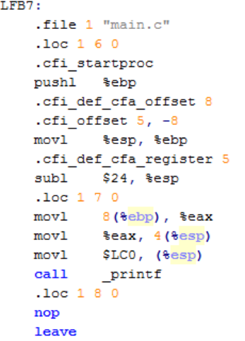


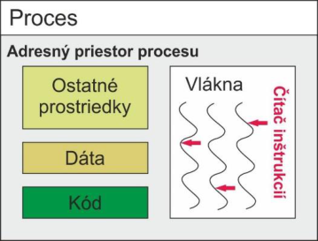


7 

**Procesy** Pamäť 

### **Správa procesov** 

Súbory 

I/O subsystém Bezpečnosť a ochrana 

Operačný systém sa snaží spracúvať všetky procesy rovnakým spôsobom, pričom je zodpovedný za nasledujúce činnosti súvisiace s procesmi: 

- **tvorba a ukončenie** ; 

- **pozastavenie a obnovenie** ; 

   - napr. v dôsledku prerušenia alebo prepnutia kontextu; 

- a poskytuje mechanizmy na: 

- **synchronizáciu procesov;** 

- **komunikáciu procesov** ; 

- **detekciu a obsluhu uviaznutí** . 


8 

### **Správa pamäte** 

CPU môže spracúvať len údaje, ktoré sa nachádzajú v operačnej pamäti. Operačný systém je zodpovedný za: 

- **evidencia voľnej a obsadenej pamäte;** 

- **rozhodovanie, ktorý proces a ktoré údaje budú presunuté do pamäte alebo z nej;** 

- **prideľovanie pamäte aktívnym procesom** ; 

- **uvoľňovanie pamäte.** 


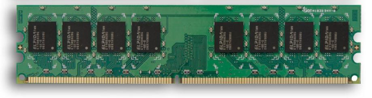


##### SRAM 


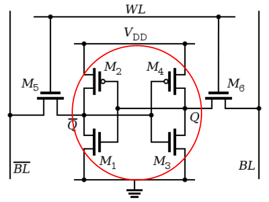


##### DRAM 


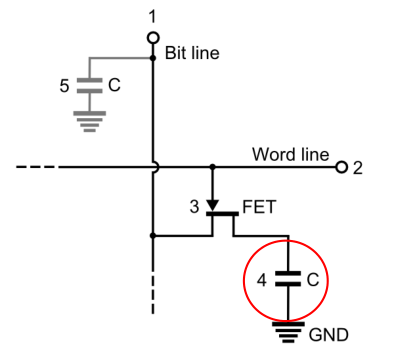


Procesy **Pamäť** Súbory I/O subsystém Bezpečnosť a ochrana 


9 

### **Správa sekundárnych pamätí** 

Procesy **Pamäť** Súbory 

I/O subsystém Bezpečnosť a ochrana 

Operačná pamäť – obmedzená veľkosť, údaje v nej nie sú uchované trvalo  nutnosť sekundárnej pamäte. 

Najčastejším typom sekundárnej pamäte je disk, pričom operačný systém je zodpovedný za: 

   - **správu voľného diskového priestoru;** 

   - **prideľovanie diskového priestoru;** 

- **plánovanie prístupu na disk pri viacerých súčasných požiadavkách na I/O.** 

- Terciárne úložné zariadenia: 


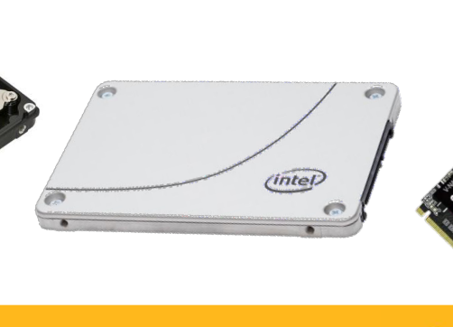


- WORM – zápis raz, čítanie viackrát; 

- prepisovateľné médiá; 

- napr. pásky LTO, optické médiá. 


10 

### **Správa súborového systému** 

- Súbor – pomenovaná množina súvisiacich informácií definovaná tvorcom súboru. 

- Súbor môže obsahovať program alebo údaje. 

- Súbory môžu byť uložené na rôznych fyzických médiách, pričom každé je riadené špecifickým hardvérovým zariadením označovaným ako **radič** . 

- Operačný systém umožňuje abstrakciu od typu fyzického média a hardvérového zariadenia, ktoré ho ovláda. 

- Operačný systém je zodpovedný za: 

   - vytváranie a mazanie súborov; 

   - vytváranie a mazanie adresárov na organizáciu súborov; 

   - prenos súborov medzi operačnou pamäťou a diskom. 

- Operačný systém poskytuje: 

   - primitíva na manipuláciu so súbormi a adresármi. 

Procesy Pamäť **Súbory** I/O subsystém Bezpečnosť a ochrana 


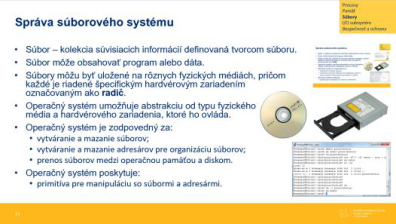


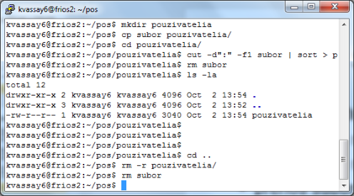


11 

### **Správa I/O subsystému** 

- Operačný systém skrýva pred používateľom špecifiká hardvérových zariadení (tieto sú známe len **ovládaču zariadenia** ). 

- Operačný systém akceptuje požiadavku na I/O a odovzdá ju príslušnému ovládaču. 

- I/O subsystém zahŕňa: 

   - mechanizmus na správu bufferov (medzipamätí) v **radičoch** ; 

   - všeobecné rozhranie pre ovládače zariadení; 

   - ovládače jednotlivých hardvérových zariadení. 

Procesy Pamäť Súbory 

**I/O subsystém** Bezpečnosť a ochrana 


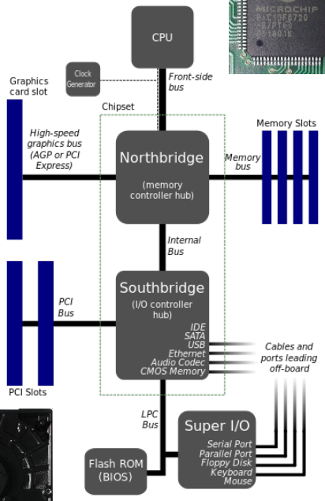


12 

## **Služby operačného systému** 


13 

### **Služby poskytované operačným systémom** 

- Pohľad používateľa: 

   - používateľské rozhranie; 

   - systémové programy; 

   - aplikačné programy. 

- Pohľad programátora: 

   - systémové volania; 

- aplikačné programové rozhranie (API) – funkcie knižníc, ktoré obaľujú systémové volania (napr. POSIX, Windows API). 

- • Štandardizácia: 

   - POSIX (angl. „Portable Operating System Interface“), aktuálne POSIX.1-2024 (IEEE Std 1003.1-2024); komunikačné protokoly a iné. 


14 

**Používateľ** Programátor 

### **Používateľské rozhranie** 

- Dva základné prístupy: 

   - **interpreter príkazového riadku** : 

      - súčasť jadra (napr. MS-DOS) alebo samostatný program spúšťaný pri prihlásení (sh, bash, zsh v systémoch UNIX/Linux; cmd.exe, PowerShell vo Windows), cez ktorý sa pristupuje k jadru  **shell** ; 

      - príkazy obyčajne zahŕňajú: 

         - tvorbu a zrušenie procesu (implicitne); 

         - manipuláciu so súbormi a adresármi; 

         - komunikáciu; 

         - obsluhu I/O subsystému; 

      - interaktívny alebo dávkový režim (skripty); 

   - **grafické používateľské rozhranie** (grafický interpreter). 

###### MS-DOS 


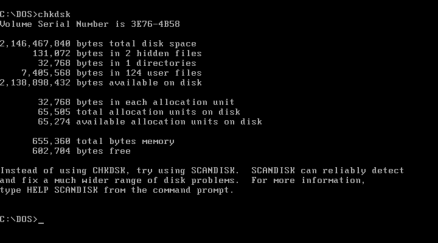


###### macOS Tahoe 


###### Windows 11 


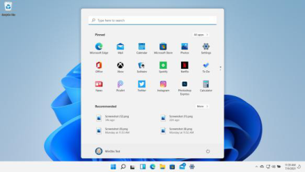


###### Bash 


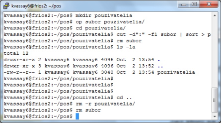


###### GNOME Shell 


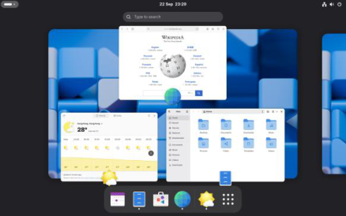


###### KDE Plasma 6 


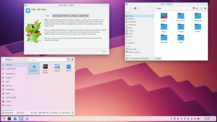


15 

**Používateľ** Programátor 

### **Implementácia interpretera príkazového riadka** 

- Dva základné prístupy: 

   - **interpreter obsahuje kód na vykonanie príkazu (vstavané príkazy):** 

      - interpreter prijme príkaz, spracuje jeho parametre (napr. názov súboru) a vykoná príslušnú časť svojho kódu; 

      - počet takýchto príkazov je obmedzený, pretože zväčšujú interpreter; 

      - napr. v Bashi: echo, read, let, cd; 

   - **interpreter používa príkaz ako volanie systémového programu** : 

      - interpreter „nerozumie“ príkazu, iba odovzdáva parametre; 

      - príkaz je názov súboru, ktorý sa zavedie do pamäte; 

      - tento prístup dovoľuje jednoduché rozšírenie interpretera; 

      - napr. v Bashi: touch, rm, mkdir, rmdir. 

Vyskúšajte: `type echo` a `type rm` – ktorý príkaz je vstavaný a ktorý je samostatný program? 


16 

**Používateľ** Programátor 

### **Systémové a aplikačné programy** 

- **Systémové programy** : 

   - predstavujú praktické prostredie na vývoj a vykonávanie programov; 

   - • môžu to byť používateľské rozhrania k systémovým volaniam alebo komplexné programy; 

   - kategórie: 

      - programy na správu súborového systému; 

      - informatívne programy (čas, využitie operačnej pamäte, disku); 

      - programy na editáciu súborov; 

      - vývojové nástroje (kompilátory, asemblery, debuggery a interpretery); 

      - zavádzacie a spojovacie programy (angl. „ **loader** “, „ **linker** “); 

      - programy na komunikáciu medzi procesmi, používateľmi, počítačovými systémami. 

- **Aplikačné programy:** 

   - riešia úlohy používateľa a využívajú služby operačného systému. 


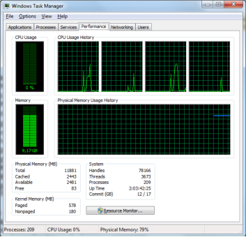


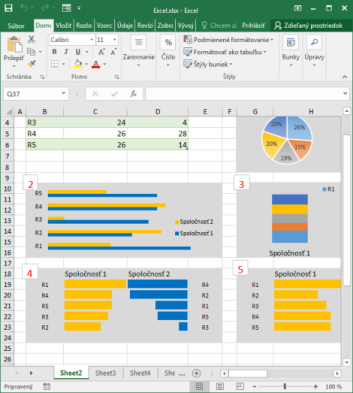


17 

Používateľ **Programátor** 

### **Systémové volania** 

- **Systémové volania** : 

   - slúžia na prístup k službám poskytovaným operačným systémom; 

   - • vykonávajú sa v režime jadra – do jadra sa prechádza špeciálnou inštrukciou (x86-64: syscall, ARM64: svc; historicky softvérovým prerušením int 0x80); 

   - programy ich zvyčajne nevolajú priamo, ale cez obaľovacie funkcie knižnice (napr. glibc v jazykoch C a C++); 

   - ich základná činnosť je vo väčšine operačných systémov rovnaká: 

      1. nastavenie parametrov (číslo volania a argumenty v registroch); 

      2. skok do jadra; 

      3. kontrola návratovej hodnoty po návrate z jadra: 

         - ak nenastala chyba, tak okamžitý návrat; 

         - ak nastala chyba, jadro vráti záporný kód chyby; obaľovacia funkcia ho uloží do premennej errno (lokálnej pre každé vlákno) a vráti hodnotu −1. 

- **Rozhranie systémových volaní** : 

   - funkcie obaľujúce systémové volania (angl. „ **wrappers** “); 

   - napr. POSIX, Windows API. 

###### Historická ukážka: systémové volanie read, x86, glibc 2.1.3 (2000) 


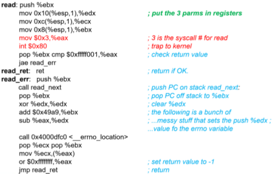


###### Prepínanie medzi režimom používateľa a režimom jadra 


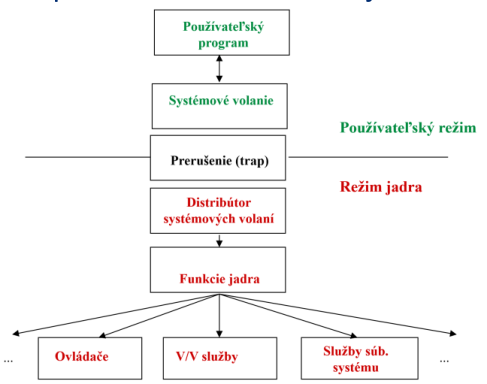


18 

### **Systémové volanie read – Linux x86-64** 

Volanie `read(fd, buf, count)` na úrovni strojového kódu: 

```
mov  rax, 0        ; číslo systémového volania read
mov  rdi, fd       ; 1. argument –deskriptor súboru
mov  rsi, buf      ; 2. argument –adresa buffra
mov  rdx, count    ; 3. argument –počet bajtov
syscall; prechod do režimu jadra
; rax = počet bajtov alebo záporný kód chyby
```

- Poradie registrov pre argumenty: `rdi` , `rsi` , `rdx` , `r10` , `r8` , `r9` . 

- Čísla systémových volaní sú definované v súbore `<asm/unistd_64.h>` . 

- Pôvodne (32-bitový x86): číslo volania v `eax` , argumenty v `ebx` , `ecx` , `edx` , prechod cez `int 0x80` . 

- Obaľovacia funkcia knižnice `read()` sa postará o naplnenie registrov, prechod do jadra aj o nastavenie premennej `errno` . 


19 

Používateľ **Programátor** 

### **Štandardné systémové volania** 

- **Na správu procesov** : 

- load, execute; 

- • create process, terminate process; • end, abort; • get process attributes, set process attributes; • wait (čakanie určený čas); • wait event, signal event; • allocate memory, free memory. 

- • **Na prácu so súbormi** : • create file, delete file; • open, close; • read, write, reposition; • get file attributes, set file attributes. 

- • **Na prácu so zariadeniami** : • podobné na systémové volanie na prácu so súbormi; • veľa systémov sa pozerá na súbory a zariadenia rovnakým spôsobom (UNIX, Linux – „všetko je súbor“); • príklady: • request device, release device; • logically attach, detach device; • read, write, reposition (napr. magnetická páska); • get device attributes, set device attributes. 

###### Príklady systémových volaní 


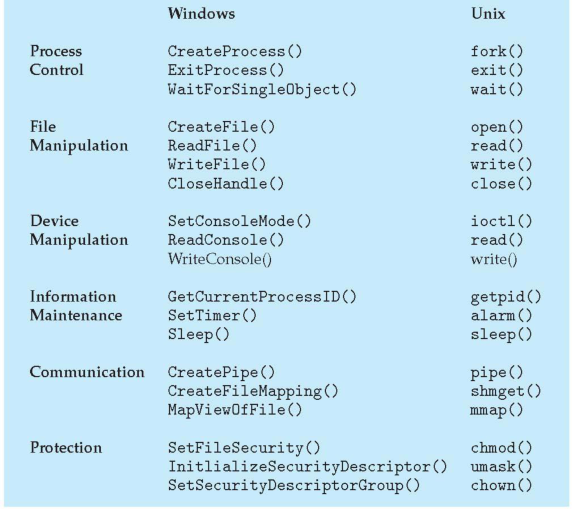


- **Na manipuláciu so systémovými informáciami** : 

   - get/set time, date; 

   - get/set system data (počet procesov, atribúty ako využitie pamäte a CPU určitými procesmi, zmena priority procesu pre plánovanie a pod.); 

   - get/set process, file, device attributes. 

- **Na komunikáciu** : 

   - create/delete communication connection; 

   - send/receive messages; 

   - transfer status information; 

   - attach/detach remote device. 


20 

### **Systémové volania používané na cvičeniach** 

|**Kategória**|**Typické operácie**|**Volania a funkcie (POSIX, Linux)**|
|---|---|---|
|**Správa procesov**|vytvorenie, ukončenie, čakanie, zmena programu,<br>signály|fork, execve, exit, waitpid, kill|
|**Vlákna a synchronizácia**|vytvorenie vlákna, čakanie na zámok|clone, futex (cez knižnicu Pthreads)|
|**Práca so súbormi**|vytvorenie, otvorenie, čítanie, zápis, presun, atribúty|open, read, write, lseek, close, stat|
|**Práca so zariadeniami**|čítanie, zápis, ovládanie zariadenia|read, write, ioctl|
|**Systémové informácie**|čas, identifikátory, informácie o systéme|clock_gettime, getpid, uname|
|**Komunikácia**|rúry, zdieľaná pamäť, sokety|pipe, shm_open, mmap, socket, send, recv|
|**Ochrana**|prístupové práva, vlastníctvo|chmod, chown, umask|


V systémoch UNIX/Linux sa so zariadeniami pracuje podobne ako so súbormi („všetko je súbor“). 


21 

### **Vyskúšajte si: strace** 

- `strace -e trace=openat,read,write,close cat /etc/hostname` – systémové volania jednoduchého programu; 

- `strace -c ls` – štatistika systémových volaní (počet, čas, chyby); 

- `strace -f ./program` – sledovanie aj novovytvorených procesov a vlákien (volania `clone` , `futex` ); 

- `man 2 read` – manuálová stránka systémového volania (sekcia 2); 

- `man 3 printf` – manuálová stránka knižničnej funkcie (sekcia 3). 

###### Ukážka výstupu (skrátená): 

```
openat(AT_FDCWD, "/etc/hostname", O_RDONLY) = 3
```

```
read(3, "pc-fri\n", 131072)                 = 7
write(1, "pc-fri\n", 7)                     = 7
close(3)                                    = 0
```


22 

Štruktúrny pohľad na operačný systém 


23 

### **Operačný systém z pohľadu architektúry** 

|**Architektúra**|**Základná idea**|**Príklady OS**|**Výhody**|**Nevýhody**|
|---|---|---|---|---|
|**Monolitická**|Celé jadro v jednom adresnom<br>priestore|Tradičný UNIX, MS-DOS|Rýchlosť|Chyba v ktorejkoľvek časti<br>jadra môže zrútiť systém|
|**Modulárna**|Monolitické jadro + zavádzateľné<br>moduly|Linux, FreeBSD|Flexibilita pri výkone<br>monolitu|Moduly bežia v režime<br>jadra bez izolácie|
|**Vrstevnatá**|Hierarchické vrstvy|THE OS, MULTICS|Prehľadnosť|Zložitosť návrhu, réžia<br>vrstiev|
|**Mikrojadro**|Minimalistické jadro|Minix 3, QNX, seL4|Stabilita|Pomalšia IPC|
|**Hybridná**|Kombinácia monolitickej a<br>mikrojadra|Windows NT, macOS<br>(XNU)|Flexibilita|Komplexnosť|
|**Exojadro**|Minimum v jadre|MIT Exokernel (výskum)|Výkon|Zložitosť|


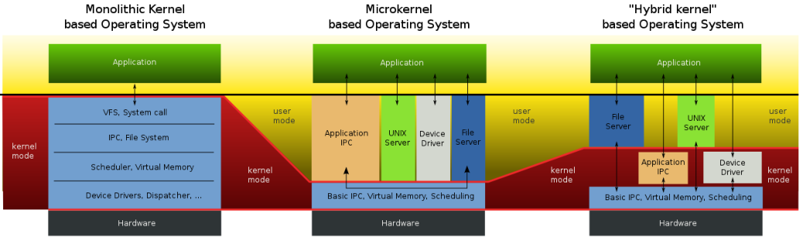


24 

### **Príklady architektúr operačných systémov** 

THE OS (Dijkstra, 1968) 

###### macOS a iOS 


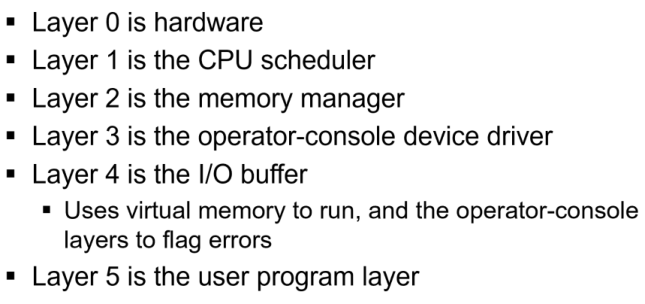


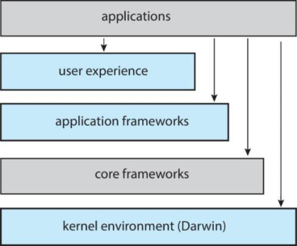


###### Linux 


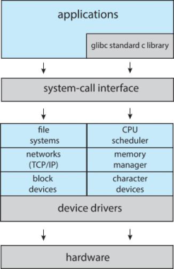


###### MS-DOS 


<!-- Start of picture text -->
UNIX<br><!-- End of picture text -->


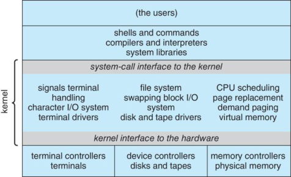


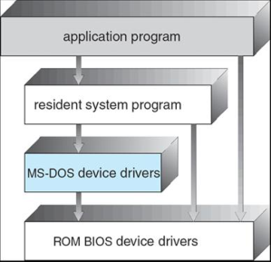


###### Darwin 


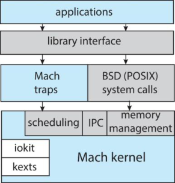


###### Android 


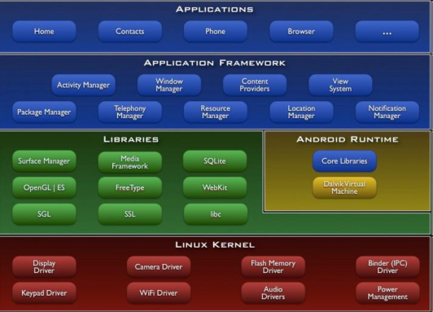


25 

### **Súčasné trendy v jadrách operačných systémov** 

- **Modulárne jadrá** – funkcionalita (napr. ovládače) sa zavádza za behu ako moduly ( `lsmod` , `modprobe` ). 

- **eBPF** – overené programy spúšťané v jadre Linuxu (sledovanie výkonu, siete, bezpečnosť) bez úpravy a reštartu jadra. 

- **Rust v jadre Linuxu** (od verzie 6.1, 2022) – pamäťovo bezpečný jazyk najmä pre ovládače. 

- • **Formálne overené mikrojadro seL4** – matematický dôkaz správnosti implementácie. 

- **Unikernely** – aplikácia a knižničný operačný systém skompilované do jedného obrazu pre virtuálny stroj. 


26 

## **Virtualizácia a kontajnerizácia** 


27 

### **Virtualizácia** 

- **Virtualizácia** – technológia, ktorá umožňuje vytvoriť virtuálne verzie hardvérových alebo softvérových prostriedkov, ako sú počítače, servery, úložiská či siete; vytvára ilúziu, že každé prostredie beží na vlastnom počítači. Predstavuje kľúčovú technológiu vo vývoji cloudových služieb. 

- Prostredie vytvorené virtualizáciou sa označuje ako **virtuálny stroj** (angl. „Virtual Machine“, VM). 

- • Základné typy virtualizácie: 

   - hardvérová; 

   - desktopová (virtualizácia pracovnej plochy); 

   - kontajnerizácia (na úrovni operačného systému). 

- Ďalšie typy virtualizácie: 

   - softvérová; 

   - pamäťová; 

   - úložisková; 

   - údajová; 

   - sieťová. 


28 

### **Fyzický stroj a virtuálny stroj** 


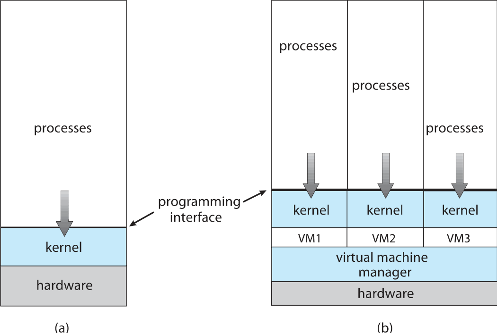


29 

### **Hardvérová virtualizácia** 

- **Hardvérová virtualizácia** – technológia, ktorá umožňuje, aby na **jednom fyzickom počítači** ( **hostiteľovi** ) bežalo viacero **virtuálnych počítačov** ( **hostí** ), pričom každý má **vlastný virtuálny hardvér** (CPU, RAM, disk, sieť). 

- Základná terminológia: 

   - **hostiteľ** (angl. „host“) – fyzický počítač, na ktorom sa realizuje virtualizácia; 

   - • **hypervízor** (angl. „hypervisor“ alebo „virtual machine monitor“) – softvérová vrstva, ktorá vytvára a spravuje virtuálne stroje; 

   - **hosť** (angl. „guest“) – virtuálny počítač, ktorý beží nad hypervízorom; 

   - **virtuálny hardvér** – softvérové napodobeniny CPU, RAM, diskov, sieťových kariet. 

- Typy hardvérovej virtualizácie: 

   - **plná – hosťovský OS nevie, že beží vo virtuálnom stroji; všetko spravuje hypervízor (napr. VirtualBox, KVM);** 

   - **paravirtualizácia** – hosťovský OS je upravený, aby komunikoval priamo s hypervízorom (Xen); 

   - **hybridná – plná virtualizácia doplnená o paravirtualizované ovládače (napr. virtio v KVM/QEMU).** 


30 

### **Typy hypervízorov** 

- **Typ 0 – hypervízor na úrovni hardvéru integrovaný priamo vo firmvéri; zriedkavý typ (napr. logické partície IBM LPAR).** 

- **Typ 1 (natívny)** – beží priamo na hardvéri, napr. VMware ESXi, Xen, Microsoft Hyper-V. 

- **Typ 2 (hostovaný)** – beží ako aplikácia v operačnom systéme, napr. VirtualBox, VMware Workstation. 

- KVM je modul jadra Linuxu, ktorý z jadra robí hypervízor – zvyčajne sa zaraďuje k typu 1. 


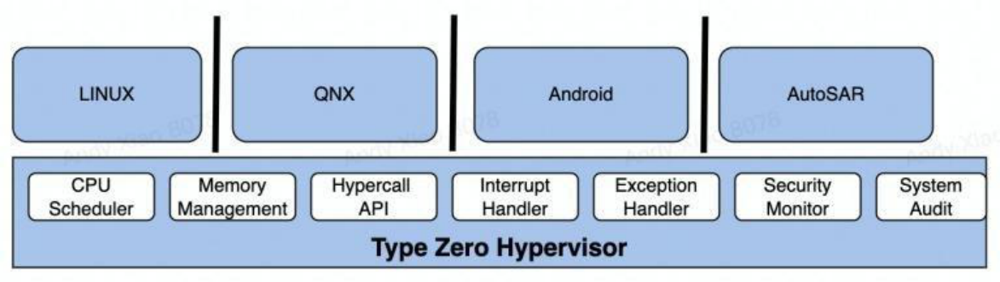


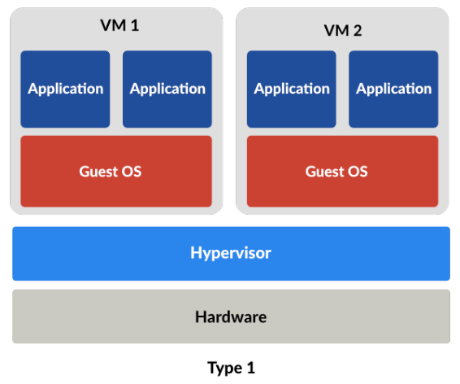


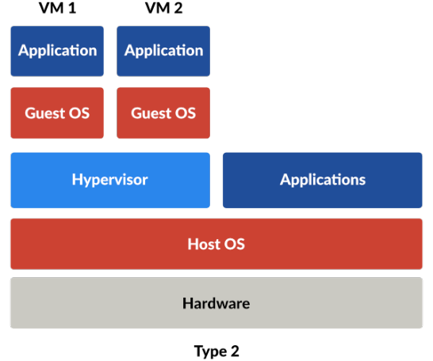


31 

### **Hardvérovo asistovaná virtualizácia – technológie** 

- **Intel VT-x** (Intel Virtualization Technology for x86), **AMD-V** (AMD Virtualization): 

   - **virtualizácia procesora** , ktorá umožňuje spúšťať viaceré OS na jednom CPU; 

   - bez tejto technológie musí hypervízor emulovať inštrukcie procesora softvérovo, v dôsledku čoho výrazne klesá výkon virtuálneho stroja; 

   - procesor má špeciálne inštrukcie, ktoré umožňujú: 

      - prepínať medzi režimom hosťa a režimom hostiteľa, 

      - zachytávať privilegované inštrukcie, 

      - izolovať virtuálne procesory (vCPU) pre jednotlivé virtuálne stroje. 

- **Intel EPT** (Extended Page Tables), **AMD RVI** (AMD Rapid Virtualization Indexing): 

   - **virtualizácia pamäte** , ktorá umožňuje mapovať pamäť medzi virtuálnym strojom a fyzickou RAM; 

   - bez tejto technológie by musel hypervízor ručne spravovať pamäťové mapovania, čo by výrazne spomalilo prístup virtuálneho stroja do pamäte; 

   - znižuje záťaž pri preklade virtuálnych adries na fyzické. 

- **Intel VT-d** (Intel Virtualization Technology for Directed I/O), **AMD-Vi** (AMD I/O Virtualization): 

   - **virtualizácia I/O zariadení** , ktorá dovoľuje hypervízoru priradiť konkrétne zariadenie priamo virtuálnemu stroju, ktorý ho môže používať ako vlastné; 

   - • bez tejto technológie musia ísť všetky I/O požiadavky cez hypervízor, v dôsledku čoho vzniká pri virtualizácii režijná záťaž; 

   - používa sa pri výkonnostne náročných aplikáciách (napr. herné virtuálne stroje, sieťové služby, databázy); 

   - • typické použitie: 

      - PCI passthrough – priradenie GPU, sieťovej karty alebo radiča konkrétnemu virtuálnemu stroju; 

      - SR-IOV (Single Root I/O Virtualization) – zdieľanie jedného zariadenia medzi viaceré virtuálne stroje. 


32 

### **Desktopová virtualizácia (Virtualizácia pracovnej plochy)** 

- **Desktopová virtualizácia** – technológia, ktorá umožňuje, aby pracovná plocha používateľa (OS, aplikácie, nastavenia) **bežala v prostredí virtuálneho stroja** (na serveri alebo v cloude) a používateľ sa k nej mohol pripájať lokálne alebo **na diaľku** . 

- Umožňuje oddeliť logickú pracovnú plochu od fyzického počítača. 

- • Princíp: 

   - na serveri beží virtualizačná platforma (napr. VMware, Microsoft Hyper-V); 

   - každý používateľ má pridelený virtuálny stroj so svojím OS (napr. Windows 11); 

   - • používateľ sa pripája tenkým klientom z ľubovoľného zariadenia (PC, notebook, tablet); 

   - grafické rozhranie (pracovná plocha) sa prenáša cez sieť, údaje a programy ostávajú na serveri. 

- Typy: 

   - lokálna – VirtualBox, VMware Workstation; 

   - vzdialená: 

      - **VDI** (angl. „Virtual Desktop Infrastructure“) – Omnissa Horizon (predtým VMware Horizon), Microsoft Remote Desktop Services; 

      - **DaaS** (angl. „Desktop as a Service“) – Amazon WorkSpaces, Microsoft Azure Virtual Desktop; 

      - vzdialený prístup – Microsoft RDP, AnyDesk. 


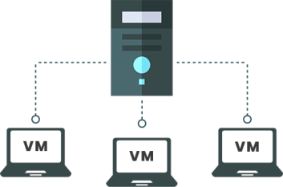


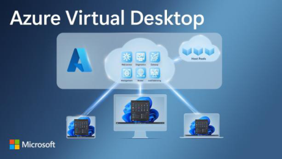


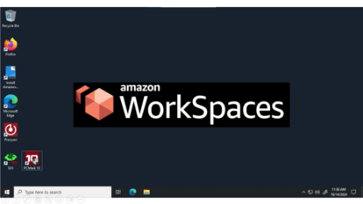


33 

### **Kontajnerizácia** 

- **Kontajnerizácia** – technológia, ktorá umožňuje spúšťať aplikácie v izolovaných prostrediach nazývaných **kontajnery** , ktoré **zdieľajú jadro operačného systému** , ale majú **vlastné knižnice, závislosti a konfigurácie** . 

- Základ pre architektúru mikroslužieb. 

- Princíp: 

   - nevytvára sa celý virtuálny počítač; 

   - všetky kontajnery zdieľajú jadro operačného systému; 

   - každý kontajner beží ako samostatný proces izolovaný od ostatných; 

   - kontajner obsahuje len to, čo daná aplikácia potrebuje (knižnice, závislosti, konfigurácia prostredia); 

   - obraz kontajnera (angl. „image“) vo formáte OCI – šablóna, z ktorej sa spúšťa kontajner. 

- Príklady: 

   - Docker, Podman; 

   - LXC (angl. „Linux Containers“) / LXD, dnes aj komunitná vetva Incus; 

   - orchestrácia kontajnerov na viacerých uzloch – Kubernetes. 


34 

### **Virtuálny stroj vs. kontajner** 

- Kontajner je obyčajný proces (skupina procesov), ktorému jadro obmedzuje: 

   - **čo vidí** – menné priestory (angl. „namespaces“): PID, sieť, prípojné body, názov hostiteľa, IPC, používatelia; 

   - **koľko môže spotrebovať** – kontrolné skupiny (angl. „control groups“, cgroups v2): CPU, pamäť, I/O; 

   - **čo smie robiť** – oprávnenia (angl. „capabilities“) a filtrovanie systémových volaní (seccomp); 

   - **aký súborový systém má** – vrstvený obraz (OverlayFS). 

|**Vlastnosť**|**Virtuálny stroj**|**Kontajner**|
|---|---|---|
|**Virtualizácia**|Hardvér|Operačný systém|
|**Jadro OS**|Každý virtuálny stroj má vlastné|Zdieľané medzi kontajnermi|
|**Rýchlosť spustenia**|Sekundy až minúty|< 1 sekunda|
|**Spotreba zdrojov**|Vyššia (celý OS)|Nízka|
|**Prenositeľnosť**|Náročnejšia|Jednoduchá (obraz OCI)|
|**Izolácia**|Silná (samostatné jadro)|Slabšia (zdieľané jadro, izolácia<br>procesov)|
|**Príklady**|VMware, VirtualBox, Hyper-V, KVM|Docker, Podman, LXC/Incus|


Kubernetes nie je kontajnerová platforma, ale orchestrátor – riadi beh kontajnerov na viacerých uzloch. 


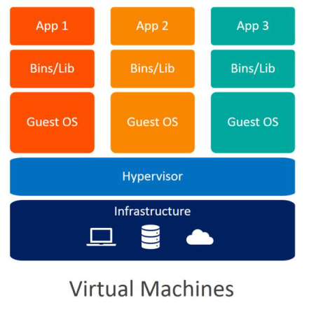


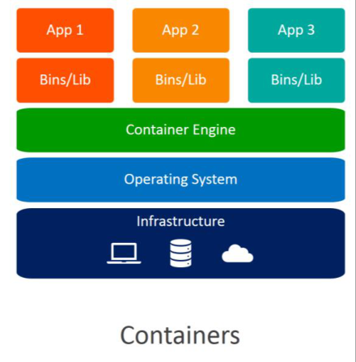


35 

### **Virtualizácia, emulácia, simulácia** 

- **Virtualizácia** – technológia, ktorá umožňuje viacerým operačným systémom bežať na jednom fyzickom počítači: 

   - virtuálny stroj (hosť) používa rovnakú architektúru procesora ako hostiteľ; 

   - hardvér sa neemuluje, len zdieľa a riadi. 

- **Emulácia** – technika, pri ktorej softvér napodobňuje iný hardvér alebo architektúru s cieľom spúšťať programy určené pre úplne odlišný systém. 

- **Simulácia** – proces tvorby a skúmania **modelu reálneho systému** , ktorý umožňuje pozorovať, analyzovať alebo predpovedať správanie reálneho systému bez nutnosti fyzického experimentovania. **V informatike sa pod ňou rozumie proces tvorby a skúmania programového modelu systému alebo zariadenia, ktorý nevykonáva reálne operácie, ale imitáciou výpočtov a spracovania údajov napodobňuje správanie systému alebo zariadenia.** 

|**Pojem**|**Účel**|**Na akej úrovni pracuje**|**Výkon**|**Príklad**|
|---|---|---|---|---|
|**Virtualizácia**|Rozdeliť existujúci fyzický<br>hardvér na viac logických<br>systémov|Reálna architektúra (rovnaký<br>procesor)|Blízko natívnemu výkonu|VMware, KVM, Microsoft<br>Hyper-V|
|**Emulácia**|Napodobniť iný hardvér<br>alebo architektúru|Softvérová napodobenina<br>hardvéru|Pomalšia|QEMU (angl. „Quick<br>Emulator“) – napr. ARM na<br>x86|
|**Simulácia**|Modelovať a skúmať<br>správanie systému (nie jeho<br>inštrukcie)|Logická / matematická<br>úroveň|Závisí od modelu systému|Simulátor kvantového<br>počítača, simulátor DNA<br>počítača|


36 

### **Záverečné informácie** 

Tento študijný materiál je primárne pripravený s využitím knihy: 

- A. Silberschatz, P. B. Galvin, and G. Gagne, _Operating System Concepts_ , 10th ed. Hoboken, NJ, USA: Wiley, 2018 

a k nej dostupných oficiálnych prezentácií, ktoré je možné nájsť na stránke: 

- <u>https://www.os-book.com/</u> 

doc. Ing. Miroslav Kvaššay, PhD. 

Katedra informatiky 

Fakulta riadenia a informatiky Žilinská univerzita v Žiline E-mail: miroslav.kvassay@fri.uniza.sk 


37 

