# Princípy operačných systémov 

Prednáška 3: Procesy a vlákna 

doc. Ing. Miroslav Kvaššay, PhD. 


## Proces 


2 

### **„Job“ a proces** 

- **Program** – pasívna entita uložená na disku v podobe spustiteľného súboru. 

- Dávkové systémy – vykonávajú programy zaradené do dávok. Vykonávaný program sa označuje ako „ **job** “. 

- Systémy so zdieľaným časom – vykonávajú používateľské programy alebo úlohy (angl. „tasks“). Vykonávané úlohy sa označujú pojmom **proces** . 

- **Proces** – bežiaci program (aktívna entita), vrátane všetkých informácií potrebných na jeho opätovné spustenie od inštrukcie, kde bol prerušený (s tými istými prostriedkami a s tou istou prioritou). 


3 

### **Proces** 

- Proces je definovaný programom, ktorý vykonáva, a aktuálnou činnosťou. 

- Program sa stáva procesom, keď je nahraný do pamäte – o to sa stará komponent operačného systému označovaný ako **zavádzač** (angl. „ **loader** “). 

- Program môže byť asociovaný s viacerými procesmi. 

- Prvky procesu: 

   - stav (status), 

   - riadiace informácie, 

   - pridelené prostriedky, 

   - vykonateľný súbor. 


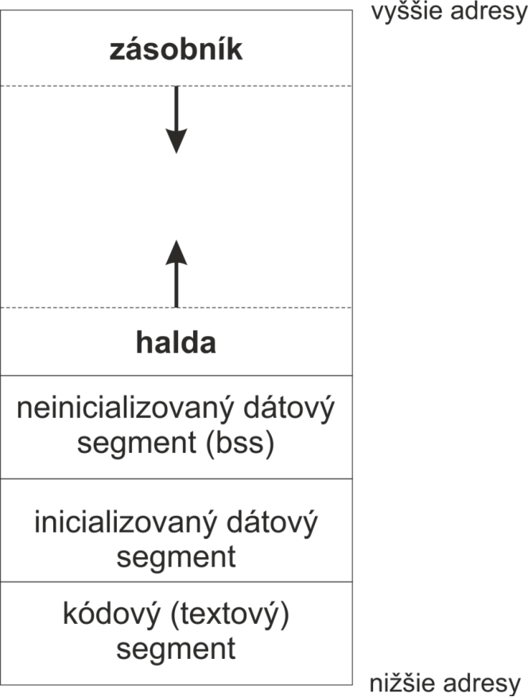


4 

### **Pamäťový priestor procesu** 


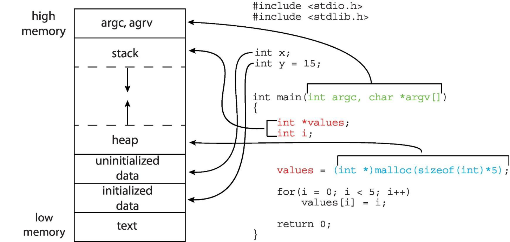


5 

### **Vykonávanie procesu** 

- Vykonávanie procesu je postupnosť: • aktivít na CPU (CPU zhluky), • iných (obyčajne I/O) aktivít (I/O zhluky). 

- • Počas svojho vykonávania proces neustále prechádza medzi týmito dvomi typmi aktivít. 


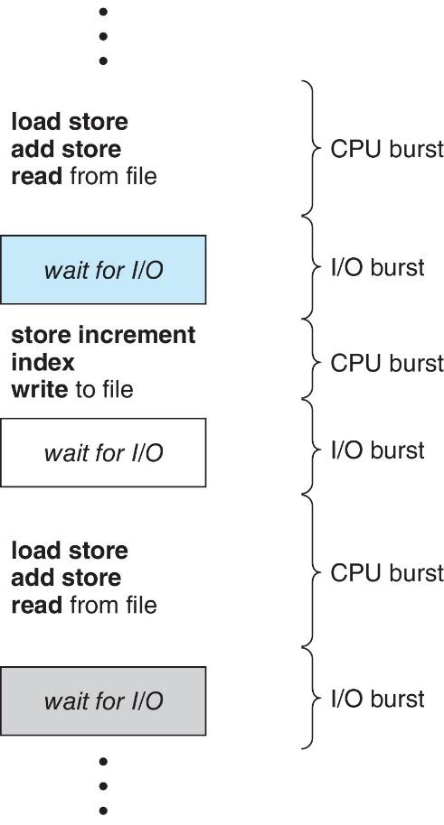


6 

### **Stavy procesu** 

###### dobre vediet 

- **Nový** – proces je práve vytvorený. 

- **Bežiaci** – vykonávajú sa inštrukcie programu. 

- **Čakajúci** – proces čaká na nejakú udalosť, napr. na dokončenie I/O operácie alebo na signál. 

- **Pripravený** – proces čaká na pridelenie procesora. 


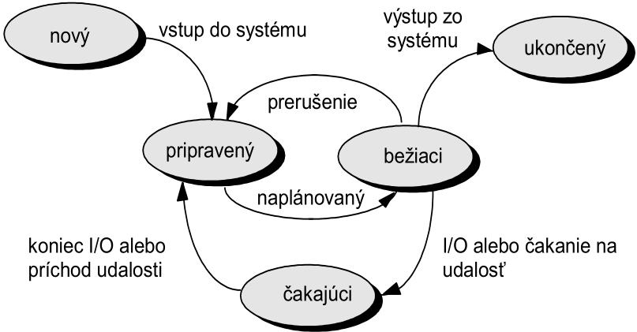


<!-- Start of picture text -->
výstup zo<br>vstup do systému<br>nový  systému<br> ukončený<br>prerušenie<br>pripravený   bežiaci<br>naplánovaný<br>koniec I/O alebo  I/O alebo čakanie na<br>príchod udalosti  udalosť<br>  čakajúci<br><!-- End of picture text -->

- **Ukončený** – proces dokončil svoje vykonanie normálne alebo spôsobil výnimku. 

Otázka: Koľko procesov môže byť v jednotlivých stavoch? 


7 

### **Stavový diagram procesu v Linuxe** 


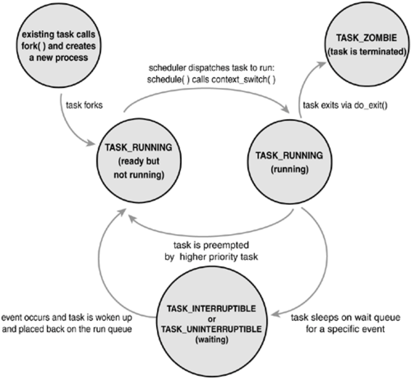


8 

### **Udalosti počas behu procesu** 

- **Interné** – vznikajú v rámci procesu a zapríčinia zmenu stavu procesu: 

   - systémové volanie – skok do jadra, 

   - chyba – zlá inštrukcia, porušenie oprávnenia prístupu do pamäte a pod., 

   - výpadok stránky („page fault“). 

- **Externé** – udalosti, ktoré proces neriadi. Sú to vonkajšie udalosti a obyčajne ich oznamujú prerušenia, ktoré obsluhuje operačný systém: 

   - vstup z terminálu (znak), 

   - ukončenie diskovej operácie, 

   - prerušenie od časovača. 


9 

### **Riadiaci blok procesu** 

- **Riadiaci blok procesu** (angl. „ **Process Control Block** “, PCB) obsahuje informácie o procese, z ktorých najdôležitejšie sú: 

   - **stav procesu** – nový, pripravený, bežiaci, čakajúci atď., 

   - **číslo procesu** – jedinečný identifikátor procesu v rámci systému, 

   - **hodnota počítadla inštrukcií** (PC) – indikuje adresu inštrukcie, ktorá bude vykonaná ako nasledujúca, 

   - **registre CPU** – akumulátory, indexové registre, ukazovatele zásobníkov, univerzálne registre, informácie o podmienených kódoch a iné, 

   - **informácie na plánovanie procesu** – priorita procesu, ukazovatele na fronty pre plánovanie a iné, 

   - **informácie na správu pamäte** – hodnoty limitných a bázových registrov, tabuľka stránok alebo segmentov (podľa použitej techniky správy pamäte), 


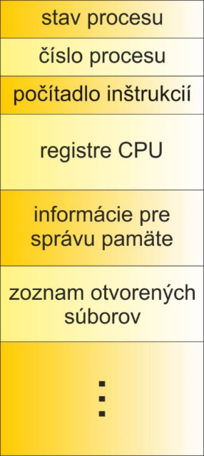


- **I/O informácie** – obsahujú zoznam I/O zariadení, ktoré sú pridelené procesu, zoznam otvorených súborov atď. 

Otázka: Kde v pamäti sa nachádza riadiaci blok procesu? 

v ram 


10 

### **Riadiaci blok procesu v operačnom systéme Linux** 

- Každý proces má <u>`task_struct`</u> (približne 1 KB, na architektúre Intel 960 bajtov), ktorý obsahuje nasledujúce informácie: 

   - všeobecné: 

c syntax i guess 

   - PID, PGRP, meno, rodič, najmladší potomok, mladší/starší súrodenec; 

   - časy procesu (utime, stime, cutime, cstime, start_time); 

   - plánovací algoritmus, priorita, nice value, errno, stav procesu; 

- vlastník (owner): 

   - UID, EUID, SUID, FSUID, GID, EGID, SGID, FSGID; 

- súbory – informácie o všetkých otvorených súboroch; 

- pamäť – informácie o pamäti použitej procesom; 

```
pid t_pid;
long state;
unsigned int time_slice
struct task_struct *parent;
struct list_head children;
struct files_struct *files;
struct mm_struct *mm;
```

`/* process identifier */ /* state of the process */ /* scheduling information */ /* this process` ’ `s parent */ /* this process` ’ `s children */ /* list of open files */` 

```
/* address space of this process */
```

   - prostriedky pre medziprocesnú komunikáciu (angl. „InterProcess Communication“, IPC) a synchronizáciu – ukazovatele na semafory, bitová maska signálov a ich obsluhovačov; 

   - ďalšie informácie. 

- Linux ukladá všetky štruktúry typu `task_struct` do obojstranne zreťazeného zoznamu. 


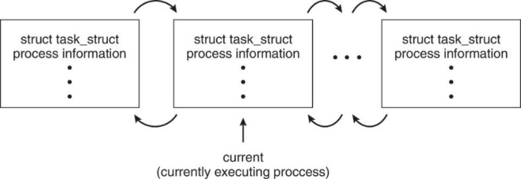


11 

### **Plánovanie procesov** 

- Rozhodovanie o tom, ktorému procesu bude pridelený procesor v **multiprogramových** systémoch alebo v systémoch so **zdieľaným časom** . 


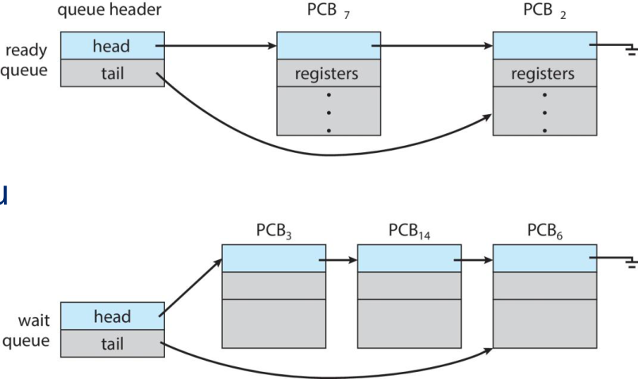


- Snahou je maximalizovať využitie CPU, pričom je nutné zabezpečiť rýchle prepínanie procesov. 

- **Plánovač procesov** (angl. „process scheduler“) vyberá spomedzi dostupných procesov ten, ktorému bude pridelené jadro CPU. 

- Typy frontov pre plánovanie procesov: 

   - **front pripravených procesov** – súbor všetkých procesov uložených v operačnej pamäti, ktoré sú pripravené a čakajú na pridelenie jadra CPU; 

   - **fronty čakajúcich procesov** – množina procesov čakajúcich na I/O udalosť. 


12 

### **Plánovanie procesov** 

#### **Stavový diagram procesu** 

#### **Diagram plánovania procesov** 


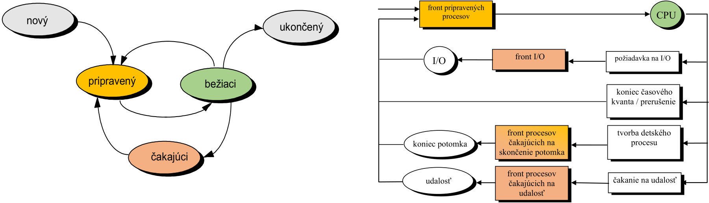


<!-- Start of picture text -->
front pripravených<br>nový  procesov   CPU<br> ukončený<br>I/O   front I/O  požiadavka na I/O<br>pripravený   bežiaci<br> koniec časového<br>kvanta / prerušenie<br>front procesov  tvorba detského<br>koniec potomka čakajúcich na  procesu<br>skončenie potomka<br>  čakajúci<br>front procesov<br>udalosť čakajúcich na  čakanie na udalosť<br>udalosť<br><!-- End of picture text -->


13 

### **Viacúlohovosť v mobilných systémoch** 

- Niektoré mobilné systémy (napr. iOS pred verziou 4) umožňovali spustenie iba jedného procesu, ostatné boli pozastavené. 

- Vzhľadom na veľkosť obrazovky a limitom používateľského rozhrania, ktoré iOS poskytuje: 

   - jediný **proces v popredí** (angl. „ **foreground** process“) – riadený cez používateľské rozhranie (zariadenia s väčším displejom môžu implementovať techniku „split-screen“); 

   - • viaceré **procesy na pozadí** (angl. „ **background** processes“) – sú v pamäti, spustené, ale nie sú na displeji a majú určité obmedzenia. 

- V Androide od jeho uvedenia môžu bežať procesy v popredí aj na pozadí s menšími obmedzeniami: • proces bežiaci na pozadí využíva **služby** (angl. „services“) na vykonávanie úloh; 

   - služba môže bežať, aj keď je proces na pozadí pozastavený; 

   - služba nemá používateľské rozhranie, má malé využitie pamäte. 


14 

### **Procesy a služby operačného systému z pohľadu programátora** 

Operačný systém poskytuje mechanizmy na: 

- **vytváranie procesov** , 

- **ukončovanie procesov** , 

- **komunikáciu medzi procesmi** (ďalšia prednáška). 

Týmito mechanizmami sú systémové volania, ktoré obsluhuje operačný systém. 


15 

### **Vytvorenie procesu** 

- **Rodičovský** proces vytvára **detské** procesy (UNIX – `fork` , Windows – `CreateProcess` ), ktoré môžu vytvárať ďalšie detské procesy ⇒ **strom procesov** . 

- Vytvorený detský proces sa pridá do frontu pripravených procesov. 

- Väčšina operačných systémov (UNIX, Windows) identifikuje procesy pomocou ID procesu (angl. „process identifier“, **PID** ). 

- Zdieľanie zdrojov: 

   - rodičovský a detský proces môžu zdieľať všetky zdroje; 

   - detský proces zdieľa podmnožinu zdrojov rodičovského procesu; 

   - rodičovský a detský proces nezdieľajú žiadne zdroje. 

- Vykonávanie procesov: 

   - rodičovský proces pokračuje vo svojej činnosti súbežne s detským procesom; 

   - • rodičovský proces čaká na skončenie detského procesu. 

- Keď detský proces skončí, jeho PID a výstup môžu byť vrátené rodičovi – ako návratová hodnota systémového volania (UNIX – `wait` ). 


16 

### **Strom procesov** 

#### **Windows** 

#### **Linux** 


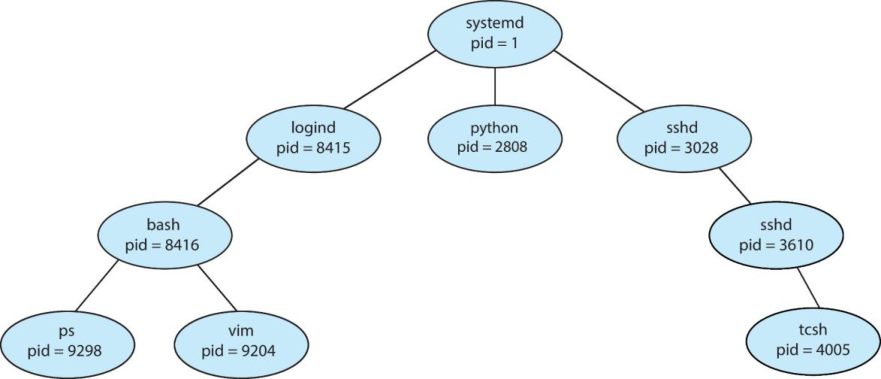


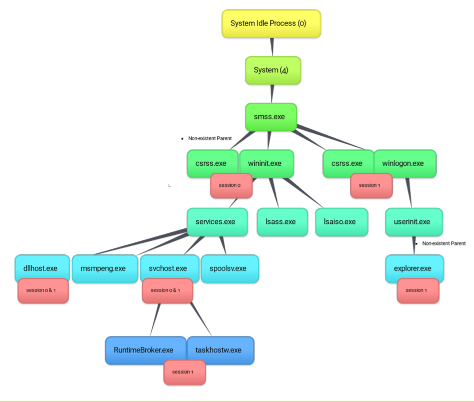


17 

### **Vytvorenie procesu – adresný priestor** 

- Detský proces môže (UNIX), ale nemusí (Windows) zdediť obsah pamäte rodiča. 

- Operačný systém UNIX: 

   - systémové volanie `fork` vytvorí nový proces; 

   - systémové volanie `exec` nahradí obsah pamäťového priestoru novým programom; 

   - rodičovský proces čaká na skončenie detského procesu prostredníctvom systémového volania `wait` . 


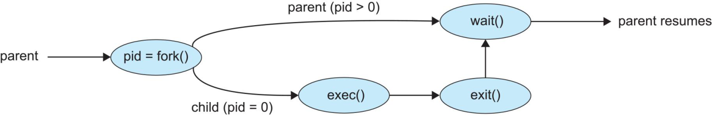


18 

### **Ukážka vytvorenia procesu** 

#### **Windows** 

#### **Linux** 


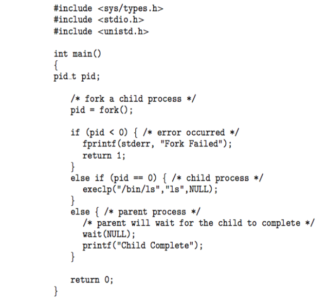


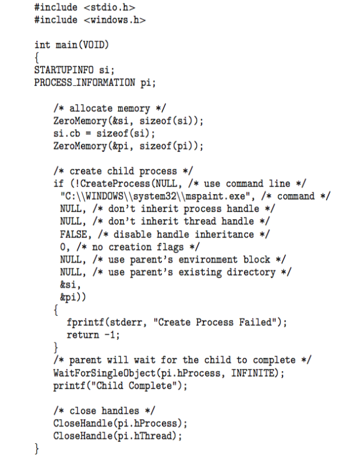


19 

### **Ukončenie procesu** 

- Keď proces vykoná posledný príkaz, požiada operačný systém o svoje ukončenie, t. j. odstránenie zo systému, prostredníctvom systémového volania `exit` . V rámci tejto fázy: 

   - stavové informácie z končiaceho procesu sú odovzdané rodičovskému procesu; 

   - zdroje pridelené končiacemu procesu sú dealokované operačným systémom. 

- Rodičovský proces môže ukončiť detský proces s využitím systémového volania `kill` . Možné dôvody: 

   - proces vyžaduje prostriedky nad rámec alokovaných zdrojov; 

   - úloha, ktorú rieši detský proces, prestala byť aktuálna; 

   - rodičovský proces končí a operačný systém nedovoľuje pokračovať detským procesom skončeného procesu. 


20 

### **Ukončenie procesu** 

- Niektoré operačné systémy neumožňujú existenciu detského procesu, ak skončil rodičovský proces. Ak sa proces skončí, musia byť ukončené aj všetky jeho detské procesy ⇒ kaskádové ukončenie. 

   - Ukončenie detských procesov iniciuje operačný systém. 

- Rodičovský proces môže čakať na skončenie detského procesu prostredníctvom systémového volania `wait` . Systémové volanie vracia stavové informácie a PID skončeného procesu: 

```
pid= wait(&status);
```

- Ak na proces nečaká žiaden rodičovský proces (zatiaľ nebolo použité systémové volanie `wait` ), proces sa označuje ako **zombie** . 

- Ak rodičovský proces skončí bez zavolania `wait` , detský proces sa označuje ako **sirota** (angl. „orphan“). 


21 

### **Systémové volania na správu procesov v Linuxe** 

|**Činnosť**|**Systémové volanie**|
|---|---|
|Vytvorenie nového procesu|`pid_t fork (void)`|
|Nahradenie procesu iným kódom|`int execv(const char *path, char *const`<br>`argv[])`|
|Normálne ukončenie procesu|`void exit(int status)`|
|Násilné ukončenie procesu|`int kill(pid_t pid, int sig)`|
|Abnormálne ukončenie procesu|`void abort(void)`|
|Čakanie na ukončenie detského procesu|`pid_t wait(int *status)`|


- Systémové volanie `abort` ukončí proces bez zavolania funkcie, ktorá bola zaregistrovaná pomocou `atexit()` , a bez zrušenia použitých objektov. 

- Systémové volanie `exit` robí vyššie uvedené činnosti, avšak nevyvoláva deštruktory objektov s pamäťovou triedou `auto` . 


22 

### **Hierarchia procesov v Androide** 

- Mobilné operačné systémy musia často ukončiť procesy, aby získali systémové zdroje, akým je operačná pamäť. 

- Procesy sa klasifikujú od najdôležitejšieho po najmenej dôležitý: 

   - **proces v popredí** – aktuálne vykonávaný proces, ktorý je viditeľný na obrazovke a s ktorým používateľ interaguje; 

   - **viditeľný proces** – proces vykonávajúci činnosť, ktorej stav sa zobrazuje v popredí; 

   - **služba** – proces, ktorý je podobný procesu na pozadí, ale vykonáva činnosť, ktorú si používateľ uvedomuje (napr. prehrávanie hudby); 

   - **proces na pozadí** – proces vykonávajúci činnosť, ktorú používateľ štandardne neeviduje; 

   - **prázdny proces** – proces, ktorý nemá priradené žiadne aktívne komponenty. 


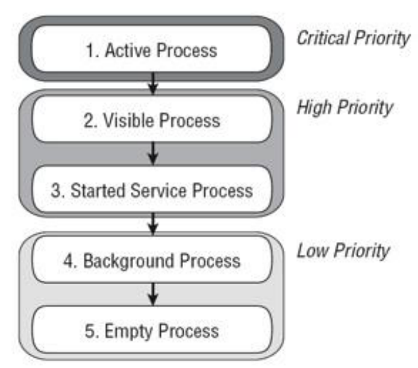


- V prípade potreby začne Android ukončovať procesy, ktoré sú najmenej dôležité. 


23 

### **Viacprocesová architektúra aplikácií** 

- Mnoho webových prehliadačov pôvodne bežalo ako jeden proces. 

   - Ak niektorá z navštívených webových lokalít spôsobuje problémy, celý prehliadač môže prestať reagovať alebo zlyhať. 

- Moderné prehliadače sú riešené ako viacprocesové aplikácie. 

   - Google Chrome – 3 typy procesov: 

      - proces prehliadača (angl. „browser“) – spravuje používateľské rozhranie, disk a sieťové I/O; 

      - proces vykresľovania (angl. „renderer“) – vykresľuje webové stránky (spracovanie HTML, JavaScriptu a pod.). Pre každú webovú lokalitu sa vytvára samostatný proces tohto typu. 

         - Procesy tohto typu bežia v prostredí „sandbox“, ktoré obmedzuje diskové a sieťové I/O, čím sa minimalizujú bezpečnostné hrozby; 

      - proces zásuvného modulu (angl. „plug-in“) – pre každý zásuvný modul sa vytvára samostatný proces. 


24 

## Vlákna 


25 

### **Vlákna – motivácia** 

- Väčšina moderných aplikácií je viacvláknová. 

- Vlákna bežia v rámci aplikácie. 

- Viaceré úlohy, za ktoré je aplikácia zodpovedná, môžu byť implementované samostatnými vláknami, napr.: 

   - aktualizácia zobrazenia; 

   - načítanie údajov; 

   - kontrola pravopisu; 

   - spracovanie sieťových požiadaviek. 

- Z pohľadu réžie je vytváranie vlákien jednoduchšie a rýchlejšie ako vytváranie procesov. 

- Vlákna môžu zjednodušiť kód a zvýšiť efektívnosť využívania zdrojov počítača. 

- • Jadrá operačných systémov sú vo všeobecnosti viacvláknové. 


26 


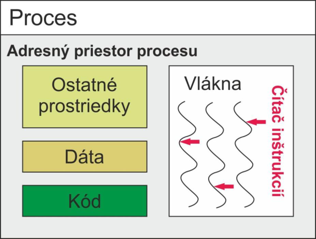


### **Vlákno** 

- **Vlákno** (angl. „ **thread** “) je časť procesu, ktorá vykonáva činnosť definovanú pri svojom vzniku. 

- Každý proces má aspoň jedno vlákno. 

- Vlákno je podobné procesu. 

- Vlákno má: 

   - stavy: 

      - pripravené, bežiace, čakajúce, ukončené, 

   - ID, počítadlo inštrukcií, registre, zásobník, 

   - svoj riadiaci blok. 


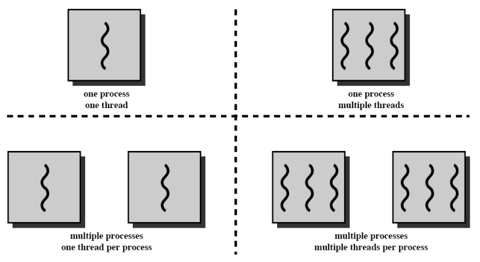


- Vlákna sú jednoduchšie a efektívnejšie: 

   - zdieľajú pamäť a súbory, **nie zásobníky** , 

   - rýchlejšie sa vytvárajú, 

   - prepínanie medzi vláknami je rýchlejšie. 

- Proces vlastní pamäť a súbory. 

- Systém, ktorý umožňuje procesom vytvárať vlákna, sa označuje ako systém s podporou **viacvláknovosti** (angl. „ **multithreading** “). 


27 

### **Pamäťový priestor procesu** 

#### **Jednovláknový proces** 

#### **Viacvláknový proces** 


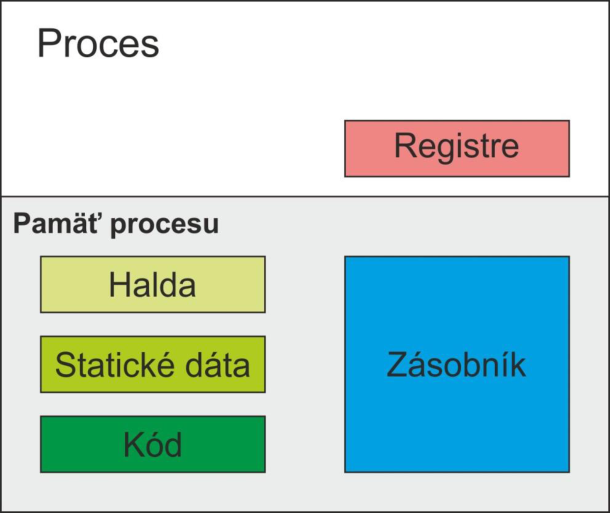


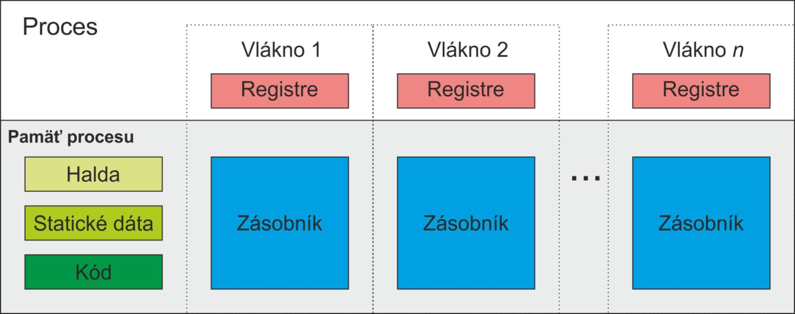


28 

### **Výhody viacvláknového programovania** 

- **Interaktivita** : 

   - viacvláknová aplikácia môže bežať, aj keď niektorá časť programu je zablokovaná alebo vykonáva časovo náročnú operáciu – **súbežné** (angl. „ **concurrent** “) vykonávanie. 

- **Zdieľanie zdrojov** : 

   - vlákna viacvláknovej aplikácie zdieľajú adresný priestor. 

- **Ekonomickosť** : 

   - vytváranie vlákien a prepínanie medzi nimi je časovo menej náročné než medzi procesmi. 

- **Škálovateľnosť** : 

   - viacvláknové aplikácie dokážu využiť výhody viacjadrových procesorov alebo viacprocesorových systémov – **paralelné** (angl. „ **parallel** “) vykonávanie. 


29 

### **Škálovateľnosť** 

#### **Viacjadrový procesor (súbežné a paralelné vykonávanie)** 

**Jednojadrový procesor (súbežné vykonávanie)** 


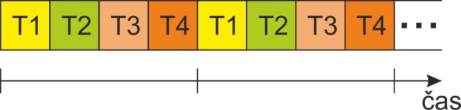


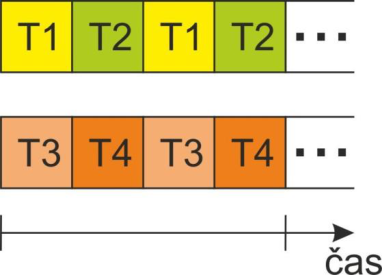


- Hlavné výzvy pri programovaní aplikácií pre viacjadrové/viacprocesorové systémy: 

   - detekcia úloh, ktoré môžu bežať paralelne, 

   - vyváženie činností paralelne bežiacich úloh, 

   - rozdelenie dát medzi jednotlivé úlohy, 

   - testovanie a ladenie. 


30 

### **Proces a vlákna v Linuxe** 

**Proces** 


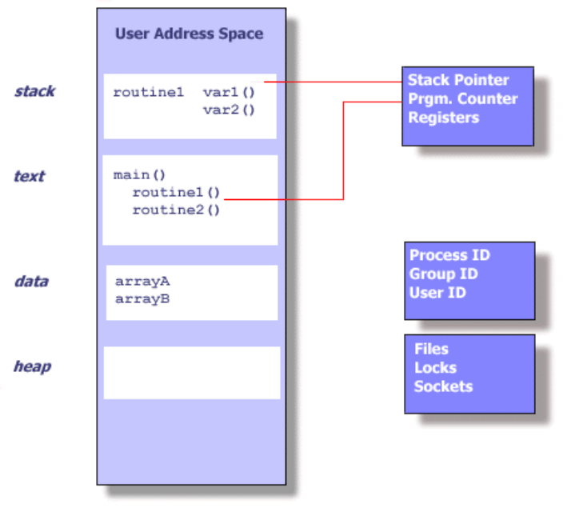


#### **Vlákna v rámci procesu** 


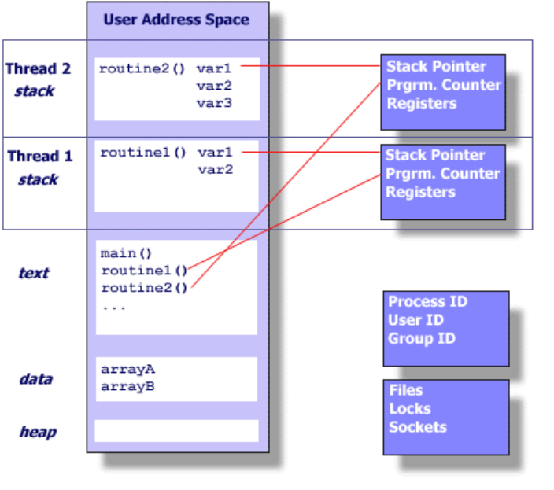


31 

### **Typy vlákien v závislosti od implementácie (1)** 

- **Na úrovni používateľa** : 

   - operačný systém o nich nevie, 

   - implementované pomocou knižníc, 

   - plánovanie v rámci úlohy. 

- **Vlákna na úrovni jadra** : • operačný systém ich pozná – jednotka pre plánovanie, 

   - operačný systém plánuje ich vykonanie. 

- **Kombinácia predchádzajúcich 2 typov** . 


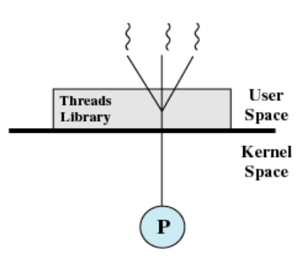


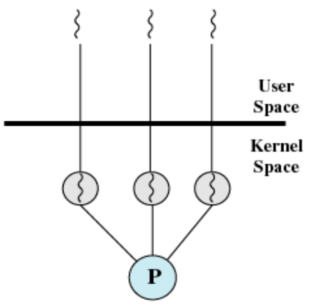


32 

### **Typy vlákien v závislosti od implementácie (2)** 

### **Na úrovni používateľa** 

### **Na úrovni jadra** 

- Riadiace operácie (tvorba, rušenie vlákien, plánovanie, prepínanie kontextu) sú **rýchlejšie** . 

- Využitie možností viacjadrových systémov je problematické. 

- Problémom sú aj **blokujúce systémové volania** . 

- Plánovanie viacvláknového procesu môže byť problematické. 

- Riadiace operácie sú **pomalšie** (nutnosť prepínať medzi používateľským režimom a režimom jadra). 

- Dokážu využiť možnosti **viacjadrových procesorov** . 

- Blokujúce systémové volania nepredstavujú problém. 

- **Operačný systém plánuje** vykonávanie jednotlivých vlákien. 


33 

### **Modely vykonávania vlákien** 

- Charakterizujú spôsob, akým sa vlákna na úrovni používateľa mapujú na vlákna na úrovni jadra: 

   - M:1, 

   - 1:1, 

   - M:N, 

   - 1:N. 


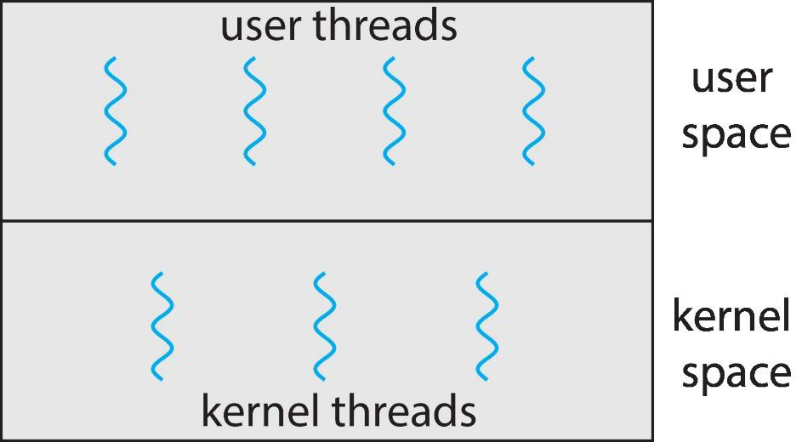


34 

### **Model M:1** 

- Používa sa v systémoch, ktoré nepodporujú vlákna na úrovni jadra. 

- Manažment vlákien riadi knižnica bežiaca v používateľskom priestore. 

- Málo efektívny – vlákna nemôžu bežať paralelne na viacjadrovom počítači. 

- Blokujúce systémové volanie zapríčiní zablokovanie celého procesu. 

- V súčasnosti málo používaný. 

- Príklady: 

   - Solaris green threads (Java 1.1), 

   - GNU portable threads. 


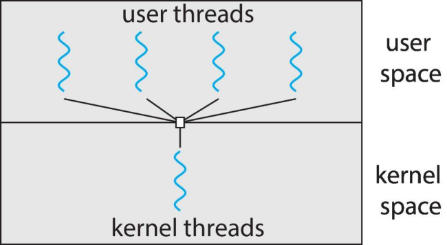


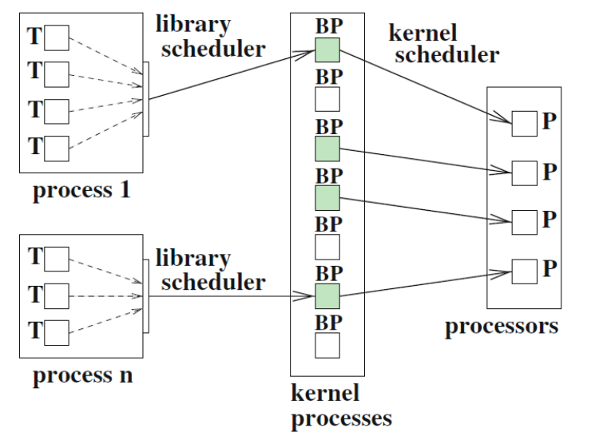


35 

### **Model 1:1** 

- Blokujúce systémové volanie nezablokuje celý proces – lepšia súbežnosť. 

- Umožňuje paralelné vykonávanie. 

- Na tvorbu a rušenie vlákien sa musia používať systémové volania. 

- Počet vlákien na proces môže byť obmedzený. 

- Príklady: 


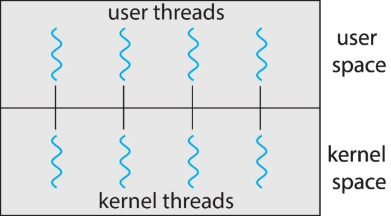


- Windows, 

- Linux, 

- Solaris vo verzii 9 a vyššej. 


36 

### **Model M:N** 

- Umožňuje vyriešiť problém s obmedzením počtu vlákien na proces. 

- Nie je veľmi bežný. 

- Príklady: 

   - Windows s balíkom ThreadFiber. 


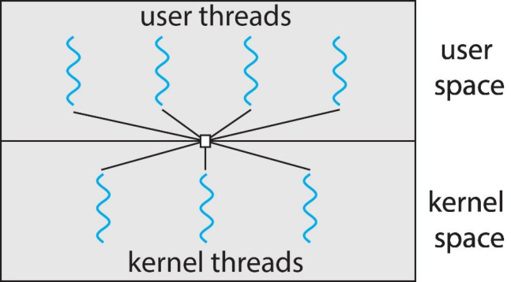


37 

### **Ďalšie modely vykonávania vlákien** 

### **Dvojúrovňový model** 

- Kombinácia M:N a 1:1. 

- Príklady: 

   - Solaris do verzie 9. 


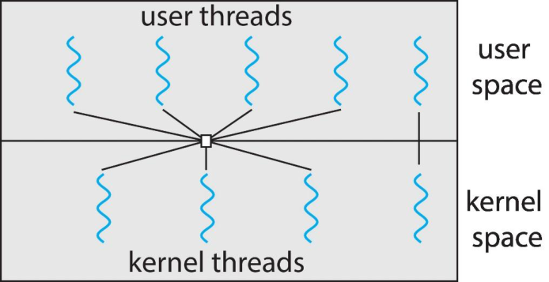


### **Model 1:N** 

- Používa sa v niektorých distribuovaných systémoch. 

- Vlákna môžu migrovať medzi jednotlivými strojmi a adresnými priestormi. 


38 

### **Modelové situácie použitia vlákien (1)** 

- **Model „pán – otrok“** – „pán“ vytvára vlákno pre každú novú požiadavku. 


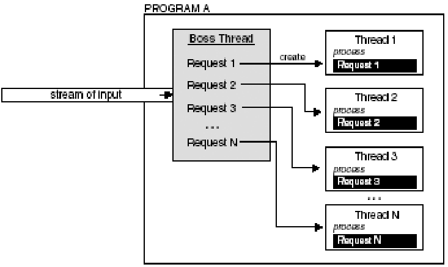


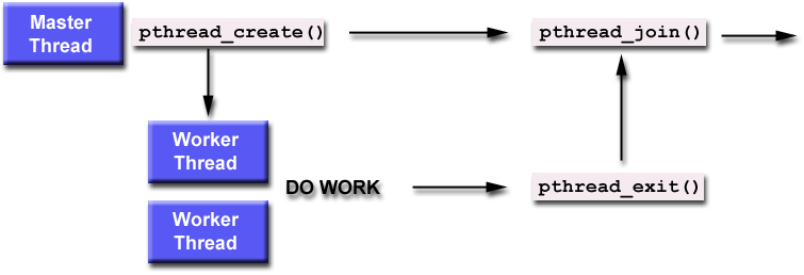


▪ Otázka: Kde sa dá využiť tento model? 


39 

### **Modelové situácie použitia vlákien (2)** 

• **Model „člen skupiny“** – vytvorí sa skupina vlákien, z ktorých každé je zodpovedné za obsluhu špecifickej požiadavky. 


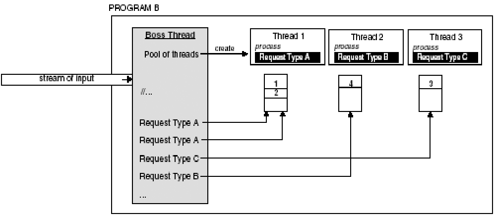


▪ Otázka: Kde sa dá využiť tento model? 


40 

### **Modelové situácie použitia vlákien (3)** 

• **Postupný model** – úloha je rozdelená do niekoľkých fáz, pričom každá fáza má samostatné vlákno. 


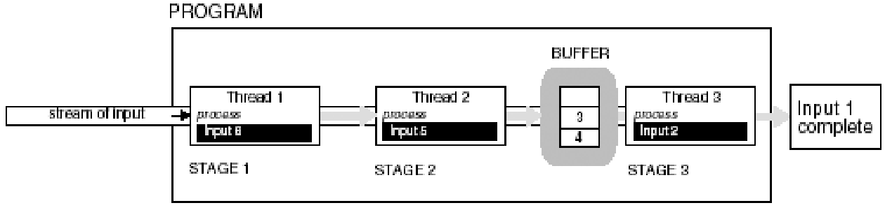


▪ Otázka: Kde sa dá využiť tento model? 


41 

### **Postupný model – ETL procesy** 

### • Napr. Pentaho Kettle 


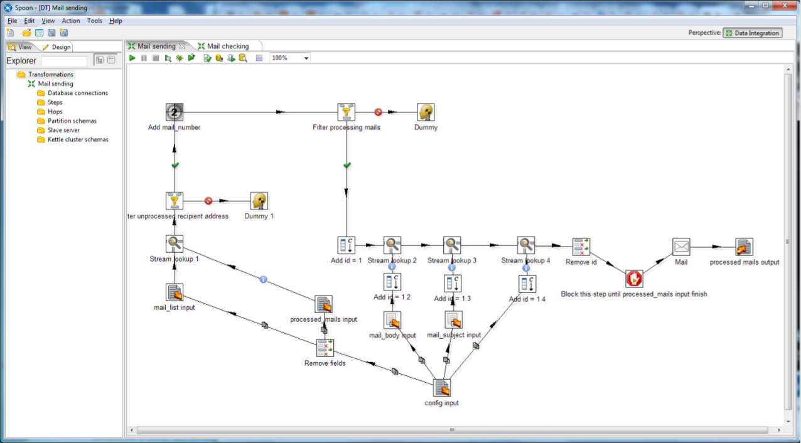


42 

### **Špecifické problémy viacvláknových programov** 

- Čo sa stane, ak vlákno vytvorí nový proces prostredníctvom systémového volania fork? 

- • Kto obslúži synchrónne/asynchrónne **signály** ? 

- Akým spôsobom zrušiť vlákno? Typické možnosti: 

   - **asynchrónne** (angl. „asynchronous“) zrušenie, 

   - **oneskorené** (angl. „deferred“) zrušenie. 

- Ako sa vyhnúť častému vytváraniu a rušeniu vlákien? Možné riešenie: • **súbor vlákien** (angl. „ **thread pool** “). 

- Ako zabezpečiť komunikáciu medzi vláknami na úrovni používateľa a vláknami na úrovni jadra? • „ **scheduler activations** “ 

- Ako zabezpečiť uchovávanie údajov medzi viacerými volaniami jednej funkcie v rámci jedného vlákna? 

   - „ **thread-local storage** “ 


43 

### **Vlákna – systémové volania** **`fork` a** **`exec`** 

- Zduplikuje systémové volanie `fork` iba volajúce vlákno alebo celý proces? 

   - Niektoré systémy typu UNIX majú dve verzie tohto systémového volania. 

|**Systém**|**Staršie volanie**|**Novšie / alternatívne**|**Rozdiel**|
|---|---|---|---|
|**Solaris, Illumos**|`fork`(kopíruje všetky<br>vlákna)|`fork1`(kopíruje len jedno)|Výkon, správanie vo<br>viacvláknovom procese|
|**AIX**|`fork`|`forkx`(voliteľné<br>správanie)|Parameter určuje počet<br>kopírovaných vlákien|
|**Linux, macOS, FreeBSD**|Iba`fork`|—|Vždy kopíruje iba volajúce<br>vlákno|


- Systémové volanie `exec` pracuje obyčajne tak, ako sa očakáva – nahradí vykonávaný proces vrátane všetkých jeho vlákien. 

- • POSIX: 

   - vo viacvláknovom procese je bezpečné po `fork` okamžite zavolať iba: 

      - funkciu typu „async-signal-safe“; 

      - alebo systémové volanie `exec` ; 

   - iné operácie (napr. `malloc` , `printf` , `pthread_mutex_lock` a iné) môžu viesť k uviaznutiu alebo nekonzistencii. 


44 

### **Obsluha signálov** 

- Prostredníctvom signálov sú procesy informované o výskyte špecifických udalostí v systéme. 

- • Spracovanie signálu: 

   1. vygenerovanie signálu špecifickou udalosťou; 

   2. doručenie signálu procesu; 

   3. obslúženie signálu obsluhovačom signálu. 

- **Obsluhovač signálu** (angl. „signal handler“): 

   - **preddefinovaný** – spúšťa ho jadro, ak proces obdrží príslušný signál; 

   - **používateľom definovaný** – môže prekryť preddefinovaný obsluhovač: 

      - `void (*` **`signal`** `(int sig, void (*handler) (int))) (int)` 

- Kam má byť signál doručený v prípade viacvláknového procesu? Možnosti: 

   - každému vláknu; 

   - konkrétnemu vláknu, na ktoré sa má signál aplikovať; 

   - špecifickým vláknam; 

   - konkrétnemu vláknu, ktoré bude obsluhovať všetky signály. 


45 

### **Zrušenie vlákna (1)** 

- Predčasné ukončenie vlákna, t. j. ukončenie vlákna pred dokončením priradenej úlohy. 

- • Rušené vlákno sa označuje ako cieľové vlákno. 

- Dva všeobecné prístupy: 

   - **asynchrónne** (angl. „asynchronous“) – ukončí cieľové vlákno okamžite; 

   - • **oneskorené** (angl. „deferred“) – umožňuje cieľovému vláknu periodicky zisťovať, či má byť zrušené. 

- Príklad – Pthreads: 


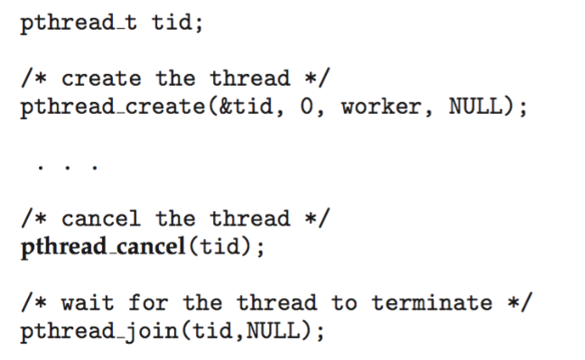


46 

### **Zrušenie vlákna (2)** 

- Úspešnosť zrušenia cieľového vlákna závisí od stavu vlákna. 

- Ak cieľové vlákno nemá povolenú možnosť zrušenia, zrušenie zostáva neobslúžené, kým ju vlákno nepovolí. 

- Preddefinovaný typ – oneskorené zrušenie: 

   - zrušenie sa vyskytne len vtedy, ak vlákno dosiahne bod zrušenia: 

      - Pthreads: 

         - **`pthread_testcancel`** 

      - po zrušení vlákna sa spustí obsluhovač uvoľňujúci systémové prostriedky pridelené vláknu. 

- Na Linuxe sa zrušenie vlákna obsluhuje prostredníctvom signálov. 


47 

### **Zrušenie vlákna v jazyku Java** 

• Oneskorené zrušenie používa metódu `interrupt` , ktorá nastaví stav vlákna tak, aby ho bolo možné zrušiť. 


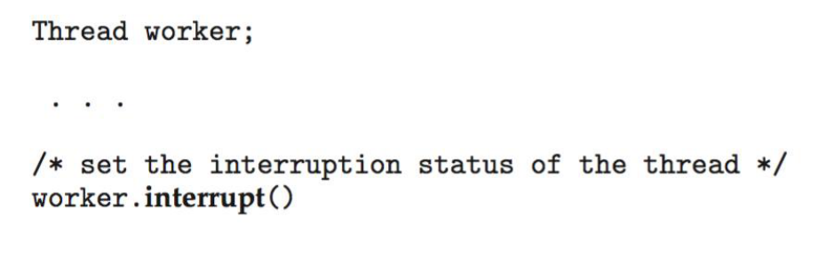


- Cieľové vlákno môže kontrolovať, či prišla žiadosť o jeho zrušenie: 


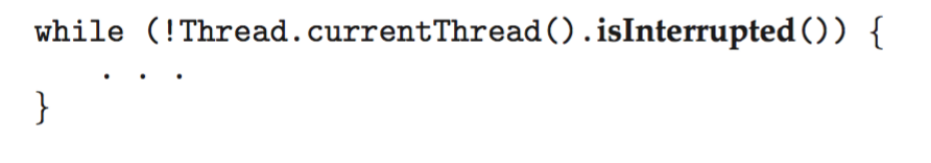


48 

### **Komunikácia medzi vláknami na úrovni používateľa a jadra** 

- Model M:N a dvojúrovňový model vyžadujú komunikáciu, aby sa zachoval príslušný počet vlákien na úrovni jadra pridelených aplikácii. 

- Typicky sa používa údajová štruktúra umiestnená medzi vláknami používateľa a vláknami jadra. Označuje sa ako odľahčený proces (angl. „ **LightWeight Process** “, LWP): 

   - ide o „virtuálny procesor“, na ktorom môže proces naplánovať spustenie používateľského vlákna; 

   - každý LWP je pripojený k vláknu jadra; 

   - operačný systém musí určiť, koľko LWP je potrebných vytvoriť. 

- Na komunikáciu medzi vláknami na úrovni používateľa a jadra sa používa mechanizmus označovaný angl. ako „ **scheduler activations** “, ktorý poskytuje tzv. „ **upcalls** “. 


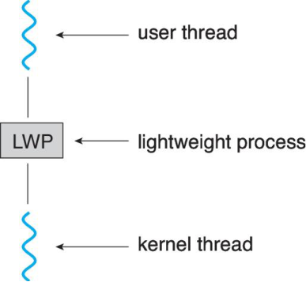


- „Upcalls“ – komunikačný mechanizmus z jadra do „upcall“ obsluhovača, ktorý sa nachádza v knižnici na prácu s vláknami na úrovni používateľa. 

- Takáto komunikácia umožňuje aplikácii udržiavať požadovaný počet vlákien na úrovni jadra. 


49 

### **Thread-Local Storage** 

- Mechanizmus, ktorý umožňuje každému vláknu mať vlastnú kópiu špecifických údajov. 

- Užitočné, ak programátor nemá kontrolu nad procesom vytvárania vlákien (napr. pri použití súboru vlákien). 

- Prostredníctvom tohto mechanizmu sa nevytvárajú lokálne premenné, ale premenné, ktoré si zachovávajú svoj obsah medzi viacerými volaniami tej istej funkcie. 


- Mechanizmus umožňuje vytvárať statické premenné pre jednotlivé vlákna. 


50 

### **Knižnice na prácu s vláknami** 

- Knižnica na prácu s vláknami poskytuje rozhranie na tvorbu a správu vlákien. 

- • Dva základné spôsoby implementácie: 

   - celá knižnica beží na úrovni používateľa; 

   - operačný systém poskytuje knižnicu na úrovni jadra. 


51 

### **Knižnica Pthreads** 

- Môže byť implementovaná buď na úrovni používateľa, alebo na úrovni jadra. 

- • API štandardu POSIX (IEEE 1003.1c) na vytváranie vlákien a synchronizáciu. • Špecifikácia, nie implementácia – API určuje správanie knižničných funkcií, implementácia závisí od vývojárov knižnice. 

- Bežne sa používa v operačných systémoch UNIX (Linux a Mac OS X). 


52 

### **Pthreads – ukážka** 


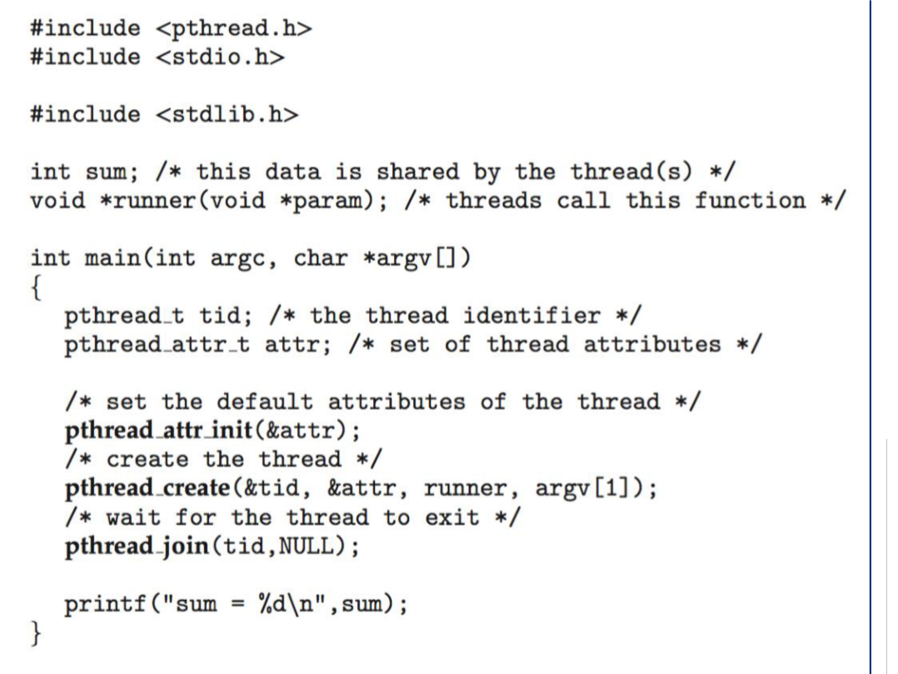


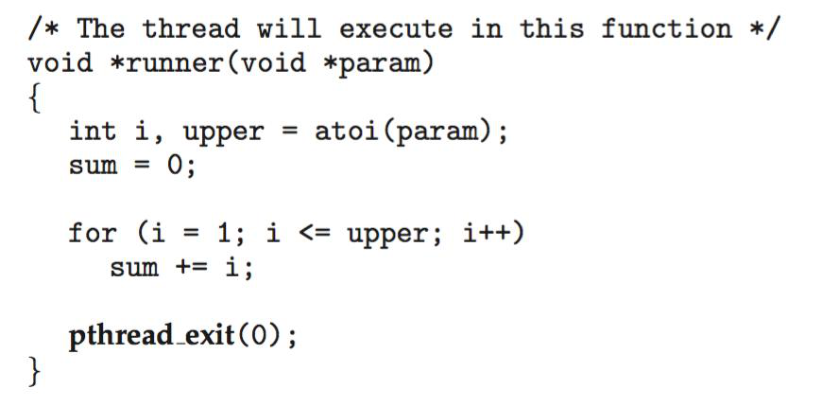


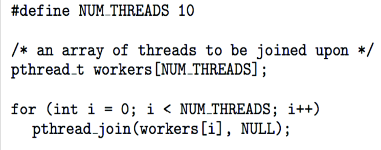


53 

### **Windows API – ukážka** 


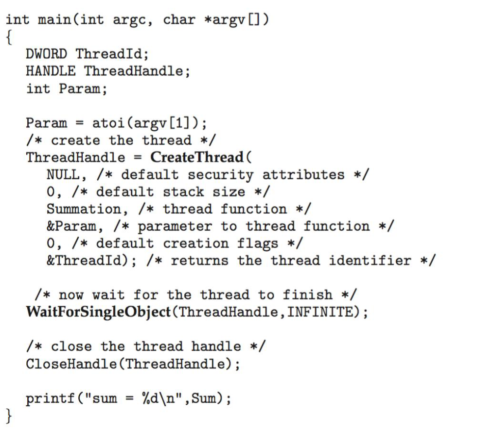


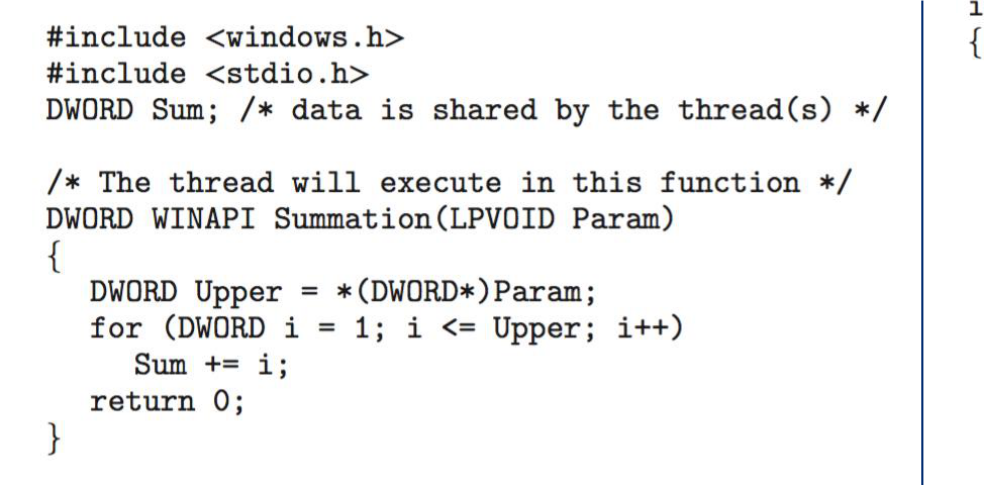


54 

### **Vlákna v jazyku Java** 

- Vlákna sú spravované JVM (angl. „Java Virtual Machine“). 

- Typicky sú implementované s použitím modelu vlákien, ktorý poskytuje operačný systém, na ktorom beží JVM. 

- Vlákna môžu byť vytvorené: 

   - zdedením triedy `Thread` ; 

   - implementáciou rozhrania `Runnable` (preferovaný spôsob): 


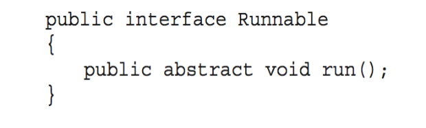


55 

### **Vlákna v jazyku Java** 

- Implementácia rozhrania `Runnable` : 


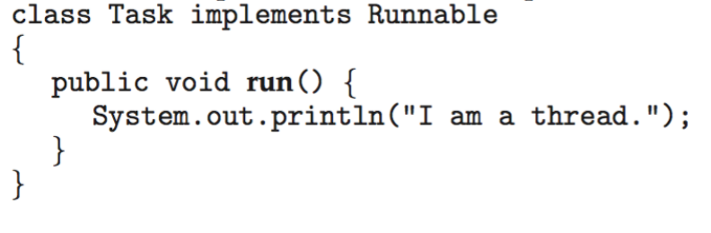


- Vytvorenie vlákna: 


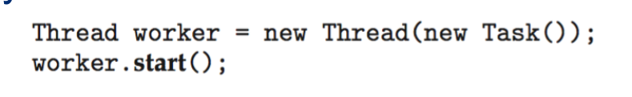


- Čakanie na vlákno: 


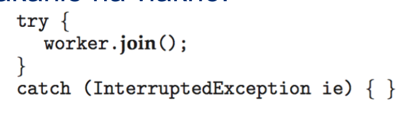


56 

### **Java Executor Framework** 

- Okrem možnosti vytvárať vlákna explicitne ponúka Java možnosť vytvárať vlákna aj s využitím rozhrania `Executor` : 


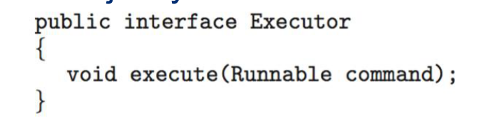


- Použitie rozhrania `Executor` : 


57 

### **Java Executor Framework – ukážka** 


58 

### **Implicitné vlákna** 

- Explicitné vlákna – programátor je zodpovedný za vytváranie a spravovanie vlákien. 

• Implicitné vlákna – za vytváranie a spravovanie vlákien je zodpovedný kompilátor a špecifické knižnice. 

- Príklady: 

   - súbor vlákien (angl. „ **thread pool** “); 

   - princíp „ **rozdeľuj a spájaj** “ (angl. „ **fork-join** “); 

   - OpenMP; 

   - oneAPI Threading Building Blocks; 

   - Grand Central Dispatch. 


59 

### **Thread Pools** 

- Vytvorenie súboru vlákien, ktoré čakajú na prácu. 

- Výhody: 

   - spracovanie požiadavky s použitím existujúceho vlákna je obyčajne rýchlejšie ako vytvorenie nového vlákna; 

   - umožňuje previazať počet vlákien v aplikáciách na veľkosť súboru; 

   - oddelenie logiky vykonávanej úlohy od mechanizmu vytvárania úlohy umožňuje realizovať rôzne stratégie spustenia úlohy. Napr. plánovanie periodického vykonávania úloh. 

- Príklad – Windows API: 


60 

### **Java Thread Pools** 

- Java Executor Framework ponúka v rámci triedy `Executors` niekoľko metód na vytváranie súboru vlákien: 


61 

### **Fork-Join** 


- Všeobecný algoritmus pre princíp „rozdeľuj a spájaj“: 


62 

### **Fork-Join v jazyku Java** 


63 

### **OpenMP** 

- Súbor direktív pre kompilátor spolu s API pre jazyky C, C++ a Fortran. 

- Ponúka podporu pre paralelné programovanie v prostrediach so zdieľanou pamäťou. 

- S použitím nasledujúcej direktívy sú označené bloky kódu, ktoré môžu byť vykonávané paralelne: 

##### **`#pragma omp parallel`** 

- Uvedená direktíva sa postará o vytvorenie toľkých vlákien, koľko je k dispozícii výpočtových jadier. 

- Paralelizácia cyklu `for` : 


64 

### **oneAPI Threading Building Blocks (TBB)** 

- Šablónová knižnica vyvinutá spoločnosťou Intel na tvorbu paralelných programov v jazyku C++. 


- Sériový kód: 


- Paralelná verzia kódu s využitím TBB: 


65 

### **Vlákna v OS Linux** 

- Vlákna sú implementované na úrovni jadra operačného systému. 

- Procesy a vlákna v OS Linux sú takmer rovnaké. Vlákna sú implementované ako procesy, ktoré zdieľajú súbory, virtuálnu pamäť, signály atď. 

- Linux ich označuje pojmom úloha (angl. „task“). 

- Vlákna zdieľajú adresný priestor. Prepnutie kontextu vlákna = skok na inú adresu v tom istom adresnom priestore. 

- Evolúcia vláknových knižníc: 

   - LinuxThreads, 

   - NGPT (Next Generation POSIX Threads), 

   - **NPTL** (Native POSIX Thread Library). 

- Vlákna sa vytvárajú systémovým volaním clone, ktoré umožňuje detskému procesu zdieľať adresný priestor rodičovského procesu, vrátane tabuľky popisovačov súborov a tabuľky obsluhovačov signálov. 

   - Príznaky definujúce správanie: 


66 

### **Vlákna v OS Windows** 

- Definované vo Windows API. 

- Vlákna sú implementované na úrovni jadra, pričom sa používa model vykonávania vlákien 1:1. 

- • Každé vlákno má: 

   - ID; 

   - **kontext** : 

      - množinu registrov definujúcich stav procesora; 

      - • oddelené zásobníky pre používateľský režim a režim jadra; 

      - priestor na uchovávanie údajov využívaných dynamicky linkovanými knižnicami (angl. „Dynamic Link Libraries“, DLL). 

- Používané údajové štruktúry: 

   - ETHREAD (angl. „executive thread block“); 

   - KTHREAD (angl. „kernel thread block“); 

   - TEB (angl. „thread environment block“). 


67 

### **Stavový diagram vlákien (1)** 

**Linux** 


<!-- Start of picture text -->
Windows<br><!-- End of picture text -->


68 

### **Stavový diagram vlákien (2)** 

**Linux** 


<!-- Start of picture text -->
Windows<br><!-- End of picture text -->


69 

### **Záverečné informácie** 

Tento študijný materiál je primárne pripravený s využitím knihy: 

- A. Silberschatz, P. B. Galvin, and G. Gagne, _Operating System Concepts_ , 10th ed. Hoboken, NJ, USA: Wiley, 2018 

a k nej dostupných oficiálnych prezentácií, ktoré je možné nájsť na stránke: 

- <u>https://www.os-book.com/</u> 

doc. Ing. Miroslav Kvaššay, PhD. 

Katedra informatiky 

Fakulta riadenia a informatiky Žilinská univerzita v Žiline E-mail: miroslav.kvassay@fri.uniza.sk 


70 

