# Princípy operačných systémov 

Prednáška 4: Medziprocesná komunikácia 

doc. Ing. Miroslav Kvaššay, PhD. 


## Komunikácia v nedistribuovanom prostredí 


2 

### **Spolupracujúce procesy** 

- Procesy v rámci systému môžu byť: 

   - **nezávislé** , 

   - **spolupracujúce** ( **kooperujúce** ). 

- Spolupracujúci proces môže ovplyvňovať alebo môže byť ovplyvňovaný iným procesom, vrátane zdieľaných údajov. 

- Dôvody spolupráce: 

   - zdieľanie informácií, 

   - zrýchlenie výpočtov, 

   - modularita, 

   - pohodlie používateľa. 

- Spolupracujúce procesy potrebujú prostriedky, ktoré im umožnia komunikovať – **medziprocesná komunikácia** (angl. „ **InterProcess Communication** “, IPC). 

- • Dva základné modely komunikácie: 

   - **zdieľaná pamäť** (angl. „ **shared memory** “), 

   - **posielanie správ** (angl. „ **message passing** “). 


3 

### **Modely komunikácie** 

#### **Zdieľaná pamäť** 

#### **Posielanie správ** 


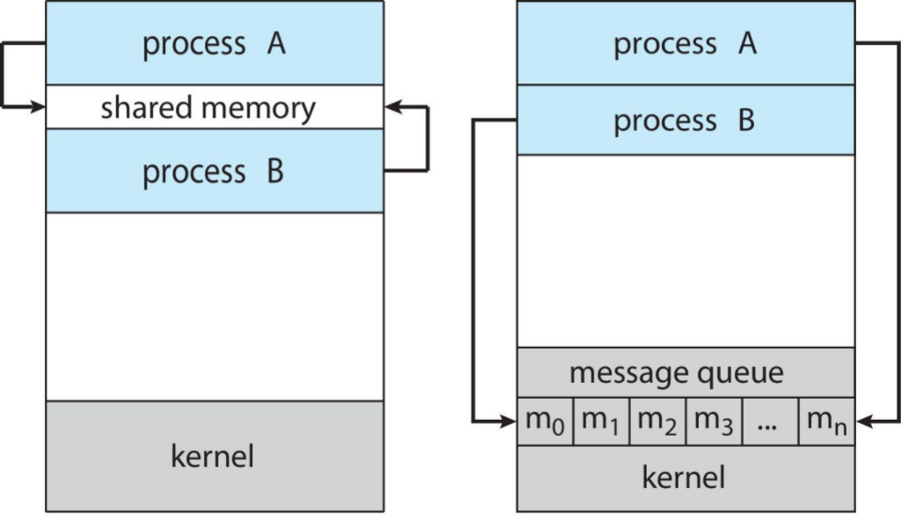


4 

### **Problém producent-konzument** 

- Paradigma pre spolupracujúce procesy. 

- Proces producent produkuje údaje, ktoré spracúva proces konzument. 

   - **Neobmedzený buffer** nekladie žiadne praktické obmedzenia na veľkosť vyrovnávacej pamäte. 

   - **Obmedzený buffer** predpokladá, že existuje pevná veľkosť vyrovnávacej pamäte. 


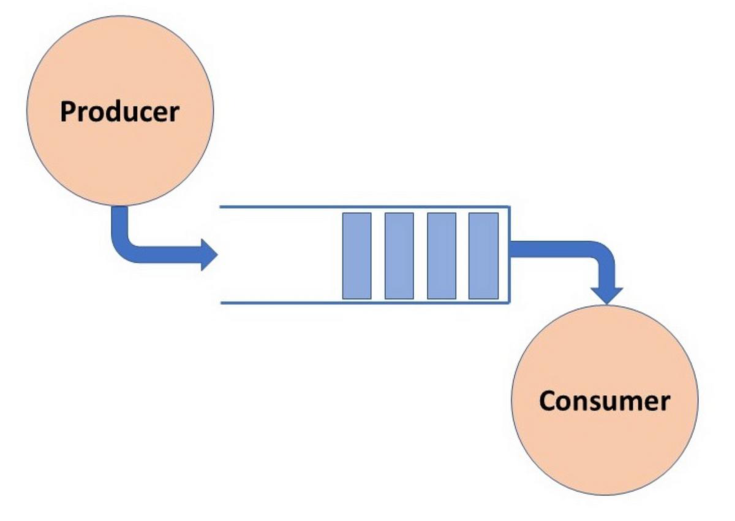


5 

### **Zdieľaná pamäť** 

- **Najrýchlejšia komunikácia medzi procesmi** (teoreticky): 

   - systémové volania sú nutné len vo fázach vytvorenia a zrušenia zdieľaného bloku pamäte, 

   - samotná komunikácia prebieha bez asistencie kernelu – komunikáciu riadia používateľské procesy. 

- Ten istý pamäťový blok je mapovaný do adresných priestorov dvoch alebo viacerých procesov. 

- Potreba **synchronizácie** prístupu pri súbežnom prístupe k zdieľaným dátam. 

- Problém viacprocesorových architektúr – **koherentnosť cache pamätí** . 


6 

### **Koherentnosť cache pamätí** 

- Zabezpečenie jednotnosti dát vo viacerých vyrovnávacích pamätiach: 

   - zmena dát v cache pamäti musí byť rozšírená do ostatných cache pamätí, 

   - každý procesor musí poznať poradie, v akom sú dáta čítané a zapisované do daného bloku pamäte ostatnými procesormi. 

- Problém je typický hlavne pre viacprocesorové, resp. viacjadrové systémy. 

- Štandardné riešenia: 

   - **snooping** , 

   - **adresárové metódy** . 


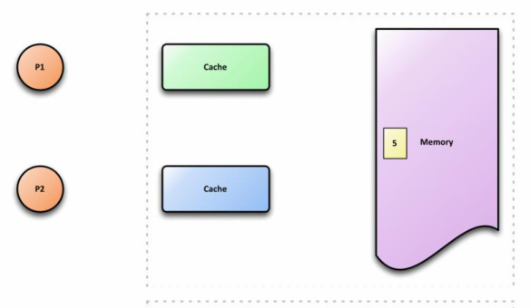


7 

### **Zdieľaná pamäť – producent-konzument s obmedzeným bufferom** 

• Zdieľané údaje: 

```
#define BUFFER_SIZE 10
typedef struct {
```

```
 . . .
} item;
```

```
item buffer[BUFFER_SIZE];
int in = 0;
int out = 0;
```


8 

### **Zdieľaná pamäť – producent-konzument s obmedzeným bufferom** 

• Producent: 

• Konzument: 

```
item next_produced;
```

```
while (true) {
```

```
 /* produce an item in next produced */
 while (((in + 1) % BUFFER_SIZE) == out)
; /* do nothing */
 buffer[in] = next_produced;
 in = (in + 1) % BUFFER_SIZE;
}
```

```
item next_consumed;
while (true) {
while (in == out)
; /* do nothing */
next_consumed = buffer[out];
 out = (out + 1) % BUFFER_SIZE;
/* consume the item in next consumed */
```

```
}
```


9 

### **Posielanie správ** 

- Mechanizmus, ktorý umožňuje procesom komunikovať a synchronizovať sa. 

- • Procesy medzi sebou komunikujú bez toho, aby používali zdieľané premenné. 

- Medzi procesmi musí existovať (logická) komunikačná linka, ktorá umožňuje posielať správy: 

   - **`send`** `(message)` , 

   - **`receive`** `(message)` . 

- Dĺžka správy môže byť: 

   - **pevná** – dovoľuje jednoduchú fyzickú implementáciu, ale program musí deliť správu na rovnako veľké časti, 

   - **variabilná** – umožňuje jednoduchšie programovanie, ale fyzická implementácia je náročnejšia. 


10 

### **Posielanie správ – implementačné detaily** 

- Ako sa vytvorí komunikačná linka? 

- Môže byť komunikačná linka asociovaná s viac ako dvomi procesmi? 

- Koľko komunikačných liniek môže existovať medzi každým párom komunikujúcich procesov? 

- Aká je kapacita komunikačnej linky? 

- Je veľkosť správy, ktorá môže byť prenesená cez komunikačnú linku, pevná alebo premenlivá? 

- Poskytuje komunikačná linka jednosmerný alebo obojsmerný prenos správ? 


11 

### **Posielanie správ – implementácia a synchronizácia** 

- Z fyzického pohľadu môže byť komunikačná linka implementovaná s využitím: 

   - zdieľanej pamäte; 

   - hardvérovej zbernice; 

   - počítačovej siete. 

- Z logického pohľadu môže komunikačná linka ponúkať: 

   - **priamu** a **nepriamu** komunikáciu, 

   - **symetrickú** a **asymetrickú** komunikáciu, 

   - **automatické** a **explicitné** buffrovanie. 


12 

### **Priama komunikácia** 

- Definícia operácií: 

   - `send(P, správa)` – posiela správu procesu P, 

   - `receive(Q, správa)` – prijíma správu od procesu Q. 

- Vlastnosti komunikačnej linky: 

   - nadväzuje sa automaticky medzi každou dvojicou procesov, ktoré chcú komunikovať, 

   - medzi každým párom komunikujúcich procesov existuje jedna komunikačná linka, 

   - linka môže byť jednosmerná, ale väčšinou je obojsmerná. 


13 

### **Typy priamej komunikácie** 

- **Symetrická** – vysielajúci aj prijímajúci proces uvádzajú meno svojho partnera. 

- • **Asymetrická** – len vysielajúci proces uvádza meno adresáta: 

   - operácie `send()` a `receive()` sú definované nasledovne: 

      - `send(P, správa)` – zasiela správu procesu P, 

      - `receive(id, správa)` – prijíma správu od ľubovoľného procesu ( `id` je výstupný parameter, ktorý obsahuje identifikátor procesu, s ktorým bolo nadviazané spojenie). 

- Otázka: Aké sú nevýhody priamej komunikácie? 


14 

### **Nepriama komunikácia** 

- Vysielanie a príjem správ prostredníctvom **schránok** (angl. „ **mailbox** “ alebo „ **port** “), ktoré predstavujú abstraktné objekty, do/z ktorých sa môže správa vložiť/vybrať. 

- • Každý mailbox má unikátne ID. 

- Definícia operácií: 

   - `send(A, správa)` – zasiela správu do mailboxu A, 

   - `receive(A, správa)` – prijíma správu z mailboxu A. 

- Vlastnosti komunikačnej linky: 

   - spojenie sa nadväzuje: 

      - len ak procesy majú prístup k zdieľanému mailboxu, 

      - medzi viacerými procesmi, 

   - medzi každým párom komunikujúcich procesov je viac komunikačných liniek a každá zodpovedá jednému mailboxu, 

   - linka môže byť jednosmerná alebo obojsmerná. 


15 

### **Mailbox** 

- Operácie: 

   - vytvorenie mailboxu; 

   - posielanie a prijímanie správ prostredníctvom mailboxu; 

   - zrušenie mailboxu. 

- Vlastníctvo mailboxov: 

   - **proces** : 

      - deklaruje premennú typu mailbox, 

      - keď sa ukončí proces, zruší sa aj mailbox, 

      - každý proces, ktorý pozná ID mailboxu, ho môže použiť, 

   - **systém** : 


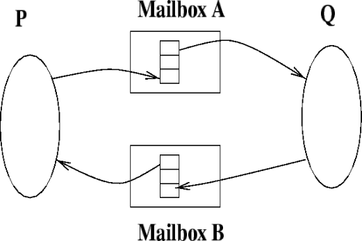


- vytvorí mailbox, 

- ponúka operácie na posielanie a prijímanie správ, 

- zruší mailbox. 


16 

### **Zdieľanie mailboxov** 

- Predpokladajme: 

   - procesy P1, P2 a P3 zdieľajú mailbox A; 

   - P1 posiela správu, P2 a P3 prijímajú správu; 

   - kto obdrží správu? 

- Riešenia: 

   - komunikačná linka môže byť asociovaná najviac s dvomi procesmi; 

   - operáciu `receive` môže v danom čase volať iba jeden proces; 

   - systém rozhodne, kto obdrží správu. Odosielateľ je informovaný o tom, kto bol príjemcom. 


17 

### **Posielanie správ – synchronizácia** 

- Posielanie správ môže byť: 

   - **blokujúce** – **synchrónne** : 

      - blokujúca operácia `send` – odosielateľ je blokovaný, kým správa nie je obdržaná príjemcom; 

   - blokujúca operácia `receive` – príjemca je blokovaný, kým neobdrží správu; 

   - • **neblokujúce** – **asynchrónne** : 

      - neblokujúca operácia `send` – odosielateľ pokračuje vo svojej činnosti hneď po odoslaní správy; 

      - neblokujúca operácia `receive` – príjemca pokračuje vo svojej činnosti bez ohľadu na to, či obdržal správu alebo nie. 

- Mechanizmus posielania správ umožňuje kombinovať blokujúce a neblokujúce operácie. 

   - Ak obe operácie ( `send` aj `receive` ) sú blokujúce, potom existuje medzi procesmi **miesto stretnutia** (angl. „ **rendezvous** “). 


18 

### **Posielanie správ – producent-konzument** 

• Producent: 

- Konzument: 

```
message next_produced;
```

```
message next_consumed;
```

```
while (true) {
```

```
/* produce an item in next_produced */
```

```
       send(next_produced);
}
```

```
while (true) {
receive(next_consumed)
```

```
/* consume the item in next_consumed */
```

```
}
```


19 

### **Buffrovanie** 

- Komunikačná linka má **kapacitu** – určuje, aký počet správ sa v nej môže nachádzať. K linke je pripojený front správ. 

- Tri spôsoby implementácie frontu: 

   - **s nulovou kapacitou** – dĺžka frontu je 0, t. j. vo fronte nemôže čakať žiadna správa, vysielajúci proces musí počkať, kým prijímajúci proces nepreberie správu. Procesy sa musia zosynchronizovať pri odovzdávaní správy – **rendezvous** . 

   - **s obmedzenou kapacitou** – front má konečnú dĺžku _n_ , t. j. môže v ňom čakať najviac _n_ správ. Ak front nie je plný, prichádzajúca správa sa doň zaradí a vysielajúci proces môže pokračovať vo svojom vykonávaní bez čakania. Ak je front plný, vysielajúci proces je zablokovaný, kým sa neuvoľní miesto. 

   - **s neobmedzenou kapacitou** (automatické buffrovanie) – vysielajúci proces nie je nikdy zablokovaný. 


20 

### **Buffrovanie** 

- Pri automatickom buffrovaní odosielateľ nevie, či správa bola doručená – potrebné **potvrdzovanie** (angl. „acknowledgment“). 

Proces **_P_** vykoná: **_send_** _(Q, správa)_ - zasiela správu _Q_ **_receive_** _(Q,_ **_potvrdenie_** _)_ - prijíma potvrdenie od _Q_ 

Proces **_Q_** vykoná: **_receive_** _(P, správa)_ - prijíma správu od _P_ **_send_** _(P,_ **_potvrdenie_** _)_ - zasiela potvrdenie _P_ 


21 

### **Buffrovanie** 

- Iné alternatívy: 

• odosielateľ sa **neblokuje nikdy** – v prípade bez buffrovania to znamená stratu správy, ak procesy nie sú synchronizované: send(Q, sprava1) → receive(P, sprava1) send(Q, sprava2) → ??? send(Q, sprava3) → receive(P, sprava3) 

• poslanie správy len ak **príde potvrdenie** : send(Q, sprava) → receive(P, sprava) (Proces P čaká) receive(Q, sprava) ← reply(P, sprava) (Proces Q sa nezablokuje) 


22 

### **Problémy pri posielaní správ** 

- **Ukončenie procesu** 

   - P čaká na správu od Q, ktorý bol ukončený: 

      - P bude zablokovaný donekonečna. Operačný systém musí buď upozorniť P, že Q bol ukončený, alebo ho ukončiť. 

   - P posiela správu Q, ktorý bol ukončený: 

      - pri automatickom buffrovaní – bez problémov pre P. 

      - bez buffrovania – P bude zablokovaný natrvalo. Operačný systém musí buď upozorniť, alebo ukončiť proces P. 

- **Stratená správa** : 

   - používajú sa nasledovné metódy ošetrenia tejto udalosti: 

         - a) operačný systém je zodpovedný za zistenie straty správy a jej opätovné vyslanie, b) za zistenie straty správy a jej opätovné vyslanie je zodpovedný vysielajúci proces, 

         - c) operačný systém je zodpovedný za zistenie straty správy a upozornenie vysielajúceho procesu. Opätovné vyslanie správy je prenechané vysielajúcemu procesu. 

- **Poškodená správa** : 

   - operačný systém obyčajne zistí poškodenie pomocou rôznych kontrol (kontrolné sumy, parita, „Cyclic Redundancy Code“ a iné) a zabezpečí aj opätovné vyslanie správy. 


23 

### **Implementácie IPC – zdieľaná pamäť v štandarde POSIX** 

- Proces najskôr vytvorí blok zdieľanej pamäte: **`shm_fd = shm_open(name, O_CREAT | O_RDWR, 0666);`** 

   - rovnaké systémové volanie sa používa aj v prípade pripojenia na existujúci blok pamäte. 

- Nastaví sa veľkosť zdieľaného bloku pamäte: **`ftruncate(shm_fd, 4096);`** 

- Komunikujúce procesy použijú systémové volanie `mmap na namapovanie` zdieľaného bloku do svojho adresného priestoru. Toto systémové volanie vráti adresu zdieľaného bloku pamäte, ktorá ho jednoznačne identifikuje v rámci adresného priestoru procesu. 

- Komunikácia medzi procesmi sa realizuje prostredníctvom ukladania a sprístupňovania údajov cez zdieľaný blok pamäte. 


24 

**Zdieľaná pamäť v štandarde POSIX – producent-konzument** 


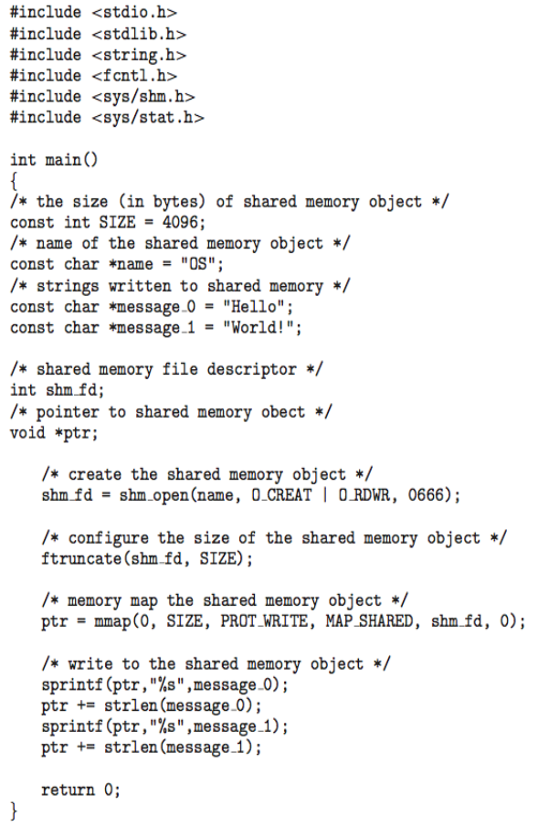


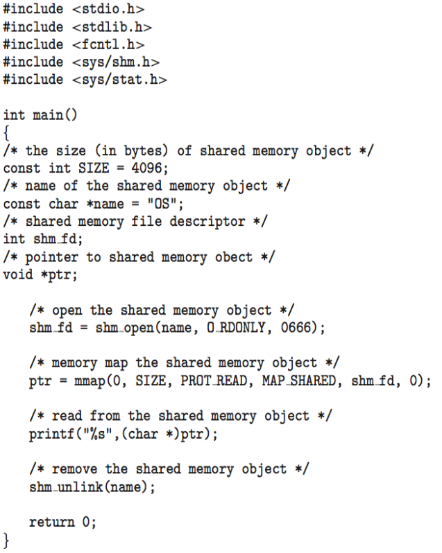


25 

### **Implementácie IPC – posielanie správ v systéme Mach** 

- Mach: 

   - kernel vyvinutý na Carnegie Mellon University (Pittsburgh, Pensylvánia, USA); 

   - základ pre kernel XNU, ktorý používa spoločnosť Apple vo svojich operačných systémoch. 

- Väčšina komunikácie v kerneli Mach je postavená na posielaní správ: 

   - systémové volania sú taktiež správy; 

   - komunikácia prebieha prostredníctvom mailboxov, ktoré sú označované ako **porty** ; 

   - porty majú obmedzenú kapacitu a sú jednosmerné; 

   - port môže mať viacerých odosielateľov, ale iba jedného príjemcu; 

   - komunikácia môže prebiehať aj v distribuovanom prostredí; 

   - každá úloha má pri vytvorení dva porty, prostredníctvom ktorých odosiela správy kernelu a prijíma správy z kernelu; 

   - • správy sú odosielané a prijímané prostredníctvom funkcie `mach_msg` ; 

   - porty potrebné na komunikáciu sú vytvárané prostredníctvom funkcie `mach_port_allocate` ; 

   - • mechanizmus posielania a prijímania správ je flexibilný a ak je mailbox plný, tak mechanizmus umožňuje: • nekonečné čakanie; 

      - ohraničené čakanie špecifikované v ms; 

      - okamžité vrátenie; 

      - dočasné cacheovanie správy. 


26 

### **Štruktúra správy v systéme Mach** 

##### **`#include<mach/mach.h>`** 

##### **`struct message {`** 

```
mach_msg_header_t header;
int data;
```

```
};
```

```
mach_port_t client;
mach_port_t server;
```


27 

### **Posielanie správ v systéme Mach – producent-konzument** 

- Klient: 

- Server: 


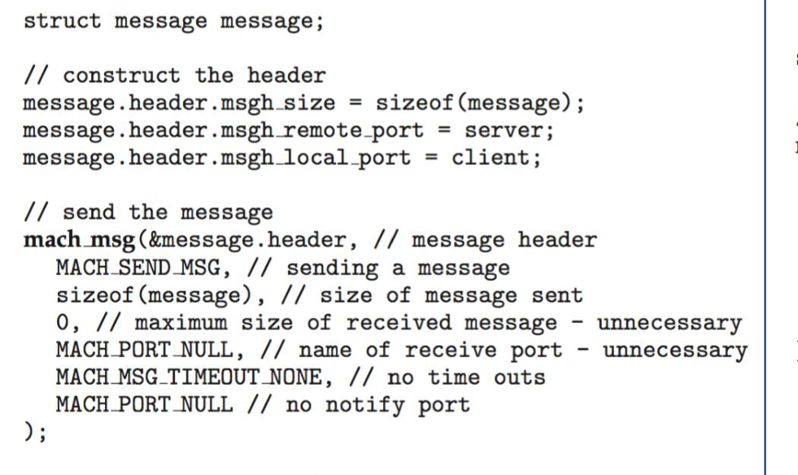


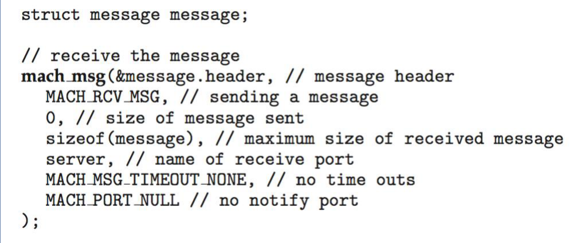


28 

### **Implementácie IPC – posielanie správ vo Windows** 

- Posielanie správ je realizované prostredníctvom mechanizmu označovaného angl. ako „ **Advanced Local Procedure Call** “ ( **ALPC** ): 

   - funguje iba medzi procesmi bežiacimi v tom istom systéme; 

   - používa mailboxy označované ako **porty** na vytvorenie a udržiavanie komunikačných liniek; 

   - mechanizmus je využívaný interne na komunikáciu medzi jednotlivými podsystémami operačného systému; 

   - komunikácia funguje nasledovne: 

      - klient otvorí port (angl. „connection port“), ktorý slúži na pripojenie k podsystému; 

      - • klient odošle požiadavku na pripojenie; 

      - server vytvorí dva súkromné **​** komunikačné porty (angl. „communication ports“) a klientovi vráti popisovač jedného z nich; 

      - klient a server používajú zodpovedajúci popisovač portu na odosielanie správ alebo spätných volaní (angl. „ **callback** “) a na príjem odpovedí. 


29 

### **Implementácie IPC – ALPC vo Windows** 


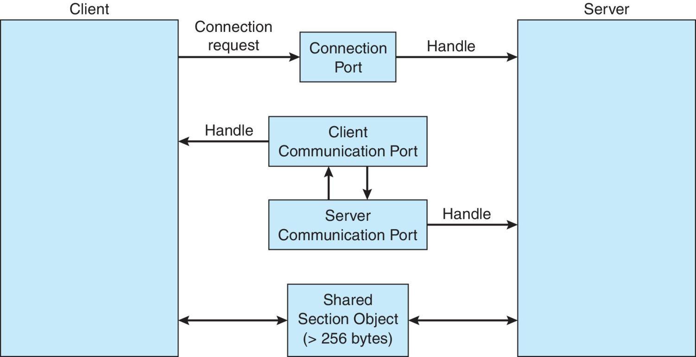


30 

### **Dátovody** 

- Dátovod (angl. „pipe“) – kanál umožňujúci komunikáciu dvoch procesov. 

- • Implementačné detaily: 

   - Je komunikácia jednosmerná (angl. „ **simplex** “) alebo obojsmerná (angl. „ **duplex** “)? 

   - V prípade obojsmernej komunikácie ide o polovičný (angl. „ **half duplex** “) alebo plný duplex (angl. „ **full duplex** “)? 

   - Musí existovať vzťah rodič-potomok medzi komunikujúcimi procesmi? 

   - • Môžu byť použité na komunikáciu v počítačovej sieti? 

- **Nepomenovaný dátovod** (angl. „ **ordinary pipe** “) – komunikácia môže prebiehať iba medzi procesmi, ktoré sú vo vzťahu rodič-potomok. Rodičovský proces obyčajne vytvorí dátovod a používa ho na komunikáciu s detským procesom. 

- **Pomenovaný dátovod** (angl. „ **named pipe** “) – môže byť používaný aj procesmi, ktoré nie sú vo vzťahu rodič-potomok. 


31 

### **Nepomenované dátovody** 

- Umožňujú komunikáciu v štýle paradigmy producent-konzument. 

- Producent zapisuje údaje na jeden koniec (vstupný koniec dátovodu). 

- Konzument číta údaje z druhého konca (výstupný koniec dátovodu). 

- Tento typ dátovodu je jednosmerný. 

- Medzi komunikujúcimi procesmi musí byť vzťah rodič-potomok. 

- Umožňuje komunikáciu medzi procesmi bežiacimi iba na tom istom počítači. 

- Windows ich označuje ako **anonymné dátovody** (angl. „ **anonymous pipes** “). 


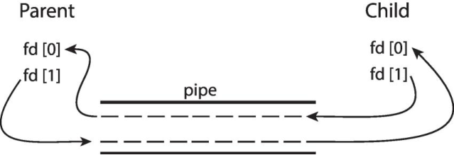


32 

### **Pomenované dátovody** 

- Pomenované dátovody sú výkonnejšie ako nepomenované. 

- • Komunikácia je obojsmerná. 

- Medzi komunikujúcimi procesmi nemusí byť vzťah rodič-potomok. 

- Umožňujú komunikáciu medzi viacerými procesmi: • typicky viacero producentov a jeden konzument. 


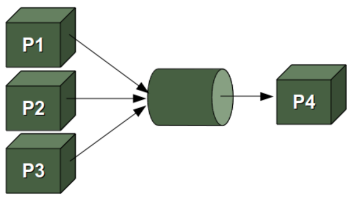


- UNIX: 

   - označujú sa ako FIFO; 

- po vytvorení sa zobrazujú v súborovom systéme ako štandardné súbory; 

- • podporujú polovičný duplex; pre súčasnú obojsmernú komunikáciu je potrebná dvojica pomenovaných dátovodov; 

- • podporujú komunikáciu medzi procesmi bežiacimi iba na tom istom počítači. 

- • Windows: 

   - podporujú plný duplex; 

   - umožňujú komunikovať procesom bežiacim na rôznych počítačoch. 


33 

## Komunikácia v distribuovanom prostredí 


34 

### **Sokety (angl. „Sockets“)** 

- Nízkoúrovňová forma komunikácie. 

- Využíva sa pri komunikácii medzi uzlami počítačovej siete. 

- Soket predstavuje koncový bod spojenia, ktorý je definovaný **IP adresou** a **číslom portu** . 

- Port – číslo zahrnuté na začiatku paketu so správou slúžiace na rozlíšenie sieťových služieb na hostiteľovi. 

- Soket 161 **.25.19.8:1625** odkazuje na port **1625** na hostiteľovi **161.25.19.8** . 

- Všetky porty menšie ako 1024 sú dobre známe a používajú sa na štandardné služby. 

- Špeciálna IP adresa 127.0.0.1 (spätná slučka, angl. „ **loopback** “), ktorá odkazuje na systém, na ktorom je spustený proces. 

- Väčšina implementácií je založená na BSD soketoch. 

- Typy soketov: 

   - Unix domain vs network sockets, 

   - datagram, stream vs raw sockets. 


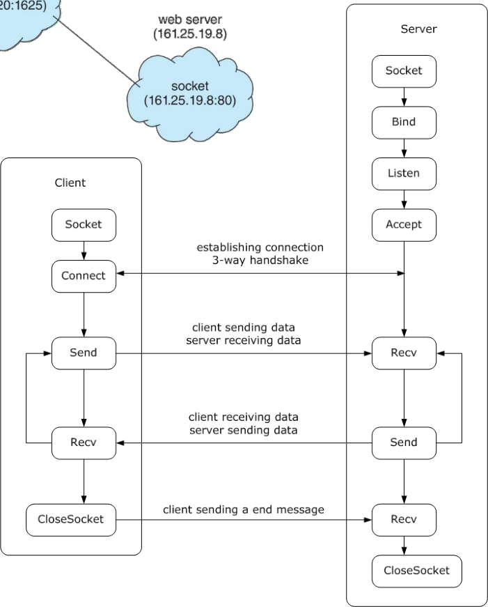


35 

### **Sokety v jazyku Java** 

- Tri typy soketov: • TCP, 

   - UDP, 

   - `Multicast Socket` – na posielanie údajov viacerým príjemcom 


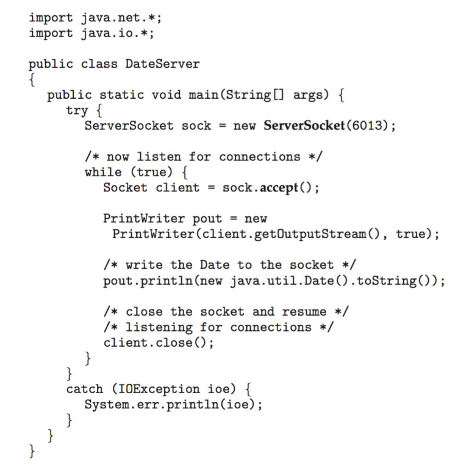


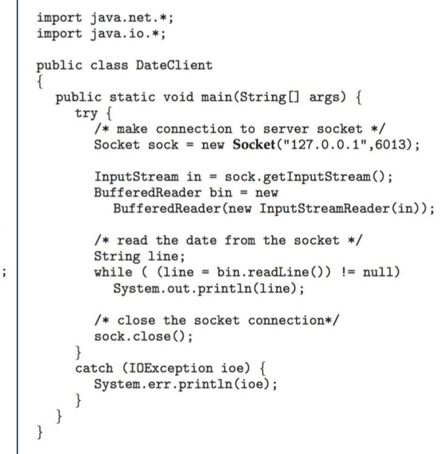


36 

### **Volanie vzdialenej procedúry (1)** 

- **Volanie vzdialenej procedúry** (angl. „Remote Procedure Call“, RPC) – pre distribuované systémy: 

   - špeciálna forma synchrónnej komunikácie pomocou správ, 

   - podobná mechanizmu volania lokálnej procedúry, 

   - procesy sa vykonávajú na rôznych uzloch siete a komunikujú pomocou posielania správ, 

   - na zabezpečenie komunikácie medzi procesmi je potrebné správu adresovať na konkrétny port (identifikačné číslo koncového bodu spojenia), ktorý je pridelený príslušnej procedúre, 

   - zistenie portu sa uskutočňuje: 

      - staticky – adresa je pridelená ešte pri kompilácii, 

      - dynamicky – adresa sa zisťuje pred nadviazaním spojenia. 


37 

### **Volanie vzdialenej procedúry (2)** 


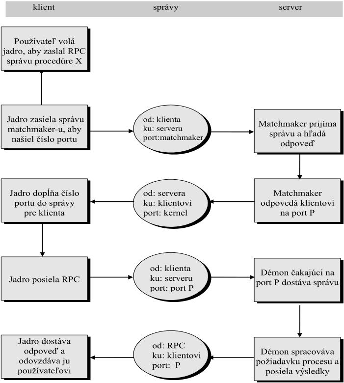


<!-- Start of picture text -->
           klient                                         správy                                          server<br>Používateľ volá<br>jadro, aby zaslal RPC<br>správu procedúre X<br>Jadro zasiela správu  od: klienta<br>matchmaker-u, aby  ku: serveru  Matchmaker prijíma<br>správu a hľadá<br>našiel číslo portu  port:matchmaker<br>: odpoveď<br>Jadro dopĺňa číslo  od: servera  Matchmaker<br>portu do správy   ku: klientovi  odpovedá klientovi<br>pre klienta  port: kernel na port P<br>od: klienta<br>Démon čakajúci na<br>Jadro posiela RPC  ku: serveru  port P dostáva správu<br>port: port P<br>Jadro dostáva<br>od: RPC<br>odpoveď a  ku: klientovi  Démon spracováva<br>odovzdáva ju  požiadavku procesu a<br>port:  P<br>používateľovi posiela výsledky<br><!-- End of picture text -->

Matchmaker – **démon** ( **služba** ) bežiaci na serveri. 

#### Maxwellov démon 

Vykonanie volania vzdialenej procedúry pri dynamickom zisťovaní portu 


38 

### **Volanie vzdialenej procedúry (3)** 

- Ak sa procesy využívajúce RPC vykonávajú na heterogénnych strojoch, vzniká problém, ako si majú vymieňať dáta (rozdielne reprezentácie, napr. big-endian a little-endian): 

   - formát XDR (eXternal Data Representation protocol): 

      - zabezpečuje kódovanie jednotlivých dát, 

      - implementuje ho **Open Network Computing** (ONC) **Remote Procedure Call** (RPC): 

         - existujú implementácie ONC RPC v mnohých UNIX systémoch, 

         - Microsoft má implementáciu pre Windows v produkte _Microsoft Windows Services for UNIX_ , 

         - existuje viacero implementácií ONC RPC pre Windows od tretích strán vrátane verzií pre C/C++, Java a .NET. 


39 

### **Endianita** 

- **Endianita** – poradie, v akom sú bajty viacbajtového dátového typu uložené v pamäti alebo prenesené po sieti. 

- **Big-endian** – Motorola 68000, Xilinx Microblaze, PowerPC, **sieťové protokoly** IPv4, IPv6, TCP, UDP,... 

- **Little-endian** – Intel **x86** , x86-64,... 

- Middle-endian 


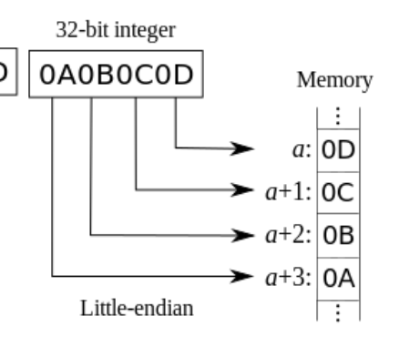


40 

### **Remote Method Invocation (RMI)** 

- Objektovo orientovaná analógia RPC. 

- Slúži na komunikáciu medzi objektmi v distribuovanom prostredí. 

- **Stub** , **skeleton** – proxy objekty zabezpečujúce komunikáciu medzi distribuovanými objektami, starajú sa o: 

   - vytvorenie komunikačnej linky, 

   - posielanie správ, 

   - transformáciu reprezentácie argumentov a návratových hodnôt (angl. „marshalling“). 

#### Klient 

#### Server 


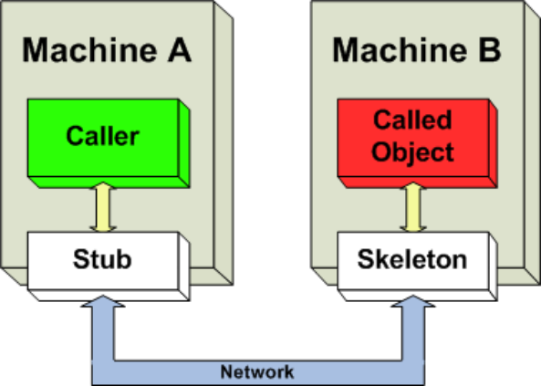


- Príklad: Java RMI. 


41 

### **Záverečné informácie** 

Tento študijný materiál je primárne pripravený s využitím knihy: 

- A. Silberschatz, P. B. Galvin, and G. Gagne, _Operating System Concepts_ , 10th ed. Hoboken, NJ, USA: Wiley, 2018 

a k nej dostupných oficiálnych prezentácií, ktoré je možné nájsť na stránke: 

- <u>https://www.os-book.com/</u> 

doc. Ing. Miroslav Kvaššay, PhD. 

Katedra informatiky 

Fakulta riadenia a informatiky Žilinská univerzita v Žiline E-mail: miroslav.kvassay@fri.uniza.sk 


42 

